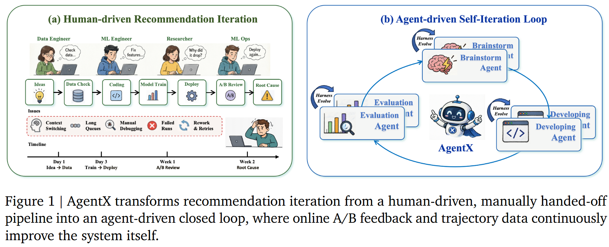

# AgentX

快手

## 摘要

推荐算法迭代正从依赖工程师的手工模式，转向工业化研究闭环，但这一转型仍受结构性执行瓶颈制约：从想法到上线的周期，依旧依靠人工工程师提出假设、修改生产代码、上线A/B实验并归因线上结果。因此创新规模仅随人力线性增长，而无法依托实证、算力与积累的实验知识实现复利式增长。本文提出AgentX，一套已投产部署的多智能体系统，从根本上重构这套生产流程。AgentX是一套自主演进的开发引擎：它可以自主生成、落地、评估推荐实验，并从中学习，其规模与速度是人工工作流难以企及的。该系统在闭环内协调四个紧密联动的阶段。头脑风暴智能体整合历史实验、系统架构、数据分析与外部研究中的信息，输出排序后的可执行方案。开发智能体基于代码仓库生成代码，并经过多维度可靠性校验，将每一份方案转化为可投入生产的代码。评估智能体在防护机制的把关下安全上线并完成A/B判定，将成功与失败的实验结果都转化为结构化知识资产。随后，调控演进层（SGPO）从执行轨迹中提炼语义梯度更新，持续优化各个智能体本身——让这套系统不只是自动化，更具备自我提升能力。在快手App首页信息流与生活服务推荐业务为期三周的上线验证中，3个AgentX工作节点把374个想法转化为10个可正式上线的版本；依托自主演进，单节点周产出效率翻倍，并发能力达到人工工程师的8倍，业务收益为人工的3.7倍，用户App使用时长提升0.561%，折合年化收益超1亿元人民币。除线上策略迭代外，这套闭环思路同样适用于模型侧研究，可自主复现论文、开展模块消融实验、跨论文组合网络结构。实验结果证明，大规模、自主演进的智能体驱动迭代已经不再停留在设想阶段，它已经能在真实投产的推荐系统中带来复利收益。AgentX预示着推荐研发领域新的分工模式：一部分工程师与智能体系统协作，大规模加速策略与模型迭代；另一部分工程师持续优化智能体框架及其基础模型，不断放大系统能力。每一次实验产生的轨迹数据同时支撑两类工作，将日常执行与长期智能能力的增长打通。人类投入的价值，第一次有机会从线性累加转变为可复利放大的杠杆。

## 引入

