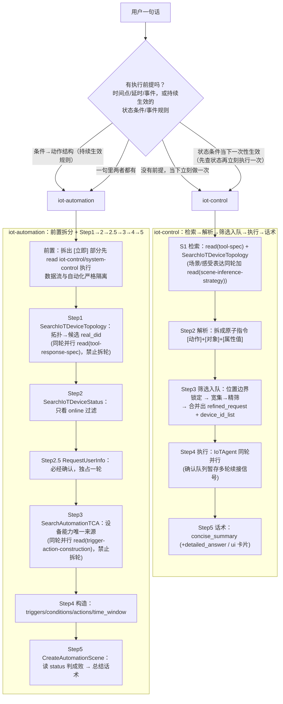

# 学习路线图：iot-control 与 iot-automation（learning1023 全套材料入口）

> **读者**：第一次接触 `xiaoaiclaw-ops/skills/iot-control` 与 `xiaoaiclaw-ops/skills/iot-automation` 的开发同学（自学用）。
> **用法**：先读完本文 [3. 5 分钟版总览](#3-5-分钟版总览) 建立心智模型，再按 [5. 建议学习顺序](#5-建议学习顺序) 读 01–06。
> **约定**：文中工具名、参数名、JSON 字段、错误码、阈值均与 skill 源文件逐条核对；关键结论后标注 `路径:行号` 出处；拿不准处显式写「待确认」。

---

## 1. 这两个 skill 是什么

- **iot-control（🏠）**：米家智能家居设备的**查询与控制**。用户明确操控/查询家居 IoT 设备（"打开客厅灯"、"查询室内温湿度"），或表达生活场景、环境感受（"准备睡觉"、"家里有点闷"）时使用；执行的是**当下无条件、立即执行一次**的动作（`xiaoaiclaw-ops/skills/iot-control/SKILL.md:4`、`xiaoaiclaw-ops/skills/iot-automation/SKILL.md:4`）。
- **iot-automation（⚙️）**：小米家庭 IoT **场景自动化**。把"触发条件→执行动作"的规则（"温度超过28度就开空调"、"每天7点开灯"、"10分钟后关灯"）解析为米家自动化创建请求，依赖工具实时获取设备拓扑、状态与可用 TCA 能力，最终调用 `CreateAutomationScene` 创建自动化场景（`xiaoaiclaw-ops/skills/iot-automation/SKILL.md:4,10-11`）。
- **一句话分工**：iot-control 是"当下立刻执行一次"，iot-automation 是"满足条件时自动执行"（`xiaoaiclaw-ops/skills/iot-automation/SKILL.md:4`）。

---

## 2. 一页速览

| 对比维度               | iot-control                                                                                                                                                                                                                                                                                                          | iot-automation                                                                                                                                                                                                                                                     |
| ---------------------- | -------------------------------------------------------------------------------------------------------------------------------------------------------------------------------------------------------------------------------------------------------------------------------------------------------------------- | ------------------------------------------------------------------------------------------------------------------------------------------------------------------------------------------------------------------------------------------------------------------ |
| **定位**         | 当下立即执行一次的家居设备控制/查询（含场景/感受类模糊意图的**现在布置**）                                                                                                                                                                                                                                     | "条件→动作"的自动化**创建**（含推荐/设计一套联动方案）（`xiaoaiclaw-ops/skills/iot-automation/SKILL.md:4`）                                                                                                                                               |
| **触发判据**     | 明确操控/查询米家家居设备，或生活场景/环境感受表达；车载/家居准入按 `car-vs-home-intent-judge.md` 判定（`xiaoaiclaw-ops/skills/iot-control/SKILL.md:14-17`）                                                                                                                                                     | 存在一个作为执行前提的触发条件（条件→动作结构）；时间类看动作是否操作设备：操作设备→本 skill，只提醒人→reminder（`xiaoaiclaw-ops/skills/iot-automation/SKILL.md:4,35-38`）                                                                                    |
| **工具链**       | `SearchIoTDeviceTopology` / `SearchIoTDeviceMetaData` / `SearchIoTDeviceStatus` / `IoTAgent` / `RequestUserInfo`，全部经 `xiaoai_web_call` 调用（`xiaoaiclaw-ops/skills/iot-control/SKILL.md:74-83`）                                                                                                  | `SearchIoTDeviceTopology` / `SearchIoTDeviceStatus` / `RequestUserInfo` / `SearchAutomationTCA` / `CreateAutomationScene`（五工具六步，`xiaoaiclaw-ops/skills/iot-automation/SKILL.md:115-123`）                                                       |
| **用户可见产出** | 标签话术：`<concise_summary>`（上屏+TTS）、`<detailed_answer>`（仅上屏明细）（`xiaoaiclaw-ops/skills/iot-control/SKILL.md:380-394`）+ `<ui><id>…</id></ui>` 卡片（卡片块定义在 5.1「UI 卡片/多卡聚合」小节，`xiaoaiclaw-ops/skills/iot-control/SKILL.md:398-416`）；反问走 `RequestUserInfo` 不输出标签 | Step 5 后的文本结果：成功 `帮你创建自动化任务成功：{scene_name}` / 失败 `创建自动化任务失败：…`；唯一例外是 Step 2.5 的反问确认/失败提示；Step 2/2.5/3 提前终止（离线/不支持）时也有收尾文本（`xiaoaiclaw-ops/skills/iot-automation/SKILL.md:125,405-409`） |
| **不做什么**     | 车载意图→`system-control`；App 内操作→`ui-agent`；非米家生态第三方设备；设备参数问答/故障诊断；信息检索（`xiaoaiclaw-ops/skills/iot-control/SKILL.md:19`）；禁止操作音箱（soundbox）、电视仅限开关（`xiaoaiclaw-ops/skills/iot-control/SKILL.md:183-184`）                                                 | 查/改/删已创建的自动化→话术引导去米家 App（`xiaoaiclaw-ops/skills/iot-automation/SKILL.md:44-53`）；只提醒人不操作设备的闹钟/倒计时→`reminder`；查资讯→`ai-search`（`xiaoaiclaw-ops/skills/iot-automation/SKILL.md:33,4`）                              |

---

## 3. 5 分钟版总览

只读本节即可建立完整心智模型（图为极简链路，必读文件的同轮 `read` 编排与完整调度纪律见 01/02 章）。

### 3.1 从一句话到话术的极简链路

### 3.2 两条链路各自要记住的三件事

|    | iot-control                                                                                                                                                              | iot-automation                                                                                                                                                                                                                                                                                                     |
| -- | ------------------------------------------------------------------------------------------------------------------------------------------------------------------------ | ------------------------------------------------------------------------------------------------------------------------------------------------------------------------------------------------------------------------------------------------------------------------------------------------------------------ |
| ① | 调度矩阵决定 S1–S4 各轮放什么工具，同格 `+` 同轮并行、跨列顺序（`xiaoaiclaw-ops/skills/iot-control/SKILL.md:93-107`）                                               | 六步必走、缺一不可，Step 2.5 必须先 `RequestUserInfo` 确认再进 Step 3（`xiaoaiclaw-ops/skills/iot-automation/SKILL.md:123`）；`read(tool-response-spec)` 与 Topology、`read(trigger-action-construction)` 与 TCA 均必须同轮并行、禁止拆轮（`xiaoaiclaw-ops/skills/iot-automation/SKILL.md:162,167-171`） |
| ② | `RequestUserInfo` 独占一轮，严禁与 `IoTAgent` 同轮混发（`xiaoaiclaw-ops/skills/iot-control/SKILL.md:41`）                                                          | 多个 trigger 恒 OR；"且/才"要拆成 1 个 trigger + `conditions[]` + `condition_relation:"and"`（`xiaoaiclaw-ops/skills/iot-automation/SKILL.md:356,370`）                                                                                                                                                      |
| ③ | 输出只有 `<explanation>` / `<concise_summary>` / `<detailed_answer>` / `<ui>` 标签，标签外裸文本会被丢弃（`xiaoaiclaw-ops/skills/iot-control/SKILL.md:22-26`） | 所有 `real_did` 必须来自 Step 1 工具返回，禁止编造/凭 session 历史填写（`xiaoaiclaw-ops/skills/iot-automation/SKILL.md:294,399`）                                                                                                                                                                              |

### 3.3 分界线一句话判据

> 问自己：**这句话是要求"现在立刻执行/查询一次"，还是要求"在某条件/某时间满足时自动执行"？** 前者 → iot-control，后者 → iot-automation；时间类（定时/延时/时长）再看动作是否操作设备：**操作设备 → iot-automation，只提醒人 → reminder**（`xiaoaiclaw-ops/skills/iot-automation/SKILL.md:4,35-38`）。
> 组合指令（"关闭麦克风10分钟后打开"）只要含延时/定时成分即归 iot-automation，立即那半由前置阶段先执行、结果在 Step 2.5 一并告知（`xiaoaiclaw-ops/skills/iot-automation/SKILL.md:25,281-283`）。
> ⚠️ **状态条件反例**："没开的话帮我开"、"把没关的灯关掉"——条件**当下一次性判断后立刻执行一次**，属 iot-control「条件控制」路径，不是自动化（`xiaoaiclaw-ops/skills/iot-control/SKILL.md:103`、`xiaoaiclaw-ops/skills/iot-control/references/tool-spec.md:64`）；只有条件作为**持续生效的规则/触发器**（满足即自动执行）才归 iot-automation。

### 3.4 三个高频误区（先打预防针）

- **同轮混发工具**：`[IoTAgent, IoTAgent, RequestUserInfo]` 同轮是违规的——`RequestUserInfo` 必须独占一轮，正确做法是 Turn1 全部 `IoTAgent`、Turn2 单独 `RequestUserInfo`（`xiaoaiclaw-ops/skills/iot-control/SKILL.md:41`）。
- **多条件全塞 `triggers[]`**：`triggers[]` 多条恒 OR 且无 `trigger_relation` 可改，"两个条件都要成立"必须拆成 1 个 trigger + 其余进 `conditions[]`（`xiaoaiclaw-ops/skills/iot-automation/SKILL.md:356`）。
- **凭 `service_list` 判"不支持"**：`service_list` 为空不代表设备不支持（音箱播放/暂停能力并不体现在 `service_list` 里），能力统一由 Step 3 TCA 裁定（`xiaoaiclaw-ops/skills/iot-automation/SKILL.md:227`）。

---

## 4. 前置术语 10 条

| #  | 术语                                                      | 一句话解释（出处）                                                                                                                                                                                                                                                                                                                                 |
| -- | --------------------------------------------------------- | -------------------------------------------------------------------------------------------------------------------------------------------------------------------------------------------------------------------------------------------------------------------------------------------------------------------------------------------------- |
| 1  | **主控设备**                                        | user message 前缀 Normalized client context 的 `设备信息.设备类型` 标识的来源设备（手机/座舱/有屏音箱/无屏音箱/其他），即用户发指令时所用的设备（`xiaoaiclaw-ops/skills/iot-control/SKILL.md:8`）。                                                                                                                                            |
| 2  | **`caller_device_type`**                          | 拓扑响应中的主控设备标识；存在时表示用户正通过该设备发指令，锁定其所属家庭为主控家庭/默认家庭，未指定位置时再按嵌套层级推理其所在房间（`xiaoaiclaw-ops/skills/iot-control/references/tool-spec.md:29`、`xiaoaiclaw-ops/skills/iot-automation/SKILL.md:193-198`）。                                                                             |
| 3  | **`real_did`**                                    | 设备唯一 ID，后续工具 `device_id_list` 的唯一来源；automation 中所有 triggers/actions/notify_speaker 的 `real_did` 必须来自 Step 1 返回（`xiaoaiclaw-ops/skills/iot-control/references/tool-spec.md:26`、`xiaoaiclaw-ops/skills/iot-automation/SKILL.md:399`）。                                                                           |
| 4  | **`device_id_list`**                              | 候选设备 `real_did` 列表；iot-control 中 Step 1 构建宽集、Step 4 必须用 Step 3.1 精筛列表；automation 中 TCA 查询用确认后设备、最多 10 个（`xiaoaiclaw-ops/skills/iot-control/SKILL.md:135-143,341`、`xiaoaiclaw-ops/skills/iot-automation/SKILL.md:294`）。                                                                                 |
| 5  | **`service_list`**                                | 设备功能点（属性/模式/可调范围）列表；iot-control 里是 MetaData 锚定的唯一权威源、禁止臆造功能点，automation 里**仅供参考不作判据**（能力由 TCA 裁定）（`xiaoaiclaw-ops/skills/iot-control/SKILL.md:174`、`xiaoaiclaw-ops/skills/iot-automation/references/tool-response-spec.md:101`）。                                                |
| 6  | **`refined_request`**                             | 发给执行器的改写指令：iot-control 中是 Step 3.3 合并后的可执行指令（由同品类原子指令合并，执行器把自然语言翻译为设备操作，不是人类读者）；automation 中是"条件任务/操作任务"标准化子查询列表（`xiaoaiclaw-ops/skills/iot-control/SKILL.md:156`、`xiaoaiclaw-ops/skills/iot-automation/SKILL.md:209`）。                                        |
| 7  | **TCA / `tca_id`**                                | 设备的自动化能力 spec（触发/条件/动作），由 `SearchAutomationTCA` 查询，是设备类合法值的唯一来源；`tca_id` 格式为 `T:{sc_id}`（触发/条件）/ `A:{sa_id}`（动作），是服务端分配的不透明 ID（`xiaoaiclaw-ops/skills/iot-automation/SKILL.md:299,437`、`xiaoaiclaw-ops/skills/iot-automation/references/tool-response-spec.md:212-213`）。 |
| 8  | **`triggers` / `conditions` / `time_window`** | `triggers[]`=触发条件（多个默认 OR，任一发生即启动）；`conditions[]`=触发那一刻还须成立的守卫（`condition_relation` 默认 `and`）；`time_window`=生效时段，只约束区间、**自身不触发**（`xiaoaiclaw-ops/skills/iot-automation/SKILL.md:361-367`）。                                                                                |
| 9  | **宽集 / 精筛**                                     | iot-control 两阶段设备列表：Step 1 按目标范围内位置+品类召回**宽集**（不做运行态过滤），Step 3.1 做关机过滤等**精筛**，禁止把宽集直接传给 `IoTAgent`（`xiaoaiclaw-ops/skills/iot-control/SKILL.md:141-143,312`）。                                                                                                                 |
| 10 | **确认队列（+ `prev_execution_id`）**             | `IoTAgent` 返回多轮续接信号（`data.reply` 含选择/确认意图且 `data.execution_id` 非空）时暂存 `execution_id`/`announcement`/`device_id_list`，主队列清空后再逐条确认；续接调用传 `prev_execution_id`，首次调用禁止传（`xiaoaiclaw-ops/skills/iot-control/references/multi-turn-session-flow.md:9-10`）。                            |

---

## 5. 建议学习顺序

> 全程约 2.5 小时（含练习与设计思考）。

| 顺序         | 文档                          | 怎么读                                                                                                               | 时长       | 读的时候动手做什么                                                                                                                                                                                                                                                                      |
| ------------ | ----------------------------- | -------------------------------------------------------------------------------------------------------------------- | ---------- | --------------------------------------------------------------------------------------------------------------------------------------------------------------------------------------------------------------------------------------------------------------------------------------- |
| **01** | `01-iot-control-精读.md`    | 先读准入判定（车 vs 家），再按 Step 1→5 顺读调度矩阵、原子指令/合并策略，最后读输出契约与反问三门槛                 | 约 35 分钟 | **照着调度矩阵复述**：纯开关/绝对值/相对调节/状态查询/条件控制/场景推理各路径的 S1–S4 工具组合说全（`xiaoaiclaw-ops/skills/iot-control/SKILL.md:97-105`）；拿 5.2.3/5.2.4 模板改写两句口语回复，检查句号结束、无问号                                                           |
| **02** | `02-iot-automation-精读.md` | 先读"前置三步拆分"（含数据隔离），再顺读 Step 1→2→2.5→3→4→5，重点停在 Step 2.5 六种情形；最后读构造规格与错误码 | 约 35 分钟 | **自己拆一遍组合指令**："关闭麦克风，10分钟后打开"→`[立即→system-control]` + `[自动化]`；把 examples.md 示例 JSON **反推回字段白名单**（哪些字段禁传）；做 trigger vs conditions vs time_window 归类练习（`xiaoaiclaw-ops/skills/iot-automation/SKILL.md:369-377`） |
| **03** | `03-对比与协作.md`          | 通读双 skill 对照表与共享概念差异，精读组合指令时序图，最后读"被 badcase 教出来的规则"                               | 约 20 分钟 | 用 3.1 的路由判定图自测 5 个新句子；对着 §3 共享概念表，说清 `service_list`、`refined_request`、`device_id_list` 在两个 skill 里的不同用法                                                                                                                                       |
| **04** | `04-易错点与FAQ.md`         | 按问题分组（A–G）跳读，遇到自己答不上来的条目做记号，回源文件补读                                                   | 约 15 分钟 | 先只看问题自答，再对照答案；把答错的条目按"术语/判据/构造/话术"归档                                                                                                                                                                                                                     |
| **05** | `05-自测练习.md`            | **先独立做完基础/进阶/挑战三档，再看答案与解析**                                                               | 约 20 分钟 | 限时作答；错题回对应 01/02 章节补读                                                                                                                                                                                                                                                     |
| **06** | `06-为什么是两个skill.md`   | 通读"交付物不同 → 六维差异 → 三处规则冲突 → 合并理由逐条检验"，最后消化设计启示五条                               | 约 15 分钟 | 拿 §7 的"合并合理性检查表"套一遍：如果让你合并 `music-search-play` 和 `system-control` 的播放部分，三条各满足吗？                                                                                                                                                                  |

阅读小贴士：

- 01/03 读到"调度矩阵"时**务必动手复述**——这两张矩阵是整个 skill 的执行骨架（`xiaoaiclaw-ops/skills/iot-control/SKILL.md:92`、`xiaoaiclaw-ops/skills/iot-automation/SKILL.md:149`）。
- 每读完一篇，用本文 [3.3 分界线一句话判据](#33-分界线一句话判据) 自测 3 个新句子归属哪个 skill。
- 遇到与本文不一致的细节，**以 skill 源文件为准**（仓库规则：高置信度回答，代码里验证，不许猜）。

---

## 6. 目录导航

> `learning/learning1023/` 全部文档一览。

| 文件                                                | 一句话说明                                                                                                                                                                                    |
| --------------------------------------------------- | --------------------------------------------------------------------------------------------------------------------------------------------------------------------------------------------- |
| `learning/learning1023/00-学习路线图.md`          | 本文：两个 skill 的定位、一页速览、5 分钟心智模型、前置术语与学习顺序（全套材料入口）                                                                                                         |
| `learning/learning1023/01-iot-control-精读.md`    | iot-control 全量精读：准入判定（车 vs 家）、五步主流程、调度矩阵、原子指令与合并策略 P0–P4、输出契约、反问三门槛、多轮续接                                                                   |
| `learning/learning1023/02-iot-automation-精读.md` | iot-automation 全量精读：前置拆分与数据隔离、六步工具链、调度矩阵、Step 2.5 六种情形、构造规格、错误码与重试                                                                                  |
| `learning/learning1023/03-对比与协作.md`          | 双 skill 全维度对照、共享概念用法差异、组合指令协作时序图、被 badcase 教出来的规则、路由速查决策表                                                                                            |
| `learning/learning1023/04-易错点与FAQ.md`         | 按主题分组的易错点与 FAQ（路由/调度/数据/时间/确认/话术/错误码），置顶三条最容易踩的坑                                                                                                        |
| `learning/learning1023/05-自测练习.md`            | 基础/进阶/挑战三档练习题，答案与解析集中文末（先做题后看答案）                                                                                                                                |
| `learning/learning1023/06-为什么是两个skill.md`   | 设计层收尾：为什么拆成两个 skill 而不合并——交付物差异、六维结构性差异、三处规则冲突、合并理由逐条检验、skill 设计启示                                                                       |
| `learning/learning1023/07-面试沉淀-部门工作全景.md` | **面试沉淀（独立用途）**：部门工作全景的口语化讲稿——电梯陈述（30 秒/3 分钟）、端到端链路、技术栈速查、8 个"难点故事"（现象→本质→方案→效果）、追问预案、待补个人信息清单、数字弹药库              |
| `learning/learning1023/.notes/`                   | **内部精读笔记（可选读）**：`iot-control-notes.md`、`iot-automation-notes.md`、`context-history-notes.md` 三份源文件逐条精读记录，含出处行号与口径存疑点；细节以 skill 源文件为准 |

---

## 附：源文件索引（精读入口）

| 源文件                                                                             | 内容                                                |
| ---------------------------------------------------------------------------------- | --------------------------------------------------- |
| `xiaoaiclaw-ops/skills/iot-control/SKILL.md`                                     | iot-control 主文件：全局规则、调度矩阵、Step 1–5   |
| `xiaoaiclaw-ops/skills/iot-control/references/tool-spec.md`                      | 五工具参数与响应字段规格                            |
| `xiaoaiclaw-ops/skills/iot-control/references/multi-turn-session-flow.md`        | 多轮续接与确认队列流程                              |
| `xiaoaiclaw-ops/skills/iot-control/references/car-vs-home-intent-judge.md`       | 车载/家居意图准入判定                               |
| `xiaoaiclaw-ops/skills/iot-control/references/scene-inference-strategy.md`       | 场景推理矩阵、高危设备与场景闭包                    |
| `xiaoaiclaw-ops/skills/iot-control/CHANGELOG.md`、`history/SKILL-v1.md`        | 版本演进与 v1 对比（理解"为什么"）                  |
| `xiaoaiclaw-ops/skills/iot-automation/SKILL.md`                                  | iot-automation 主文件：前置拆分、六步流程、调度矩阵 |
| `xiaoaiclaw-ops/skills/iot-automation/references/trigger-action-construction.md` | 请求 Schema、传参白名单、系统 trigger 表、时间映射  |
| `xiaoaiclaw-ops/skills/iot-automation/references/tool-response-spec.md`          | 各工具调用语法、响应字段表、envelope 解码           |
| `xiaoaiclaw-ops/skills/iot-automation/references/delay-and-duration.md`          | 延时/时长 → 绝对时间换算与跨天规则                 |
| `xiaoaiclaw-ops/skills/iot-automation/references/error-codes.md`                 | `FAIL_*` 错误码与重试规则（同请求最多 2 次）      |
| `xiaoaiclaw-ops/skills/iot-automation/references/examples.md`                    | 输出示例 A–H 与前置拆分示例                        |
