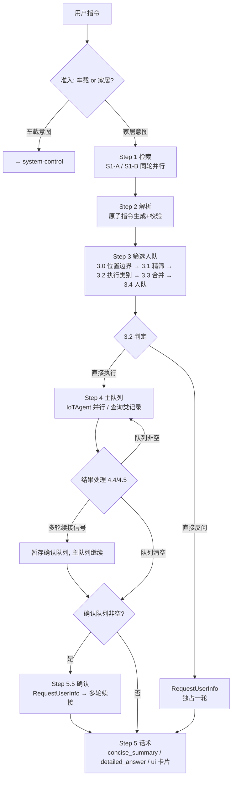
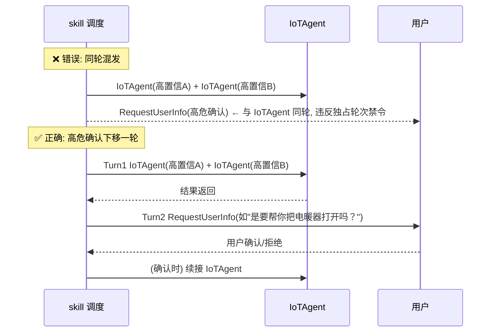
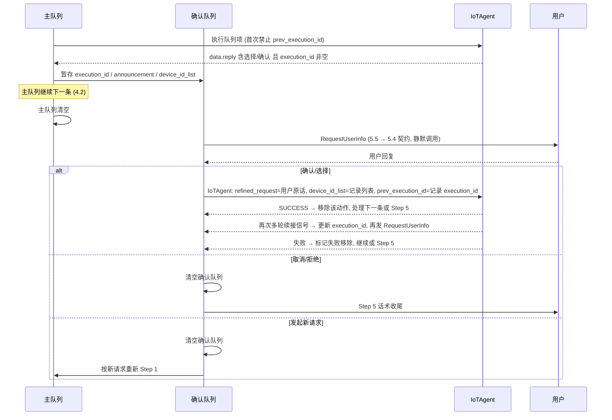

# IoT Control Skill 精读笔记（01）

> **读者**：第一次接触 `xiaoaiclaw-ops/skills/iot-control` 与 `xiaoaiclaw-ops/skills/iot-automation` 两个 skill 的开发同学（自学用）。
> **目标**：把 iot-control 的准入边界、五步主流程、调度纪律、原子指令/合并规范、场景推理、多轮续接、输出契约串成一张可执行的心智图。
> **写法约定**：
> - 关键结论后标注出处：`repo-root 相对路径:行号`。本文是**索引**，细节与冲突一律以源文件为准（仓库规则：高置信度回答，代码里验证，不许猜）。
> - 拿不准的地方明确标注「待确认」。
> - 示例中的设备名、`real_did`、`ui.id` 均为**虚构占位**（如 `did_0001`、`ui_xxxx`），仅用于演示流程形态。
>
> **精读源文件**（当前 skill 版本 `2.1.1`，xiaoaiclaw-ops/skills/iot-control/SKILL.md:2-3）：
>
> | 文件 | 作用 |
> |---|---|
> | `xiaoaiclaw-ops/skills/iot-control/SKILL.md` | 决策主干（[A] 全局规则 / [B] 调度总览 / [C] 主流程五步） |
> | `xiaoaiclaw-ops/skills/iot-control/references/tool-spec.md` | 工具参数、响应字段、调用约束（`[始终]` 加载） |
> | `xiaoaiclaw-ops/skills/iot-control/references/car-vs-home-intent-judge.md` | 车家准入判定（`[始终]`，准入时必查） |
> | `xiaoaiclaw-ops/skills/iot-control/references/scene-inference-strategy.md` | 场景推理矩阵（`[按需]`，模糊指令时加载） |
> | `xiaoaiclaw-ops/skills/iot-control/references/multi-turn-session-flow.md` | 多轮续接确认（`[按需]`，确认队列非空时加载） |
>
> references 加载分级见 xiaoaiclaw-ops/skills/iot-control/SKILL.md:532-536。

---

## 1. 定位与触发

### 1.1 一句话定位

米家智能家居设备的**查询与控制**（xiaoaiclaw-ops/skills/iot-control/SKILL.md:4,7）。根据 user message 前缀 Normalized client context 的 `设备信息.设备类型` 判断来源（手机、座舱、有屏音箱、无屏音箱或其他）；来源设备称「**主控设备**」（xiaoaiclaw-ops/skills/iot-control/SKILL.md:8）。

### 1.2 两类适用诉求（frontmatter description）

| 类型 | 内容 | 示例 |
|---|---|---|
| 1. 明确指令 | 把客厅灯打开、查询卧室/房间/室内温湿度、室内环境指标、非车端打开空调/风扇/灯、非车端 IoT 设备状态/耗材/滤芯剩余量/耗电量查询，以及**车端明确的家庭 IoT 设备控制/查询意图** | "把客厅灯打开"、"查询卧室温湿度" |
| 2. 模糊意图 | 有点冷调节家里设备、看书加班观影氛围、清洁打扫房间 | "有点冷"、"帮我布置观影氛围" |

（xiaoaiclaw-ops/skills/iot-control/SKILL.md:4）

### 1.3 不适用边界（分流表）

| 诉求 | 归属 | 依据 |
|---|---|---|
| 车载意图（"打开车上的空调/灯"、车端"打开空调/灯"） | `system-control` | xiaoaiclaw-ops/skills/iot-control/SKILL.md:16,19 |
| 手机/音箱系统功能控制 | `system-control` | xiaoaiclaw-ops/skills/iot-control/SKILL.md:19 |
| App 内操作 | `ui-agent` | xiaoaiclaw-ops/skills/iot-control/SKILL.md:19 |
| 非米家生态第三方设备 | 不处理 | xiaoaiclaw-ops/skills/iot-control/SKILL.md:19 |
| 设备参数问答/故障诊断（"空调为什么不制冷"、"冰箱的节能系数"） | 不处理 | xiaoaiclaw-ops/skills/iot-control/SKILL.md:4,19 |
| 信息检索/知识查询 | 不处理 | xiaoaiclaw-ops/skills/iot-control/SKILL.md:19 |
| 音箱（soundbox）的任何操控 | 不处理（硬排除，见 §5/§10） | xiaoaiclaw-ops/skills/iot-control/SKILL.md:254 |

**与 iot-automation 的分界**（兄弟 skill，判别要点在对方 description 中写死）：

- iot-control = **当下无条件、立即执行一次**的设备控制/场景，以及**查当下状态**（"打开客厅灯"、"空调调低2度"、"有点冷帮我调节一下"、"我要看电影了把氛围弄一下"、"空调几度"）→ iot-control（xiaoaiclaw-ops/skills/iot-automation/SKILL.md:4,31-32）。
- iot-automation = 存在**作为执行前提的触发条件**（条件→动作结构）：事件触发、定时（周期/单次）、相对时间（延时/时长）、环境数值阈值、场景自动化设计/推荐（xiaoaiclaw-ops/skills/iot-automation/SKILL.md:4）。
- 时间类归属判据：**只提醒人、不操作任何设备**的闹钟/倒计时/日历 → `reminder`；**一旦操作设备**（含单次定时、延时、时长）→ iot-automation（xiaoaiclaw-ops/skills/iot-automation/SKILL.md:33,35-38）。
- 组合指令（"打开客厅灯 30 分钟后关闭"）中，立即那半会被 iot-automation 前置阶段 `read iot-control` 执行掉，且数据流严格隔离（xiaoaiclaw-ops/skills/iot-automation/SKILL.md:25,65-68）——即 iot-control 仍按本文流程被当作独立子任务调用。

### 1.4 车家意图判别规则

判定规则见 `references/car-vs-home-intent-judge.md`（xiaoaiclaw-ops/skills/iot-control/SKILL.md:12）。判定对象：车载设备操控意图 / 家庭设备操控·查询意图（xiaoaiclaw-ops/skills/iot-control/references/car-vs-home-intent-judge.md:8-11）。

| 意图 | 判定 | 处理 | 示例 |
|---|---|---|---|
| 车载意图 | 座舱请求且操控座舱设备，或明确操控「车上的…」 | → `system-control` | "打开车上的空调/灯"、车端"打开空调/灯" |
| 家居意图 | 查询/操控米家家居设备，含车端远程操控家居设备 | → `iot-control` | 非车端"打开空调/灯/开关/风扇/摄像头"、车端"打开家里的灯/空调/风扇" |

（xiaoaiclaw-ops/skills/iot-control/SKILL.md:14-17）

- **车载意图**（满足任一）：请求来自座舱且明确操控「座舱设备」；或请求指令明确操控「车上的…」「座舱设备」（xiaoaiclaw-ops/skills/iot-control/references/car-vs-home-intent-judge.md:16-19）。常见座舱设备示例：空调、摄像头、云台摄像头、遮阳帘、香氛机；车门、车锁、车窗、天窗、天幕；近光灯、远光灯、阅读灯、氛围灯、位置灯、双闪、日行灯、警示灯；冰箱、车载加湿器、后排电视、中控屏、头枕、蓝牙按键、机械按键（car-vs-home-intent-judge.md:21-27）。
- **家居意图**（满足任一）：明确查询/操控「家/房间里的…」「家居设备」；目标为家居生态设备（扫地机、洗衣机、冰箱等；源文件称「与座舱设备无交集」，**待确认**——car-vs-home-intent-judge.md:26 与 :35 对「冰箱」归类互相矛盾，见附录 9）；来自座舱且明确操控「家/房间里的…」「家居设备」（car-vs-home-intent-judge.md:32-36）。常见家居设备示例（**不包含音箱**）：灯、空调、窗帘、洗衣机、扫地机、冰箱、插座、开关、晾衣架等（car-vs-home-intent-judge.md:38-39）。
- **Hard Rules（优先级与冲突）**：若请求指令非明确操控「家/房间里的…」「家居设备」且为车载意图 → 判车载意图，**不调用** iot-control；否则若判为家居意图 → 继续调用 iot-control（car-vs-home-intent-judge.md:45-46）。

### 1.5 灰区：车端"打开空调" vs 车端"打开家里的灯"

同一台座舱设备发出的指令，仅因**是否带「家/房间里的」显式限定**而分流：

| 车端说 | 判定 | 去向 | 依据 |
|---|---|---|---|
| "打开空调"、"打开灯" | 车载意图（未明确操控家里的） | `system-control` | xiaoaiclaw-ops/skills/iot-control/SKILL.md:16 |
| "打开家里的灯"、"打开家里的空调/风扇" | 家居意图（车端远程操控家居） | `iot-control` | xiaoaiclaw-ops/skills/iot-control/SKILL.md:17 |

关键锚点是「**家/房间里的**」「家居设备」这类显式限定词（car-vs-home-intent-judge.md:34,45）；车端"打开空调"被明确写进车载示例（SKILL.md:16），不能凭"空调是常见家电"就抢判家居。冰箱、空调、灯、摄像头、加湿器等**重叠品类**在车端请求下同样按 Hard Rules（:45-46）+显式限定词裁决，勿凭品类清单抢判（清单本身对"冰箱"归类矛盾，见附录 9）。另外即便进入 iot-control，`is_car_home=true` 的家庭其下所有设备也不纳入家居操控候选（xiaoaiclaw-ops/skills/iot-control/references/tool-spec.md:25；SKILL.md:228）——车家和家是两层不同的"车"。

---

## 2. 核心概念与术语表

| 术语 | 含义 | 出处 |
|---|---|---|
| 主控设备 | user message 前缀 Normalized client context `设备信息.设备类型` 标识的来源设备（手机/座舱/有屏音箱/无屏音箱/其他） | xiaoaiclaw-ops/skills/iot-control/SKILL.md:8 |
| `caller_device_type` | 拓扑响应中的主控设备标识；存在时**锁定其所属家庭为主控家庭**，未指定位置时再推理其所在房间 | xiaoaiclaw-ops/skills/iot-control/references/tool-spec.md:29 |
| `homes[].is_car_home` | 车端家庭标记；`true` 时其下所有设备不纳入家居操控候选 | xiaoaiclaw-ops/skills/iot-control/references/tool-spec.md:25 |
| `real_did` | 设备唯一 ID，后续工具 `device_id_list` 的**唯一来源** | xiaoaiclaw-ops/skills/iot-control/references/tool-spec.md:26,186 |
| `category` / `expended_category` / `sub_category` | 真实品类 / 扩展品类（开关/插座可外连任意 IoT 设备）/ 子品类 | xiaoaiclaw-ops/skills/iot-control/references/tool-spec.md:27-28,184-185 |
| `service_list` | 功能点名称、可调范围等；推理功能点**必须**参考、**禁止臆造**——MetaData 锚定的唯一权威源 | xiaoaiclaw-ops/skills/iot-control/references/tool-spec.md:56,191；xiaoaiclaw-ops/skills/iot-control/SKILL.md:174 |
| `service_name=environment` | 环境温/湿度查询筛选设备的属性条件 | xiaoaiclaw-ops/skills/iot-control/SKILL.md:242 |
| `spec_name=on` 的 `value` | 设备开关状态，用于关机过滤 | xiaoaiclaw-ops/skills/iot-control/SKILL.md:255 |
| 原子指令 | `[动作] + [对象：单一品类/子品类或设备名] + [可选：属性值，取自 MetaData]`；合并前的单品类、单动作输入单元 | xiaoaiclaw-ops/skills/iot-control/SKILL.md:156-158 |
| `refined_request` | Step 3.3 合并后发给 IoTAgent 执行器的可执行指令（执行器把自然语言翻译为设备操作，**不是人类读者**）；可由同品类、同执行类别多条原子指令合并而来 | xiaoaiclaw-ops/skills/iot-control/SKILL.md:156 |
| 宽集 vs 精筛 | Step 1 只构建范围内**宽集**、不做运行态精筛；关机过滤等精筛在 Step 3.1；Step 4 `device_id_list` 必须用精筛列表，禁止复用宽集 | xiaoaiclaw-ops/skills/iot-control/SKILL.md:141-143,312,341 |
| 执行类别 | `直接执行` / `直接反问`，按设备品类分组独立判定 | xiaoaiclaw-ops/skills/iot-control/SKILL.md:260 |
| 明确单指令 | 满足 2.2 原子规范、含未指定/泛指位置；仅规范化直接执行 | xiaoaiclaw-ops/skills/iot-control/SKILL.md:205 |
| 模糊指令 | 感受/场景意向表达（含"轻松/舒适/放松/温馨/惬意/氛围"等）；走 scene-inference-strategy 推理 | xiaoaiclaw-ops/skills/iot-control/SKILL.md:206 |
| 功能点降级 | **仅**意向性/模糊指令：属性无法落地时省略属性设置只生成开关操作；明确指令不降级 | xiaoaiclaw-ops/skills/iot-control/SKILL.md:193-199 |
| 场景闭包 | 命中矩阵行后 `高置信+低置信` 是候选品类闭集；除用户显式点名外不得召回矩阵外品类 | xiaoaiclaw-ops/skills/iot-control/references/scene-inference-strategy.md:9,12-15 |
| 高置信 / 低置信 | 高置信直接执行；低置信直接反问 | xiaoaiclaw-ops/skills/iot-control/references/scene-inference-strategy.md:10 |
| 高危设备 | 非用户显式指定设备+动作时必须先确认、禁止直接执行（厨电/大功率发热/洗涤/电源开关/饮水液体/开窗器等） | xiaoaiclaw-ops/skills/iot-control/references/scene-inference-strategy.md:28-38 |
| 确认队列 | IoTAgent 返回多轮续接信号（`data.reply` 含选择/确认意图且 `data.execution_id` 非空）时暂存 `execution_id`、`announcement`、`device_id_list`；主队列清空后进确认流程 | xiaoaiclaw-ops/skills/iot-control/references/multi-turn-session-flow.md:9 |
| `prev_execution_id` | 上次 IoTAgent 返回的 `data.execution_id`；**仅**多轮续接传入，首次调用禁止传入 | xiaoaiclaw-ops/skills/iot-control/references/multi-turn-session-flow.md:10,20 |
| 主队列 | Step 3.4 构建的执行队列；队列项 = `refined_request`（3.3 合并后）+ `device_id_list`（3.1 精筛后）+ 执行类别 | xiaoaiclaw-ops/skills/iot-control/SKILL.md:311 |
| 品类别名 | 照明=灯+开关；遮阳=窗帘；基础环境=空调、温控器、风扇、新风机、加湿器、除湿机、空气净化器；香氛=香薰机；影音=电视、投影仪、机顶盒、电视盒子。**别名只用于场景闭包召回与话术，不是 `refined_request` 合并单元** | xiaoaiclaw-ops/skills/iot-control/references/scene-inference-strategy.md:49-55 |
| 输出标签 | `<explanation>`（过程提示、仅上屏）、`<concise_summary>`（上屏+TTS）、`<detailed_answer>`（结构化明细、仅上屏）、`<ui><id>…</id></ui>`（卡片） | xiaoaiclaw-ops/skills/iot-control/SKILL.md:22-26,379-386,398-402 |

---

## 3. 五步主流程总览

主流程：`Step 1(检索) → Step 2(解析) → Step 3(筛选入队) → Step 4(执行调度与结果处理) → Step 5(话术)`。终止条件：队列清空+确认队列清空，或用户拒绝，或**连续 2 次同动作失败**（xiaoaiclaw-ops/skills/iot-control/SKILL.md:112-113）。



> 注：图中 H→M 仅画单轮主干；直接反问后用户回复实际经 Step 4.6 分流（见 §7.2，SKILL.md:370-374），并非反问后直接话术收尾。

### 每步的输入 / 输出 / 禁止事项

| 步骤 | 输入 | 输出 | 禁止事项（出处） |
|---|---|---|---|
| Step 1 检索 | 用户指令 + 调度矩阵路径 | Topology（首次必查）；按需 MetaData/Status（对宽集一次性调用） | 禁止 Step 1 前单独预加载 tool-spec；禁止拆轮（SKILL.md:69-71,86-90）；当前请求 Topology **最多一次**，禁止因场景不确定/候选缺失/房间不匹配重查（SKILL.md:126-128）；禁止因会话历史/压缩摘要跳过本应触发的调用（SKILL.md:119-123） |
| Step 2 解析 | Step 1 的拓扑/功能点/状态 | 单意图、单设备的原子指令集合 | 缺 MetaData/Status 时只补 S2、**不得重查 Topology**；禁止无功能点/状态信息臆造请求或参数（SKILL.md:147-149） |
| Step 3 筛选入队 | 原子指令 + 拓扑 | 执行队列（队列项三元组） | 入队前 `device_id_list` 为空 → 禁止入队/工具调用，直接 5.2.2「设备未找到」兜底（SKILL.md:308）；禁止复用 Step 1 宽集（SKILL.md:312）；Step 1-3 推理过程禁止输出（SKILL.md:314） |
| Step 4 执行 | **冻结**后的队列 | IoTAgent 结果 / 查询记录 / 确认队列 | 禁止重新筛选设备、扩大 `device_id_list`、回退补拓扑/状态、重套 2.2 原子规范（SKILL.md:316-317） |
| Step 5 话术 | 队列/确认队列状态 | 标签文本或 `RequestUserInfo` | 非反问路径禁问号/后续建议（SKILL.md:424-425）；Step 5 禁止复述 `<explanation>` 已展示话术（SKILL.md:37,386）；反问路径不输出任何标签或自然语言（SKILL.md:377） |

---

## 4. 调度矩阵与轮次纪律

### 4.1 S1 并行启动（S1-A / S1-B）

S1 启动规则（xiaoaiclaw-ops/skills/iot-control/SKILL.md:68-74）：

- 禁止在 Step 1 前单独预加载 `references/tool-spec.md`。
- 若当前请求上下文尚未加载 tool spec，必须把 `read(tool-spec)` 放入 S1 第一批并行工具组。
- `SearchIoTDeviceTopology` 参数固定为空对象（`params: {}`），且必须与 `read(tool-spec)` 同轮并行。
- **场景/模糊/感受表达**必须在 S1 同轮追加 `read(scene-inference-strategy)`（准备睡觉、出门/回家、看剧观影、做饭洗漱、运动会客、清洁工作、舒服/氛围/环境、有点冷/热/闷、潮湿/干燥等）。
- 明确控制默认**不**加载 scene（"打开客厅灯"、"空调调到 26 度"）；同句含场景/感受表达时例外。
- 所有工具通过 `xiaoai_web_call` 统一调用（调用体形如 `<function=xiaoai_web_call>` 内嵌工具名与 JSON `params`，示例见 tool-spec.md:14-19；SKILL.md:74）；本文示例的 `[Tool Call: …]` 为简写。

S1 类型（xiaoaiclaw-ops/skills/iot-control/SKILL.md:95）：

- **S1-A** = `read(tool-spec)` + `SearchIoTDeviceTopology`
- **S1-B** = `read(tool-spec)` + `SearchIoTDeviceTopology` + `read(scene-inference-strategy)`

**S1 禁止模式**（xiaoaiclaw-ops/skills/iot-control/SKILL.md:86-90）：① `read(tool-spec)` 单独一轮；② `read(tool-spec)`+`read(scene-inference-strategy)` 后单独查 Topology；③ `read(tool-spec)`+Topology 后单独 `read(scene-inference-strategy)`；④ 先查 Topology 再判断是否需要 scene。

### 4.2 调度矩阵（强制参照）

同一单元格内 `+` 必须同轮并行（含 S1 检索组）；跨列 S1→S2→S3→S4 必须顺序执行。单条指令同时命中明确+模糊时，按 Step 2 拆分后分别套矩阵（xiaoaiclaw-ops/skills/iot-control/SKILL.md:92-93）。

| 路径 | 判定 | S1 | S2 加载 | S3 执行 | S4 确认 | 示例 |
|---|---|---|---|---|---|---|
| 纯开关 | 打开/关闭+明确设备，不涉模式/属性/状态依赖 | S1-A | — | `IoTAgent` | — | 打开灯、关闭空调 |
| 绝对值/模式 | 调到/设置为/切换到+明确值/模式 | S1-A | `SearchIoTDeviceMetaData` | `IoTAgent` | — | 调至26度、切制热 |
| 相对调节 | 调高/调低/更亮/更暗/一点等，依赖当前值 | S1-A 或 S1-B† | `SearchIoTDeviceMetaData`+`SearchIoTDeviceStatus` | `IoTAgent` | — | 调高温度、调亮灯光 |
| 状态查询 | 查/看看/多少/开了吗/有没有 | S1-A | `SearchIoTDeviceStatus` | → Step 5 | — | 查温湿度、灯开了吗 |
| 条件控制 | 如果/没开的话/没关的话，先查状态再决定 | S1-A | `SearchIoTDeviceStatus` | 条件 IoTAgent | — | 没开的话帮我开 |
| 场景推理 | 生活场景/环境感受/氛围；高置信设备直接执行 | S1-B | `SearchIoTDeviceMetaData`+`SearchIoTDeviceStatus` | `IoTAgent`×N | — | 准备睡觉、有点闷 |
| 场景推理(含高危) | 命中低置信或高危设备 | S1-B | `SearchIoTDeviceMetaData`+`SearchIoTDeviceStatus` | `IoTAgent`(高置信) | `RequestUserInfo`(低置信) | 有点冷→电暖器、出门关全屋 |

（xiaoaiclaw-ops/skills/iot-control/SKILL.md:97-105）

† 相对调节若同时是感受/场景表达（"有点热/潮湿/闷，帮我弄舒服点"）用 S1-B；明确设备相对调节（"把客厅灯调亮一点"）用 S1-A（xiaoaiclaw-ops/skills/iot-control/SKILL.md:107）。

### 4.3 依赖弧

`S1→S2`：MetaData/Status 依赖 Topology 的 `device_id_list`；`S2→S3`：IoTAgent 的 `refined_request` 可能依赖 MetaData/Status；`S3→S4`：`RequestUserInfo` 独占轮次，不与任何工具并行（xiaoaiclaw-ops/skills/iot-control/SKILL.md:109-110）。

### 4.4 并行与拆轮禁令

- **同阶段可并行，跨阶段按依赖弧顺序**。禁止拆轮的组合：`read(tool-spec)`+`SearchIoTDeviceTopology`、`SearchIoTDeviceMetaData`+`SearchIoTDeviceStatus`、多个 `IoTAgent`——均应同轮并行（xiaoaiclaw-ops/skills/iot-control/SKILL.md:39）。
- 同批所有「直接执行-操控类」必须同轮并行 `IoTAgent`；禁止逐个等待或边执行边补同批队列。仅重试、多轮续接、用户明确顺序任务或条件依赖允许串行（xiaoaiclaw-ops/skills/iot-control/SKILL.md:336）。
- 每个非 `RequestUserInfo` 的工具调用前**必须**先输出一句 `<explanation>`（有且只能有该标签）；禁止静默调用（xiaoaiclaw-ops/skills/iot-control/SKILL.md:34-36）。

### 4.5 RequestUserInfo 独占轮次禁令（最高优先级）

`RequestUserInfo` 必须独占一轮，**同一轮严禁与 `IoTAgent` 并行**。场景含高危时：先在当轮发全部 `IoTAgent`（高置信执行），等结果返回后，下一轮单独发 `RequestUserInfo`（高危确认）（xiaoaiclaw-ops/skills/iot-control/SKILL.md:41）。Step 4.2 的批量提取遇「直接反问」项即停止提取——本批 `IoTAgent` 结束当前轮（xiaoaiclaw-ops/skills/iot-control/SKILL.md:327）。

**高危时序 ❌/✅**（源文件原样，xiaoaiclaw-ops/skills/iot-control/SKILL.md:41）：

- ❌ Turn1 `[IoTAgent, IoTAgent, RequestUserInfo]` 同轮混发
- ✅ Turn1 `[IoTAgent, IoTAgent]`，Turn2 `[RequestUserInfo]`



### 4.6 `<explanation>` 模板（行动前话术）

| 工具组合 | 模板 |
|---|---|
| `read(tool-spec)`+`SearchIoTDeviceTopology`[+`read(scene-inference-strategy)`] | `正在查询设备信息。` |
| `SearchIoTDeviceMetaData` | `正在查询[设备]的功能。` |
| `SearchIoTDeviceMetaData`+`SearchIoTDeviceStatus` | `正在查询[设备]的功能和状态。` |
| `SearchIoTDeviceStatus` | `正在查询[设备]的状态。` |
| `IoTAgent`（单品类） | `正在[动作][位置]的[品类]。` |
| `IoTAgent`×N（同品类不同位置） | `正在[动作][位置A]和[位置B]的[品类]。` |
| `IoTAgent`×N（场景多品类） | `正在帮你布置[场景]环境。` |
| `RequestUserInfo` | 静默，禁止输出文本 |

（xiaoaiclaw-ops/skills/iot-control/SKILL.md:43-54）

并行 `IoTAgent` 只输出一句整体 `<explanation>`，禁止逐设备输出或夹带设备盘点：✅`正在帮你布置客厅观影环境。` ❌`客厅有窗帘、空调。正在帮你布置观影环境～`（xiaoaiclaw-ops/skills/iot-control/SKILL.md:56）。

---

## 5. Step 2 原子指令规范 与 Step 3 合并策略

### 5.1 原子指令对象契约（先分清两个对象）

- `refined_request` 是 Step 3.3 合并后发给 IoTAgent 执行器的可执行指令；Step 2.2 定义的**原子指令**是合并前的输入单元：单品类、单动作；`refined_request` 可由同品类、同执行类别的多条原子指令合并而来（xiaoaiclaw-ops/skills/iot-control/SKILL.md:156）。
- 原子指令 = `[动作] + [对象：单一品类/子品类或设备名] + [可选：属性值，取自 MetaData]`（SKILL.md:158）。
- 语体：**纯命令**，只写「做什么」；场景目标、氛围、感受词不写入指令（SKILL.md:159）。
- 属性值：取自 MetaData `service_list` 可选值/范围；无法落地时按「功能点降级」处理（SKILL.md:160）。
- 「保留/不动/排除」某设备：将其移出 `device_id_list` 实现，指令文本**不出现**「保留」（SKILL.md:161）。
- 上述语体、属性值、保留表达约束在合并后继续生效（合并只放宽设备数与动作数）（SKILL.md:163）。

### 5.2 四条校验（逐条过）

| 约束 | 要求 | 出处 |
|---|---|---|
| 单一设备 | 仅一种品类/子品类（如"灯"/"吸顶灯"）或设备名；禁止"设备/所有设备/全部设备"等跨品类统词 | SKILL.md:169 |
| 单一动作意图 | 基础动作（打开/关闭）、其他动作（暂停/设置/调节）或复合动作之一 | SKILL.md:170 |
| 单一功能值（可选） | 仅一个功能/属性/模式设置或调节；禁止同时调多个功能点 | SKILL.md:171 |
| 全量词忠实 | 原文含"全部/都/所有"必须保留；不含禁止添加；位置泛指（"屋里的灯"）**不等同**全操控 | SKILL.md:172 |

（xiaoaiclaw-ops/skills/iot-control/SKILL.md:165-172）

查询类例外：可同时包含多个查询属性（如"温湿度"），无需按单一属性拆分，因为 `SearchIoTDeviceStatus` 一次返回全部属性（SKILL.md:181）。另两条硬限制：**禁止操作音箱（soundbox）**；**电视仅限开关**（SKILL.md:183-184）。

### 5.3 MetaData 锚定（`service_list` 是唯一权威源）

| 规则 | 要求 | 违规→正确 |
|---|---|---|
| 功能点校验 | 只写 `service_list` 中存在的功能点 | 空调插座仅有 `on` → ❌"设置为睡眠模式" ✅"打开空调" |
| 属性值落地 | 属性值来自 MetaData 可选值/范围，用`设置为`句式 | ❌"低速运转" ✅"风速设置为低速"；❌"舒适的温度" ✅"打开空调" |

（xiaoaiclaw-ops/skills/iot-control/SKILL.md:174-179；禁止臆造见 tool-spec.md:56,191）

### 5.4 功能点降级（**仅限模糊指令**）

仅当原始指令属意向性/模糊指令（感受/场景表达）时，若满足任一条件，原子指令**省略属性设置、仅生成开关操作**（xiaoaiclaw-ops/skills/iot-control/SKILL.md:193-197）：

1. MetaData `service_list` 中无目标功能点/模式；
2. 用户表达为感受词（舒适/合适/舒服/适宜/惬意）且无法唯一映射为取值范围内的具体值；
3. 无法从 MetaData 取值范围确定具体属性值。

**明确指令不降级**：用户显式指定功能/值/模式（"空调调到26度""设置为睡眠模式"）时，MetaData 缺该功能点/值就保留原属性诉求下发，由执行结果按 5.2.2「功能不支持」处理，**禁止降级为开关**（SKILL.md:199）。

### 5.5 位置推理

- 指定具体位置（非"家/房间/屋里"类泛指）→ 指令必须包含该位置且**不推理到其他房间**；未指定位置 → **禁止**包含具体位置，由 Step 3 合并（xiaoaiclaw-ops/skills/iot-control/SKILL.md:188）。
- 房间名精确匹配优先：原文位置与拓扑房间名完全一致时直接使用，禁止因存在包含关系房间名（"卧室/主卧"）而反问（SKILL.md:188）。

### 5.6 功能名/模式名净化

引用 MetaData 功能名/模式名时，若含括号、斜杠、特殊符号等，**省略符号内容，仅保留主名称纯文本**：`电视模式（影院模式）`→`电视模式`；`制冷/除湿`→`制冷`（xiaoaiclaw-ops/skills/iot-control/SKILL.md:190-191）。

### 5.7 指令分类与拆分

| 类型 | 定义 | 处理 | 出处 |
|---|---|---|---|
| 明确单指令 | 满足 2.2，含未指定/泛指位置 | 仅规范化，直接执行 | SKILL.md:205 |
| 模糊指令 | 感受/场景意向表达（"轻松/舒适/放松/温馨/惬意/氛围"等） | 参考 scene-inference-strategy 推理（应在 S1 同轮加载，Step 2 仅兜底补加载） | SKILL.md:206 |

- **混合意图拆分（先拆后分类）**：明确部分直接执行；模糊部分按场景推理+置信度判定，未指定位置时继承明确部分位置；**禁止整体只按模糊或明确处理**。例："我想在客厅看电视，帮我营造下轻松舒适的氛围"→明确"打开客厅电视"+模糊"客厅营造轻松舒适氛围"（xiaoaiclaw-ops/skills/iot-control/SKILL.md:208-214）。
- **多连续任务拆分（顺序连接词）**：含"之后/然后/再/接着"时拆为独立子任务，各自走 Step 2-5；子任务 N 的歧义不阻塞 N-1。例："我要洗衣服，之后看电视放松"→先洗衣，再处理 TV+场景推理；禁止因 TV 歧义丢弃洗衣任务（SKILL.md:216-217）。

### 5.8 合并策略（Step 3.3）：只减工具调用，不改语义

对**同品类 + 同执行类别**的原子指令合并产出 `refined_request`。合并仅放宽：「单品类→同品类多设备/多位置」「单一功能值→同品类无冲突多动作（受 P4 约束）」（xiaoaiclaw-ops/skills/iot-control/SKILL.md:270）。**跨品类禁止合并**：不同品类（灯/空调等）必须拆为独立 `IoTAgent` 并行执行（SKILL.md:272）。

**合并前提 P0-P4**（xiaoaiclaw-ops/skills/iot-control/SKILL.md:274-282）：

| # | 条件 | 说明 |
|---|---|---|
| P0 | 范围一致 | 合并前所有设备必须已通过 Step 3.0；同一条 `refined_request` 的 `device_id_list` 必须属于同一目标家庭和目标范围 |
| P1 | 位置忠实 | 明确控制且原文指定位置时，合并后必须保留原始位置，禁止省略 |
| P2 | 位置不添加 | 明确控制且原文无位置时，合并后禁止添加位置 |
| P3 | 全量语义补充 | 模糊指令场景推理产生 **≥3 个位置**同类原子指令时，合并后须加"所有"；"所有"只指 Step 3.0 目标范围内所有匹配设备 |
| P4 | 功能点上限 | 合并后单条 `refined_request` **最多 3 个功能点**，超出拆分调用 |

注意：这里的 P0-P4 与 Step 5.4 反问护栏的 P1-P3（§8.5）是**两套编号**，别混淆。

**合并规则表**（xiaoaiclaw-ops/skills/iot-control/SKILL.md:284-292）：

| 来源 | 条件 | 方式 |
|---|---|---|
| 明确指令（原文含位置） | 同品类+同设备集合+动作无冲突 | 保留原始位置，合并一条，受 P4 约束 |
| 明确指令（原文无位置） | 同品类+同设备集合+动作无冲突 | 保持无位置表述，合并一条，受 P4 约束 |
| 模糊指令（场景推理） | 2 个位置+同品类 | 合并为「2 位置+单品类」 |
| 模糊指令（场景推理） | ≥3 个位置+同品类 | 合并为「所有+单品类」 |
| 多个直接反问 | — | 合并为一个反问操作 |

动作无冲突：禁止合并方向相反动作（开+关）或同一属性不同值；设备集合不同不合并；合并后 `device_id_list` 为设备集并集；原文含"所有/全部/都"时合并后必须保留（SKILL.md:294）。

**正反例**（xiaoaiclaw-ops/skills/iot-control/SKILL.md:296-304）：

| 场景 | ✅ | ❌ |
|---|---|---|
| 含位置："打开客厅和卧室灯" | "打开客厅和卧室的灯" | "打开灯"（丢了位置） |
| 无位置："打开灯"（匹配多房间灯） | "打开灯" | "打开卧室和客厅的灯"（凭空加位置） |
| ≥3 位置模糊："准备睡觉了，帮我操作下设备" | "关闭所有灯" | "关闭灯"（漏"所有"） |
| 同品类多动作："打开灯，亮度调高" | 一条 `refined_request`="打开灯并调高亮度" | 两次 `IoTAgent` |
| 功能点上限 | "打开空调，设置为制热，温度设为26度"（3 个） | "打开灯，亮度调高，色温调低，设置为月光模式"（4 个须拆） |
| 照明合并 | 同房间多路灯/开关同动作合并一条，`device_id_list` 传所有灯/开关 ID | 仅动作冲突（大灯关+氛围灯开）时才拆分 |
| 语体纯净 | "关闭客厅窗帘"；"打开风扇"（降级） | "关闭客厅窗帘，营造观影氛围"；"风扇调到舒适的风速" |
| 跨品类禁合并 | 场景"客厅看电影布置环境"→并行 3 条 IoTAgent：`"关闭客厅窗帘"`+`"打开客厅空调"`+`"打开客厅电视"` | 一条 `"关闭客厅窗帘，打开客厅空调，打开客厅电视"` |

### 5.9 Step 3.1 筛选速记（缺省品类与特殊规则，SKILL.md:244-257）

- 缺省查询（未指定品类）可召回品类：环境温度=空调、新风机、温控器、空气净化器、空气检测仪、加湿器、除湿机、电暖器、温湿度传感器、香薰机；环境湿度=以上+浴霸；其他环境（PM2.5/甲醛等）=新风机、空气净化器、空气检测仪；耗材类品类不限、按 `service_list` 耗材属性筛（SKILL.md:246-251）。
- 特殊规则（按顺序）：①非开关/耗材/环境类查询过滤已关机（`on=false`）设备，开关状态/耗材/环境信息查询**豁免**（SKILL.md:255）；②仅查询类未指定位置→主控房间优先（:256）；③环境查询未指定位置→优先客厅，多品类优先级链 温湿度传感器>空气检测仪>空气净化器>加湿器>新风机>电暖器>其他（:257）。
- `SearchIoTDeviceStatus` 响应含 `devices[].online`（离在线）与 `devices[].status`（授权/可控）；话术"因离线未操作成功"依赖这两个字段（tool-spec.md:83-84,195-199）。

---

## 6. 场景推理（scene-inference-strategy）

### 6.1 使用原则与置信度

- 仅用于模糊/感受/场景表达；命中矩阵行后 `高置信+低置信` 是候选品类闭集，除用户显式点名外不得召回矩阵外品类；不命中矩阵时再按上下文和常识推理（xiaoaiclaw-ops/skills/iot-control/references/scene-inference-strategy.md:5-9）。
- **高置信直接执行；低置信直接反问**（scene-inference-strategy.md:10；执行类别判定见 SKILL.md:264-266）。

### 6.2 场景命中闭包

- 拓扑中位于用户位置/主控位置/场景范围内的高置信品类**必须全部入队**；非高危高置信直接执行，高危按覆盖规则（scene-inference-strategy.md:13）。
- 场景高置信品类**仅在目标位置**（主控家庭/指定房间）内召回；目标位置无该品类时跳过，**禁止跨位置/跨家庭补齐品类**（scene-inference-strategy.md:14）。
- MetaData/Status 是辅助信息；纯开关或无具体参数的场景调节已定位时，辅助查询失败**不得阻断**高置信入队，执行失败交由主流程处理（scene-inference-strategy.md:15）。

### 6.3 场景触发词归一

| 用户表达 | 优先场景 | 约束 |
|---|---|---|
| 看剧、追剧、观影、看电视、窝着看会儿剧 | 游戏影音 | 优先召回已存在的影音、照明、遮阳、环境调节高置信品类 |
| 放松、舒服、舒适、惬意、舒适惬意的氛围 | 休息放松 | 禁止漂移到休闲养身；除非明确提到按摩/养生/足浴等 |
| 刺眼、晃眼、光太强、太阳晒 | 日照遮阳 | 有遮阳设备时必须召回；无遮阳或明确说灯太亮时再处理照明 |
| 脏衣服、衣服变干净、洗衣服、处理衣服 | 洗衣晾衣 | 洗涤高危按高危覆盖规则 |

（xiaoaiclaw-ops/skills/iot-control/references/scene-inference-strategy.md:17-23）

### 6.4 高危设备与高危覆盖

高危设备定义：**非用户显式指定设备+动作时，必须先确认，禁止直接执行**（scene-inference-strategy.md:28）。清单（scene-inference-strategy.md:30-38）：

| 分类 | 品类 |
|---|---|
| 厨电类（明火/高温/高压） | 电饭煲、烤箱、空气炸锅、集成灶、微波炉、压力锅、电磁炉、多功能料理锅 |
| 大功率/发热类 | 电暖器(暖风机)、足浴盆(足浴器)、电热毯(水暖毯) |
| 洗涤类 | 洗衣机、烘干机、干衣机、洗碗机 |
| 电源/开关类 | 插座、继电器 |
| 饮水/液体类 | 榨汁机、即热饮水吧、净水器、饮水机、鱼缸 |
| 外出场景高风险设备 | 冰箱在"临时外出/关全屋"场景中属低置信度设备，需反问 |
| 通风/隐私类 | 开窗器 |

**高危覆盖优先级**（同时属场景高置信和高危时，高危规则优先，scene-inference-strategy.md:40-44）：

- 原文**显式**操控该设备及动作（"启动洗衣机洗衣服"）→ 按明确指令执行。
- 仅表达场景/目标（"衣服脏了，让它们变干净"）→ 该高危设备进入**直接反问**，禁止直接执行。
- 同场景的非高危高置信设备**仍直接入队执行**，不能因高危待确认而整体跳过；但高危确认必须在执行轮之后**单独一轮**发起（独占轮次禁令），禁止与高置信 `IoTAgent` 同轮。

### 6.5 品类别名（只影响召回与话术）

照明=灯+开关；遮阳=窗帘；基础环境=空调、温控器、风扇、新风机、加湿器、除湿机、空气净化器；香氛=香薰机；影音=电视、投影仪、机顶盒、电视盒子。别名**不是** `refined_request` 合并单元——合并以单一品类为界（如空调、风扇、加湿器各自独立成条）（xiaoaiclaw-ops/skills/iot-control/references/scene-inference-strategy.md:49-55）。

### 6.6 场景矩阵（节选示例，全表见源文件 scene-inference-strategy.md:57-140）

| 场景 | 高置信品类 | 低置信品类 | 出处 |
|---|---|---|---|
| 入眠准备 | 照明、基础环境、香氛、遮阳、智能床、智能枕 | 无 | scene-inference-strategy.md:67 |
| 游戏影音 | 照明、遮阳、基础环境、凉霸（仅厨房）、影音 | 无 | scene-inference-strategy.md:93 |
| 休息放松 | 照明、遮阳（关）、基础环境、凉霸（仅厨房）、影音 | 无 | scene-inference-strategy.md:94 |
| 日常上班 | 照明、空调、开关、面板开关、摄像头、扫地机、遮阳 | 插座（有隐患）、冰箱、继电器 | scene-inference-strategy.md:74 |
| 温度调节 | 空调、温控器、风扇、凉霸 | 无 | scene-inference-strategy.md:115 |

矩阵共 9 个业务域（早晚起居、出行回家、烹饪用餐、娱乐健身、环境清洁、空间舒控、萌宠陪伴、洗衣个护、工作学习）。注意两点易误读：①「遮阳（关）」这类括号标注的是动作方向约束；②洗衣机/烘干机/干衣机既是"洗衣晾衣"场景的高置信品类（scene-inference-strategy.md:133）又是洗涤类高危（scene-inference-strategy.md:34）——高危覆盖裁决后：仅表达洗衣场景→**反问**，显式"启动洗衣机洗衣服"→执行。

---

## 7. 多轮续接与确认队列流转（multi-turn-session-flow）

### 7.1 核心概念

- **确认队列**：执行阶段中 `IoTAgent` 返回多轮续接信号（`data.reply` 含选择/确认意图且 `data.execution_id` 非空）时，暂存该动作的 `execution_id`、`announcement` 和 `device_id_list`，主队列继续执行；主队列清空后进入确认流程（xiaoaiclaw-ops/skills/iot-control/references/multi-turn-session-flow.md:9）。
- **`prev_execution_id`**：上次调用 `IoTAgent` 时返回的 `data.execution_id`；仅多轮续接（用户确认/选择后）传入，首次调用**禁止**传入（multi-turn-session-flow.md:10,20）。

响应关键字段：`data.status`（执行状态）、`data.reply`（结果描述）、`data.execution_id`（含选择/确认意图时须记录）、`data.ui`（`data.ui.id` 非空须出卡）（multi-turn-session-flow.md:24-29）。

### 7.2 状态流转



（流转依据：xiaoaiclaw-ops/skills/iot-control/references/multi-turn-session-flow.md:44-81；SKILL.md 4.1 多轮续接入口：xiaoaiclaw-ops/skills/iot-control/SKILL.md:319-324）

**Step 5 反问后的用户回复分流**（SKILL.md:370-374）：命中确认队列 → 走 4.1；回答当前 `RequestUserInfo` 的位置/范围消歧 → **用已冻结候选**构建队列进 4.2（不重走 Step 1、不重查 Topology）；表达新的独立 IoT 意图 → 作为新请求从 Step 1 重启；无关/拒绝 → Step 5 总结或终止。

### 7.3 续接调用的字段纪律

| 字段 | 值 | 出处 |
|---|---|---|
| `refined_request` | 用户的回复内容（"第二个"、"确认"、"都关掉"、"卧室的"、"所有的"等），**禁止改写** | xiaoaiclaw-ops/skills/iot-control/SKILL.md:321；multi-turn-session-flow.md:33,66 |
| `device_id_list` | 确认队列中记录的列表 | SKILL.md:322；multi-turn-session-flow.md:67 |
| `prev_execution_id` | 确认队列中记录的 `execution_id` | SKILL.md:323；multi-turn-session-flow.md:69 |
| `announcement` | 结合用户选择生成的播报话术（**仅 multi-turn-session-flow.md 出现，口径存疑见附录**） | multi-turn-session-flow.md:68 |

- 确认流程第一步：`data.reply` 含设备选择列表→`question_text` 呈现选项；含操作确认请求→询问是否确认；`data.ui.id` 非空→`question_text` 末尾**必须**包含 UI 卡片信息（multi-turn-session-flow.md:52-56）。
- **多轮续接重试例外**：携带 `prev_execution_id` 遇 `Semantic Error` 时**禁止改写** `refined_request`；用相同 `prev_execution_id`+用户原始回复重试 1 次；仍失败标记 `failed`；禁止丢弃 `prev_execution_id` 后改写重试（xiaoaiclaw-ops/skills/iot-control/SKILL.md:357-359）。
- Step 5.5 若 multi-turn reference **加载失败，直接话术总结收尾**（SKILL.md:530）。

### 7.4 上下文隔离（SKILL.md:58-64）

- 默认切断：当前指令能独立表达场景/房间/设备/动作/查询对象即视为新 IoT 子会话；仅省略/指代无法独立理解时才最小继承上一轮语义槽位，且**继承语义 ≠ 复用历史工具结果**；Step 5 只总结本轮实际结果，压缩摘要/被中断任务不得进最终话术（SKILL.md:59-60,64）。
- 允许继承四类：连续操控、连续查询、明确指代（"它/那台/同一个房间"等）、回答 `RequestUserInfo` 的候选/选择/确认；必须切断：新的完整场景/目标、已明确房间和目标、"还/继续/也/再"只修饰用户活动（SKILL.md:61,63）。

---

## 8. 输出语法契约

### 8.1 三种标签（最高优先级，贯穿全流程）

| 标签 | 行为 | 用途 | 出处 |
|---|---|---|---|
| `<explanation>` | 仅上屏 | 仅工具调用过程提示（非 `RequestUserInfo` 调用前）；Step 5 禁止复述 | SKILL.md:23,386 |
| `<concise_summary>` | 上屏+TTS | 操控结果、查询摘要、失败/受限/兜底短结果 | SKILL.md:24,384 |
| `<detailed_answer>` | 仅上屏 | **仅**结构化列查询明细/设备状态列表（序号、设备名、状态值等）；严禁主观评价、原因分析、总结说明、操控建议；仅非反问场景可跟在 `<concise_summary>` 后 | SKILL.md:385 |

- 反问/确认：只调用 `RequestUserInfo`，调用前**不输出任何标签或自然语言**（SKILL.md:25）。
- **标签外禁止自然语言；裸文本会被系统丢弃，等同没回复**（SKILL.md:26）。

组合规则（SKILL.md:388-394）：总结播报→仅 `<concise_summary>`；+查询明细→`<concise_summary>`+`<detailed_answer>`；有反问/确认→不输出任何标签，直接 `RequestUserInfo`。

### 8.2 `<ui>` 卡片与多卡聚合

- `data.ui.id` 非空时**必须出卡**；无 UI 卡片时禁止任何卡片描述（xiaoaiclaw-ops/skills/iot-control/SKILL.md:399）。
- `<ui>` 独占一行，禁止前后引导文本；仅短摘要→先 `<concise_summary>` 再 `<ui><id>{data.ui.id}</id></ui>`；有查询明细→明细和 `<ui>` 放入 `<detailed_answer>`（SKILL.md:400-402）。
- **多卡聚合契约**：每个 SUCCESS 的 `IoTAgent` 返回 `data.ui.id` → 对应一张 `<ui>` 卡片；N 个并行 `IoTAgent` 产生 N 个 ui.id → 逐行输出 N 个 `<ui>` 块，按 Step 3.4 队列顺序排列，位置在 `<concise_summary>` 之后（SKILL.md:404-407）。

示例（源文件原样，SKILL.md:410-416）：

```
<concise_summary>客厅空调已打开了。</concise_summary>\n<ui><id>47e557</id></ui>
<concise_summary>家里共有12个灯开着。</concise_summary>\n<detailed_answer>已查询到你家里开着的灯有....\n<ui><id>47e557</id></ui>\n</detailed_answer>

✅ <concise_summary>客厅观影环境已经调好了。</concise_summary>\n<ui><id>32b9a1</id></ui>\n<ui><id>a5970c</id></ui>\n<ui><id>9ada4c</id></ui>
❌ 只输出 1 个或 0 个 <ui>（丢弃/合并卡片）
```

### 8.3 话术模板：5.2.2 结果类型策略

| 结果类型 | 规则 |
|---|---|
| 全部成功 | 一句短句确认完成，禁止夸张扩展 |
| 部分成功/部分异常 | 先确认已完成，再半句说明异常 |
| 全部失败 | 客观说明原因，不强行反问 |
| 静默失败（无 reply、Client Exception、不支持类） | 不进最终话术 |
| 安全/权限限制 | 轻提受限原因，不提供绕过建议 |
| 功能不支持 | 一句话说明不支持，句号结束 |
| 数据未上报 | 一句话说明查不到，禁止用历史/经验数据补位 |
| 状态部分缺失 | 说明已查到信息+一句缺失，禁止推测或追加操控建议 |
| 设备未找到 | 一句话说明未找到指定设备，句号结束；禁止列替代设备、提议查询其他设备、询问设备名称或建议接入米家 |

（xiaoaiclaw-ops/skills/iot-control/SKILL.md:427-439）

另：5.2.1 生成顺序=判定结果类型→选标签→只总结本轮实际结果、不重复 `<explanation>`（SKILL.md:419-422）；5.2.1.1 **最终回复禁问规则**：非反问路径必须句号结束，禁止问号/疑问语气/后续建议（SKILL.md:424-425）。

### 8.4 话术模板：5.2.3 查询类 / 5.2.4 操控类

**5.2.3 查询类**（`<concise_summary>` 必须且只能选下列模板陈述事实，SKILL.md:441-451）：

- 单设备/明确对象：`[对象][位置词]的[属性]是[状态/数值]。` 或 `[对象]目前是[状态]的。` 例：`主卧现在的温度是26度。`
- 多设备聚合（≥5）：`家里目前有[数量]个[品类]是[状态]的。` 例：`家里目前有6个灯是开着的。`
- 数据缺失/未上报：`暂时没有获取到[对象]的[属性]数据。` 例：`暂时没有获取到影音室的空气质量数据。`
- 核心约束：排除条件（"除了…外"）界定的设备仅用于筛选、不纳入回复；禁止追加操控建议/反问句/替代方案（禁："需要帮你打开/关掉吗？"、"要帮你查一下客厅那台的吗？"、"要不要看看其他设备？"）；一律句号结束。

**5.2.4 操控类**（语气干脆，句号后立即结束，SKILL.md:453-467）：

- 全部成功：`已经帮你[动作]了[执行对象]（，[极简目的]）。` 或 `[执行对象]已经[动作]了。` 例：`客厅空调已经打开了。`
- 部分成功：`[成功对象]已经[动作]了；[失败对象]因[原因]未操作成功。` 例：`卧室主灯已经打开了；台灯因离线未操作成功。`
- 全部失败：`因为[客观原因]，暂时没办法帮你[动作][执行对象]。` 例：`因为设备都离线了，暂时没办法帮你打开空调。`
- 条件操控组合：`发现[符合条件的对象]是[当前状态]的，已帮你[动作]。` 例：`发现卧室有两盏灯是开着的，已帮你关掉。`
- 不支持/受限：`[对象]目前不能[动作]。` 或 `出于安全考虑，目前不能远程操作[高危设备]。`
- 意向性/场景类（**不允许出现设备名**，只描述整体氛围/效果并回应原意）：`[简短回应肯定]，[整体氛围/效果]已经调好了。` 或 `[氛围/效果描述]，已完成。`；范围内无可操作设备：`[范围]暂时没有可以[目标效果]的智能设备。`（❌`已经帮你把窗帘关上了，空调打开了。` ✅`好的，客厅环境已经调好了。`）
- 查询+控制结合类：先按 5.2.3 简要回复查询结果，再套操控模板。

### 8.5 禁令 H1-H5、自检清单、反问三门槛 G1-G3、护栏 P1-P3

**禁令清单**（xiaoaiclaw-ops/skills/iot-control/SKILL.md:471-478）：

| 编号 | 禁令 |
|---|---|
| H1 | 模板死线：`<concise_summary>` 必须严格套 5.2 对应模板；`<detailed_answer>` 仅客观结构化罗列数据，严禁评价/发散 |
| H2 | 纯文本禁问：非反问路径禁止问号或疑问语气；确需反问按 5.4 直接调用 `RequestUserInfo` |
| H3 | 严禁评价与发散：禁止担忧/评价执行效果或替代方案；禁止用"不过/而且/另外/顺便/如果"等转折假设词引出附加信息 |
| H4 | 物理边界幻觉：严禁承诺/提议/暗示物理动作（"帮你搬过去"、"我去看看"、"我来收拾"）；你仅是数字网关，只能发网络控制指令 |
| H5 | 客观精简：不夸张拟人（如"不用担心/啦"），不过度安慰，杜绝推销 |

**最终自检清单**（输出前必过，SKILL.md:480-485）：① 标签合法（符合 5.1 组合规则）；② 无问句/无追问（无 `？`、"需要帮你/要不要/还需要别的吗"等）；③ 模板匹配（严格对应 5.2.2/5.2.3/5.2.4，否则重写）；④ 卡片全量（本轮所有 SUCCESS 的 `ui.id` 均逐行输出 `<ui>` 块）。

**反问契约（最高优先级）**：仅两类允许反问——(1) Step 3.2 判为「直接反问」；(2) `IoTAgent` 返回选择/确认类 `reply` 且 `execution_id` 非空。已查询、已成功、设备未找到、功能不支持时**不得**反问（xiaoaiclaw-ops/skills/iot-control/SKILL.md:488-497）。

**反问准入三门槛（三者同时满足）**（SKILL.md:499-505）：

| 门槛 | 满足 | 不满足（禁止反问） |
|---|---|---|
| G1 真歧义 | 拓扑/场景无法消解的设备/位置/动作/是否执行歧义 | 已可唯一确定→直接执行 |
| G2 引导 IoT | 反问能引导回具体 IoT 操控/查询 | 与设备控制无关发散 |
| G3 聚焦控制 | 问操控哪台/哪个房间/是否执行某高危动作 | 收集主观偏好或参数细节（如"调到几度"，应给默认或直接执行） |

天然满足 G1-G3：Step 3.2 直接反问路径；`IoTAgent` 返回选择/确认类 `reply` 且 `execution_id` 非空（SKILL.md:507）。

**防退化护栏**（SKILL.md:509-512）：

- P1 可定位优先执行：设备/位置可由拓扑或场景确定时必须执行，禁止反问（明确单指令、场景高置信设备属此）。
- P2 高危反问只问"是否执行"：`question_text` 必须是风险确认（"是要帮你把电暖器打开吗？"），禁止收集参数（"调到几度/太热还是太冷"，应直接执行或给默认）。
- P3 已完成禁追问：查询后禁问"要不要帮你关/开/调"；操控成功后禁问"还需要别的吗"。

**位置指代特例**：主控无房间锚点、用户用"这个房间/这里"指代、拓扑多家庭/房间无法唯一定位 → 真歧义，允许问家庭/房间。示例："你有王府园、远洋、安屿那三个家，要操作哪个家的哪个房间？"；能唯一确定（仅一个家庭，或仅一房间含目标设备）则按 P1 直接执行（SKILL.md:514-517）。设备选择消歧（"你想用哪台洗衣机"）**必须由 `IoTAgent` 返回触发**，严禁查完拓扑主动发起（SKILL.md:520）。

`question_text` 组装（tool-spec.md:147-170）：格式 A"总结内容。反问句？"（例：`"主卧两盏灯都关着。要帮你打开吗？"`）；格式 B"总结内容。反问句？\n明细内容"；`question_text` 中不使用标签（但 tool-spec.md:145 又要求 UI 卡片进入 `question_text`，口径存疑见附录）。

---

## 9. 典型示例演练

> 以下示例的拓扑、设备名、ID 均为**虚构占位**（`did_0001` 等），只用于演示 Step 1-5 的轮次形态与话术落点；模板与规则出处逐条标注。

### 9.1 「打开客厅灯」——纯开关路径（S1-A，无 S2）

- **准入**：非车端明确家居指令 → iot-control（SKILL.md:17）。
- **Step 1（Turn 1）**：纯开关不涉模式/属性/状态 → 调度矩阵「纯开关」行，S1-A（SKILL.md:99）。假设 tool spec 未加载：

  ```
  <explanation>正在查询设备信息。</explanation>
  [Tool Call: read(tool-spec) + SearchIoTDeviceTopology(params:{})]   ← 必须同轮并行
  ```

- **Step 2**：位置推理——"客厅"是明确位置，原子指令必须含该位置、不外溢其他房间（SKILL.md:188）。原子指令 = `打开` + `灯` +（无属性值）；语体纯命令（SKILL.md:158-159）。
- **Step 3**：3.0 目标家庭=主控家庭（有 `caller_device_type` 时锁定，tool-spec.md:29）；目标房间=客厅；3.1 通用筛选按位置+品类取客厅灯（SKILL.md:240-241）。假设匹配 2 盏灯：`did_0001`、`did_0002`。3.2 明确单指令→全部直接执行（SKILL.md:264）。3.3 同品类+同设备集合+动作无冲突 → 保留原始位置合并一条：`refined_request`="打开客厅的灯"（P1 位置忠实，SKILL.md:279,288）。3.4 队列项 = (`打开客厅的灯`, [`did_0001`,`did_0002`], 直接执行)。
- **Step 4（Turn 2）**：纯开关无需 S2；同批操控类同轮并行 `IoTAgent`（这里 1 条）。组装：`device_id_list` 用 3.1 精筛列表、首次禁止 `prev_execution_id`（SKILL.md:340-342）：

  ```
  <explanation>正在打开客厅的灯。</explanation>          ← 模板「正在[动作][位置]的[品类]。」
  [Tool Call: IoTAgent, {"refined_request":"打开客厅的灯","device_id_list":["did_0001","did_0002"]}]
  ```

  结果 `SUCCESS`，假设返回 `ui.id=ui_aaaa` → 记录 `reply` 与 `ui.id`（SKILL.md:349）。
- **Step 5**：全部成功模板 `[执行对象]已经[动作]了。`（SKILL.md:455）：

  ```
  <concise_summary>客厅的灯已经打开了。</concise_summary>
  <ui><id>ui_aaaa</id></ui>
  ```

  自检：无问号、模板匹配、卡片全量、标签合法（SKILL.md:480-485）。

### 9.2 「调高温度」——相对调节路径（S1-A，S2 双查）

- **准入**：家居意图；非感受表达的明确相对调节 → S1-A（† 规则，SKILL.md:107）。
- **Step 1（Turn 1）**：`read(tool-spec)`+`SearchIoTDeviceTopology`，`<explanation>正在查询设备信息。</explanation>`。假设目标范围内仅客厅一台空调可调温度：`did_0003`。
- **Step 2**：矩阵「相对调节」行 → S2 必须 `SearchIoTDeviceMetaData`+`SearchIoTDeviceStatus` **同轮并行**（SKILL.md:101,132）。原子指令 = `调高` + `空调` + 属性`温度`（依赖当前值）。因涉及功能点/状态，先确认 Step 1 已提供 MetaData/Status（SKILL.md:147）。
- **Step 2 补载（Turn 2）**：

  ```
  <explanation>正在查询空调的功能和状态。</explanation>   ← 模板「正在查询[设备]的功能和状态。」
  [Tool Call: SearchIoTDeviceMetaData + SearchIoTDeviceStatus]   ← 禁止顺序拆轮
  ```

  `device_id_list` 为 Step 1 宽集 [`did_0003`]（SKILL.md:136-141）；MetaData `service_list` 确认存在温度功能点、Status 给出当前值（功能点校验/属性值落地，SKILL.md:176-179）。
- **Step 3**：3.2 直接执行；3.3 单条即成品（合并只放宽设备数/动作数，SKILL.md:270）：`refined_request`="调高空调温度"（示意措辞；无位置不添加位置，P2，SKILL.md:280）；`device_id_list`=[`did_0003`]（3.1 精筛）。
- **Step 4（Turn 3）**：

  ```
  <explanation>正在调高空调温度。</explanation>
  [Tool Call: IoTAgent, {"refined_request":"调高空调温度","device_id_list":["did_0003"]}]
  ```

  结果 `SUCCESS`、`ui.id=ui_bbbb`。若遇 `Semantic Error`/`Cloud Exception`/返回空/设备无响应类话术 → 重新生成 `refined_request` 重试 1 次（**保持动作方向不变**，仅修属性值落地/参数格式），失败标记 `failed`（SKILL.md:351,355）。
- **Step 5**：

  ```
  <concise_summary>已经帮你调高了客厅空调的温度。</concise_summary>
  <ui><id>ui_bbbb</id></ui>
  ```

### 9.3 「准备睡觉了」——场景推理路径（S1-B，含 P3 合并与跨品类并行）

- **准入**：生活场景表达 → iot-control 模糊意图（SKILL.md:4）。
- **Step 1（Turn 1）**：场景/感受表达必须 S1-B 同轮加 `read(scene-inference-strategy)`（SKILL.md:72）：

  ```
  <explanation>正在查询设备信息。</explanation>
  [Tool Call: read(tool-spec) + SearchIoTDeviceTopology + read(scene-inference-strategy)]
  ```

  命中「入眠准备」：高置信 = 照明、基础环境、香氛、遮阳、智能床、智能枕；低置信 = 无（scene-inference-strategy.md:67）。假设目标范围内实际有：3 个房间的灯（`did_0011/0012/0013`）、窗帘、空调、香薰机；智能床/智能枕无 → 按闭包"目标位置无该品类时跳过"（scene-inference-strategy.md:14）。
- **Step 2（Turn 2）**：矩阵「场景推理」行 S2 = MetaData+Status 同轮并行（SKILL.md:104）；场景高置信设备查完功能/状态后**必须继续 `IoTAgent` 操控**，禁止只查询后收尾或反问（SKILL.md:133）。原子指令按品类拆（跨品类禁止合并，SKILL.md:272）。照明部分：3 个位置同类原子指令 → 3.3 合并为「所有+单品类」，须加"所有"（P3）：`refined_request`="关闭所有灯"（✅ 正例即此，SKILL.md:299）。
- **Step 3**：3.0 目标范围锁定（场景矩阵只决定品类闭集、不扩范围，SKILL.md:223）；3.2 模糊指令+全高置信 → 直接执行（无低置信/高危）；3.4 队列按「直接执行 > 直接反问，其次用户原始顺序」排序（SKILL.md:310）。
- **Step 4（Turn 3）**：同批多条 `IoTAgent` **同轮并行**，一句整体 `<explanation>`（场景多品类模板，SKILL.md:53,336）：

  ```
  <explanation>正在帮你布置睡眠环境。</explanation>
  [Tool Call: IoTAgent ×N]   ← 每品类一条: "关闭所有灯"(灯×3) / 窗帘一条 / 空调一条 / 香薰机一条
  ```

  注：除"关闭所有灯"外，遮阳/基础环境/香氛在入眠场景下的**具体动作方向与措辞源文件未给定**——此处按语义交给执行器翻译（`refined_request` 的读者是执行器，SKILL.md:156），**待确认**，不臆造具体值。
- **Step 5**：意向性/场景类话术**不允许出现设备名**（SKILL.md:461）；N 个 ui.id → N 个 `<ui>` 块：

  ```
  <concise_summary>好的，睡眠环境已经调好了。</concise_summary>
  <ui><id>ui_ccc1</id></ui>
  <ui><id>ui_ccc2</id></ui>
  <ui><id>ui_ccc3</id></ui>
  <ui><id>ui_ccc4</id></ui>
  ```

  ❌ 反例：`已经帮你把窗帘关上了，空调打开了。`（列设备名，SKILL.md:464）。
- **若同一场景另含高危设备**（如"有点冷"→电暖器，scene-inference-strategy.md:33）：Turn 3 先并行高置信 `IoTAgent`，**Turn 4 单独一轮**静默 `[Tool Call: RequestUserInfo, arguments: {"question_text":"是要帮你把电暖器打开吗？"}]`（SKILL.md:41,525；P2 禁止问"调到几度"，SKILL.md:511）。

---

## 10. 本 skill 易错点小结

1. **S1 拆轮**：`read(tool-spec)` 单独一轮、先查 Topology 再决定是否加载 scene——都是 S1 禁止模式（xiaoaiclaw-ops/skills/iot-control/SKILL.md:86-90）。
2. **独占轮次禁令**：同轮混发 `[IoTAgent, …, RequestUserInfo]`；高危确认必须等 IoTAgent 结果返回后**下一轮单独**发（SKILL.md:41）。
3. **Topology 只查一次**：当前请求内最多一次；Step 4 禁止回退补拓扑/状态（SKILL.md:126-128,317）。
4. **宽集 ≠ 精筛**：Step 4 的 `device_id_list` 必须来自 Step 3.1 精筛，禁止复用 Step 1 宽集（SKILL.md:143,312,341）。
5. **音箱/电视**：soundbox 任何路径不得进候选/`device_id_list`/IoTAgent 目标（"播放音乐"直接忽略）；电视仅限开关（SKILL.md:254,183-184）。
6. **车家边界**：`is_car_home=true` 家庭设备不得混入家居候选；车端"打开空调"归 system-control，"打开家里的灯"才进 iot-control（tool-spec.md:25；SKILL.md:16-17）。
7. **臆造功能点/降级滥用**：属性值必须取自 `service_list`（❌"低速运转"✅"风速设置为低速"）；明确指令缺功能点时**不得**降级为开关，按"功能不支持"处理（SKILL.md:176-179,199）。
8. **合并纪律**：跨品类禁合并（拆独立 `IoTAgent` 并行）；单条 ≤3 个功能点（P4）；开+关、同属性不同值禁合并；P1 位置忠实 / P2 不添加位置 / P3 ≥3 位置加"所有"（SKILL.md:272,282,294,279-281）。
9. **语体纯净**：`refined_request` 不写场景/氛围/感受词（❌"关闭客厅窗帘，营造观影氛围"）；"保留/排除"通过移出 `device_id_list` 实现（SKILL.md:303,161）。
10. **反问纪律**：仅 5.4 两类可反问；已查询/已成功/设备未找到/功能不支持禁反问；设备选择消歧必须由 `IoTAgent` 返回触发；高危反问只问"是否执行"（P2）；已可唯一确定禁反问（P1）（SKILL.md:488-497,520,510-511）。
11. **话术纪律**：最终回复句号结束、禁问号与后续建议；场景类话术禁列设备名；`<detailed_answer>` 只列结构化数据；禁 H4 物理动作承诺（SKILL.md:424-425,461,385,477）。
12. **卡片与标签**：N 个 ui.id → N 个 `<ui>` 块，禁止丢弃/合并/只取首个；`RequestUserInfo` 前完全静默；标签外裸文本被系统丢弃（SKILL.md:404-416,32,26）。
13. **重试与多轮**：重试不翻转动作方向；`Client Exception`/不支持类禁止重试（静默跳过）；多轮续接禁改写 `refined_request`、禁丢 `prev_execution_id`（SKILL.md:355,352,321,357-359）。
14. **新请求重新检索**：每次新指令后 Topology/MetaData/Status 按当前请求重新判定，禁止因会话历史/压缩摘要跳过（SKILL.md:119-123）；上下文"不要XX"只禁字面动作（窄化，SKILL.md:62）。

---

## 附录：口径存疑 / 待确认清单

写作与实现时如遇到下列点，以源文件现状为准并留意文档间不一致：

1. **`announcement` 字段口径不一致（待确认）**：确认队列暂存与续接调用表出现 `announcement`（xiaoaiclaw-ops/skills/iot-control/references/multi-turn-session-flow.md:9,68），但 tool-spec.md 的 IoTAgent 参数表只有 `refined_request`/`device_id_list`/`prev_execution_id` 三项（tool-spec.md:92-96），SKILL.md 4.1 也只列这三项（SKILL.md:321-323）；`announcement` 未定义类型/必填、也未出现在调用示例（tool-spec.md:102）。
2. **"UI卡片展示原则"小节名不存在（旧名残留）**：multi-turn-session-flow.md:29,56 引用 "Step 5 `UI卡片展示原则`"，现行 SKILL.md 对应内容在 5.1「UI 卡片」与「多卡聚合契约」（SKILL.md:398-404）。
3. **`question_text` 与 UI 卡片标签表述冲突（待确认）**：tool-spec.md:145 要求 `question_text` 末尾须包含 UI 卡片标签，tool-spec.md:170 又说"`question_text` 中不使用标签"，SKILL.md:496 说"只包含要用户回答的问题"。
4. **tool-spec.md 步骤号引用有误**：`homes[].is_car_home` 说明指向 "SKILL.md Step 3.1 位置边界锁定·车端排除"（tool-spec.md:25），但「位置边界锁定」实为 **Step 3.0**（SKILL.md:222-233），3.1 是候选设备筛选。
5. **调用示例占位符形态与类型声明不符（轻微）**：示例把 `device_id_list` 占位符写成字符串形态 `""<查询设备id列表>""`（tool-spec.md:49,75,102），类型声明实为 `string[]`（tool-spec.md:43,69,95）。
6. **`SM_PRE_REPLY` 仅见于 SKILL.md**：`SUCCESS`（含 miot_status `SM_PRE_REPLY`）只在 SKILL.md:349 出现，tool-spec.md 结果处理表未列（tool-spec.md:109-115）。
7. **S2 对场景推理是"尽力加载"**：调度矩阵把场景推理 S2 统一写为 MetaData+Status（SKILL.md:104-105），而 scene-inference-strategy.md:15 允许辅助查询失败不阻断高置信入队——S2 非硬依赖。
8. **洗衣机等双重归类不是冲突**：洗涤类高危清单（scene-inference-strategy.md:34）与"洗衣晾衣"高置信（scene-inference-strategy.md:133）重叠，由高危覆盖优先级裁决（scene-inference-strategy.md:40-44）——"高置信"≠"必执行"。
9. **座舱/家居设备清单对「冰箱」双重归类（待确认）**：car-vs-home-intent-judge.md:26 把冰箱列为座舱设备，:35 与 :38-39 又列为家居生态设备，"与『座舱设备』无交集"（:35）与源清单自相矛盾；冰箱、空调、灯、摄像头、加湿器等重叠品类在车端请求下应按 Hard Rules（car-vs-home-intent-judge.md:45-46）+「家/房间里的」显式限定词判定，勿凭品类清单抢判。
