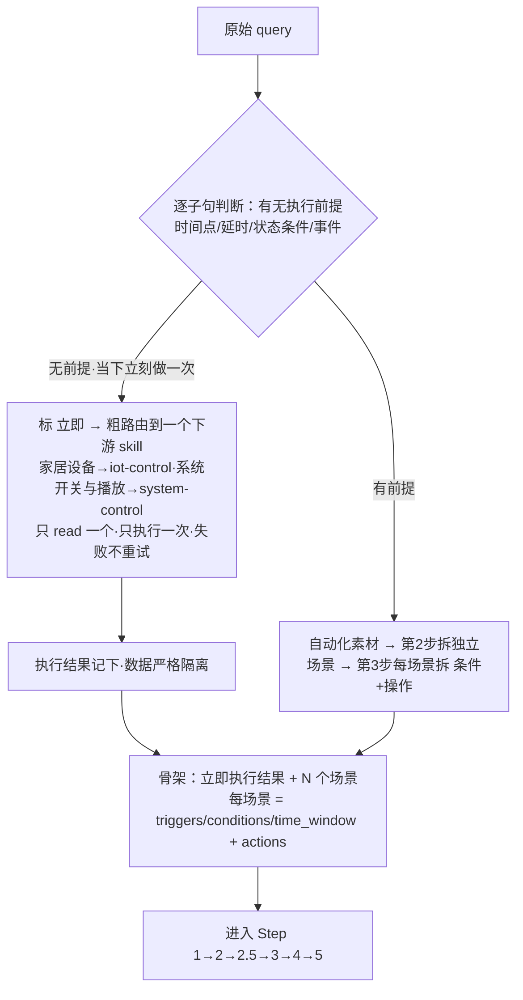
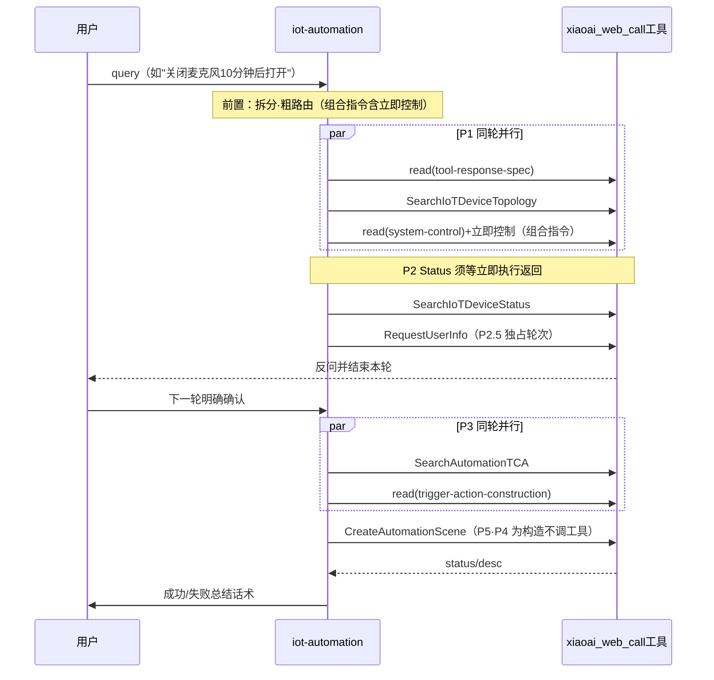
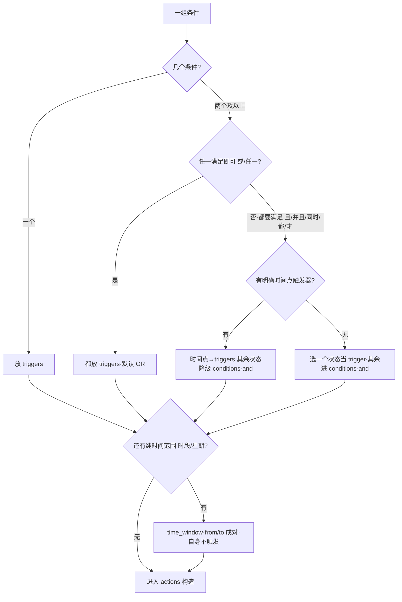

# iot-automation 精读 — 家庭自动化任务规划（六步创建流程）

> **读者**：第一次接触 `xiaoaiclaw-ops/skills/iot-control` 与 `xiaoaiclaw-ops/skills/iot-automation` 两个 skill 的开发同学（自学用）。**性质**：学习笔记 / 索引，事实细节**最终以源文件为准**；关键结论后标注出处（repo-root 相对路径:行号），拿不准处标注「待确认」。
> **工具调用语法**：业务工具统一经 `xiaoai_web_call` 调用（XML 模板），本文用伪语法 `xiaoai_web_call(name=…, params=…)` 表达，语义等价（xiaoaiclaw-ops/skills/iot-automation/SKILL.md:164）。
> **出处缩写**：`SKILL`=`xiaoaiclaw-ops/skills/iot-automation/SKILL.md`；`trs`=`…/references/tool-response-spec.md`；`tac`=`…/references/trigger-action-construction.md`；`dd`=`…/references/delay-and-duration.md`；`ec`=`…/references/error-codes.md`；`ex`=`…/references/examples.md`；`ctl`=`xiaoaiclaw-ops/skills/iot-control/SKILL.md`（`…`=`xiaoaiclaw-ops/skills/iot-automation`）。例：`SKILL:123` = `xiaoaiclaw-ops/skills/iot-automation/SKILL.md:123`。

---

## 1. 定位与触发判别

### 1.1 定位

把用户的**触发式 / 场景化**需求解析为米家自动化创建请求（条件 `triggers`/`conditions` + 操作 `actions`），依赖工具实时获取设备拓扑、状态与可用 TCA 能力，最终调用 `CreateAutomationScene` 创建自动化场景（`xiaoaiclaw-ops/skills/iot-automation/SKILL.md:10`、`:11`）。

### 1.2 判别要点：「条件→动作」vs「立即执行一次」

| 维度 | iot-automation | iot-control / system-control |
|---|---|---|
| 结构 | 存在一个**作为执行前提的触发条件**（条件→动作结构）（SKILL:4） | **当下无条件、立即执行一次**（SKILL:4） |
| 典型话术 | "温度超28度就开空调"、"每天7点开灯"、"10分钟后关灯" | "打开客厅灯"、"空调调低2度"、"空调几度"（SKILL:31-32） |
| 交付物 | Step 5 后的文本结果（创建成功/失败话术）（SKILL:125） | 当场执行 / 查询结果（ctl:29） |

一句话区分：**iot-control/music/system-control 是"当下立刻执行一次"，iot-automation 是"满足条件时自动执行"**（SKILL:4）。

### 1.3 时间类归属判据（定时 / 延时 / 时长都适用）

**看动作是否操作设备**（`xiaoaiclaw-ops/skills/iot-automation/SKILL.md:35`）：

| 动作性质 | 归属 | 例子 |
|---|---|---|
| 操作设备 | **本 skill**（含单次定时、延时、时长） | "每天7点开灯"、"明早8点开一次空调"、"10分钟后关灯"、"打开空调5分钟"（=开后5分钟关）（SKILL:36） |
| 只提醒人、不碰设备 | `reminder` | "定个7点闹钟"、"10分钟倒计时提醒我"（SKILL:37） |
| 点名音箱做播报（`notify_speaker`） | **本 skill**（属操作设备） | 见 ex § 示例 D（SKILL:38） |

- 不属于本技能：当下无条件立即执行一次的设备控制/场景、查当下状态（"打开客厅灯"、"空调调低2度"、"有点冷帮我调节一下"、"我要看电影了把氛围弄一下"、"空调几度"）→ `iot-control`；查资讯/事实/新闻/行情 → `ai-search`（SKILL:4）。

### 1.4 管理类（查 / 改 / 删已有自动化）三类不支持话术

以下三类**仍归本 skill，但不创建**，必须用话术提示用户去米家 App 处理；不要基于对话历史、记忆或"我的记录"列出任务（`xiaoaiclaw-ops/skills/iot-automation/SKILL.md:27`、`:44`）：

| # | 请求类型 | 回复话术（原文） |
|---|---|---|
| 1 | 查询已创建的自动化任务 | `我没法直接查询米家 App 里的完整自动化列表，建议你在米家 App 里确认一下哪些实际生效了。`（SKILL:47） |
| 2 | 修改 / 删除已创建的自动化 | `暂不支持修改或删除已创建的自动化，你可以在米家 App 里手动修改或关掉它。`（SKILL:50） |
| 3 | TCA 查询无对应能力 | `这个设备暂不支持这样的自动化，建议你在米家 App 里手动创建。`（SKILL:53） |

- 第 2 类的关键判据：**只要已经执行到 `CreateAutomationScene`，无论创建成功还是失败**，后续引用"刚刚那个 / 上次那个 / 已创建的"要求改/删，都用不支持话术（SKILL:49）。
- 第 3 类：**不要**尝试其他工具，也不要提示用户"用文本指令 / 语音指令操作一下"等替代方案（SKILL:52）。

### 1.5 路由判别优先级（定时/条件结构 > 播放类动作关键词）

⚠️ 当 query 同时包含"定时/条件表达"和"播放音乐/视频"时，**以触发条件结构为第一判据**（`xiaoaiclaw-ops/skills/iot-automation/SKILL.md:4`）：

1. 存在『每天/每周/工作日 + 时间点 + 设备操作』结构 → 归 iot-automation，**不因动作关键词**（播放音乐/看视频）归入 `music-search-play` / `video-search-play`。
2. 播放控制类（暂停/继续/停止播放/下一首）一旦带**延时/时长/定时**成分（如"暂停播放10分钟"、"音乐继续播放10分钟"、"1小时后停止播放"）→ 归 iot-automation，**不因"暂停/继续/播放"关键词**归入 `music-search-play` / `system-control`；立即那半（暂停/继续）在前置交 `system-control` 执行，延时那半建成定时任务（SKILL:4）。
3. 带房间名**不改路由**："暂停主卧音箱播放歌曲，3小时后再继续播放"——带房间名的「主卧音箱」**整句归本技能**；立即那半连同房间+设备名一起交 `system-control`（SKILL:102-103）。

---

## 2. 前置：意图理解与任务调度

收到 query 后按**固定顺序**处理，**不可跳步**（`xiaoaiclaw-ops/skills/iot-automation/SKILL.md:57`-`:59`）。



### 2.1 第 1 步：剥离「立即执行」部分 + 粗路由

逐子句判断：**这个动作有没有执行前提（时间点 / 延时 / 状态条件 / 事件）？**（SKILL:63）

- **没有前提、要求当下立刻做一次** → 标 `[立即]`，把立即部分**整体**按类型粗路由到**一个**下游 skill（SKILL:65）：
  - 家居设备控制（灯/空调/窗帘/扫地机/风扇…）→ `read` **iot-control**；
  - 系统开关与播放控制（麦克风/音量/亮度/勿扰/暂停/继续/下一首…）→ `read` **system-control**。
- 执行纪律（SKILL:65，一条都不能松）：**只 read 一个、只执行一次**，失败**不重试、不改调其他 skill**；**只执行拆分出的立即指令，不得新增 / 改写 / 扩充**；执行成败先记下，留到 **Step 2.5** 告知用户。
- **有前提** → 留作「自动化素材」，进第 2 步（SKILL:66）。

### 2.2 数据隔离规则（关键）

立即部分是**独立子任务**：`read` 下游 skill 只为完成它、执行完即结束；**它 read 到的设备 / 状态数据、执行结果都不得被自动化流程复用或影响**——自动化部分照旧从 Step 1 重新、完整地走 Step1→2→2.5→3→4→5，**不得因为前置执行过立即部分就跳步、借用其设备数据或改变创建逻辑**（`xiaoaiclaw-ops/skills/iot-automation/SKILL.md:68`）。

- 调度上：立即部分的 `read(下游 skill)` + 控制调用与自动化的 `Topology` **同轮并行**，但**数据流严格隔离**；立即执行结果**仅在 Step 2.5 转述**，不流入自动化数据（SKILL:68、163）。

### 2.3 第 2 步：把自动化素材拆成独立场景（单 / 多）

数一数有几组**互相独立的「触发 → 动作」**（一条自动化 = 一组）（SKILL:70-75）：

- **多场景**：不同触发时机各配不同动作（"早7点开灯" + "晚10点关灯"）→ Step 2.5 提示用户这是多个自动化、建议分开，确认后**逐个**调用 `CreateAutomationScene`（一次只创建一个），不要塞进同一场景（SKILL:74）。
- **单场景多 action**：同一触发下的多个动作（"到家就开灯、开空调"）→ 一条自动化多个 action（SKILL:75）。

### 2.4 第 3 步：每个场景内拆「条件 + 操作」

- **条件**（什么时候 / 满足什么）→ 再分三类：触发点 `triggers[]` / 守卫 `conditions[]`(+`condition_relation`) / 生效区间 `time_window`（判别见 §8）；多条件区分 OR 触发还是 AND 守卫（SKILL:79）。
- **操作**（做什么）→ 按动作粒度拆开，**一个也别漏**；模糊表达翻译成可执行操作（"弄暖和些"→"提高室温/开暖气"）（SKILL:80）。
- **产出骨架**：`[立即部分执行结果]` + N 个场景，每场景 = `{triggers / conditions / time_window}` + `{actions[]}`，即 Step 1→5 的输入（SKILL:82）。Step 2 的 `refined_request` 列表即由这些**条件项 + 操作项**改写而来（SKILL:107）。
- 标注 `[条件] …` / `[操作] …` / `[立即→…] …` **仅为示意、不是真实函数调用**，拆分文字不必与原 query 逐字一致（SKILL:84）。

### 2.5 组合指令拆分示例（立即 + 延时/定时）

原文见 `xiaoaiclaw-ops/skills/iot-automation/SKILL.md:88`-`:104`：

| query | 拆分 |
|---|---|
| 关闭麦克风，10分钟后打开 | `[立即→system-control]` 关闭麦克风 ＋ `[自动化]` 10分钟后打开麦克风 |
| 打开客厅灯，30分钟后关闭 | `[立即→iot-control]` 打开客厅灯 ＋ `[自动化]` 30分钟后关灯 |
| 暂停播放10分钟 | `[立即→system-control]` 暂停播放 ＋ `[自动化]` 10分钟后继续播放 |
| 音乐继续播放10分钟 | `[立即→system-control]` 继续播放 ＋ `[自动化]` 10分钟后暂停播放 |
| 暂停主卧音箱播放歌曲，3小时后再继续播放 | `[立即→system-control]` 暂停主卧音箱播放（带房间名的「主卧音箱」整句归本技能，立即那半连同房间+设备名一起交 system-control）＋ `[自动化]` 3小时后继续播放（Step 3 取 label 含"继续 / 恢复"的 action tca_id，**不是**停止 / 暂停）（SKILL:102-103） |

> **相反动作规律**：组合指令两半是一对相反动作（暂停↔继续、开↔关、播放↔停止），自动化那半别建成同一动作（§7.3、§10）。
> 更多拆分示例（模糊表达 / 推荐类 / 意向性表达）见 `xiaoaiclaw-ops/skills/iot-automation/references/examples.md:179`-`:207`。

---

## 3. 六步工具链总览与调度矩阵

### 3.1 六步工具链总览表

主干六步（组合指令时前置另 `read` 下游 skill 并调其工具，见 §2.1）（`xiaoaiclaw-ops/skills/iot-automation/SKILL.md:113`-`:135`）：

| 步骤 | 调用（工具用途） | 输入（来自） | 输出（喂给下一步） |
|---|---|---|---|
| 前置 | 理解拆分；组合指令先 `read` 一个下游 skill 执行立即部分 | 原始 query | `[条件]`+`[操作]` 拆分 list（+立即部分执行成败） |
| Step 1 | `SearchIoTDeviceTopology`（查询家庭设备拓扑） | 无参 | 家庭/房间/设备树 → 候选 `real_did` |
| Step 2 | `SearchIoTDeviceStatus`（在线状态与当前属性值） | `refined_request` + 候选 `device_id_list` | 只判 `online`、保留 `online=true` → 在线可用 `real_did` |
| Step 2.5 | `RequestUserInfo`（向用户确认/追问） | Step2 命中设备 + 拆分条件 | 确认（**必经**）；环境不支持则提示失败、终止 |
| Step 3 | `SearchAutomationTCA`（查询设备自动化能力） | **确认后**的 `device_id_list` | `data.answer` JSON 字符串 → `models[]` 的 triggers/actions spec |
| Step 4 | 构造（不调业务工具） | query + Step2 状态 + Step3 spec + 系统 trigger 契约 | `CreateAutomationScene` 请求 JSON |
| Step 5 | `CreateAutomationScene`（创建自动化场景） | Step 4 请求 JSON（`request_id`/`props` 由 Claw 自动注入） | 检查 `data.status`，回复成功/失败文本 |

> ⚠️ **六步必走、缺一不可**：Step 1→2 取设备/状态 → **Step 2.5 必须先 `RequestUserInfo` 跟用户确认** → 确认后再 Step 3 查 TCA → Step 4 构造 → Step 5 创建（`xiaoaiclaw-ops/skills/iot-automation/SKILL.md:123`）。
> ⚠️ **多任务跳步禁令**：同一对话创建多个自动化时，**每个任务都必须从 Step 1 重新完整走流程**；无论前面是否查过拓扑/状态/TCA、也无论有无相似历史 session 记录，都**不得**跳步或复用上一个任务的中间结果（session 历史中的 `real_did`/`tca_id`/`spec` 可能已过时），否则参数错位（SKILL:124）。
> 本 skill 的**最终交付物是 Step 5 后给用户的文本结果**；唯一例外是 Step 2.5 的反问确认 / 失败提示。成功只表示自动化已下发到米家侧，**不代表设备动作已立即执行**（SKILL:125）。

### 3.2 依赖弧（P1→P2→P2.5→P3→P4→P5）

（`xiaoaiclaw-ops/skills/iot-automation/SKILL.md:141`-`:147`）

- **P1→P2**：`SearchIoTDeviceStatus` 依赖 `SearchIoTDeviceTopology` 的 `device_id_list` + 前置 `refined_request`；组合指令时 P2 须等立即执行返回（读动作后状态）。
- **P2→P2.5**：确认内容依赖 Status 过滤结果 + 环境属性值。
- **P2.5→P3**：`SearchAutomationTCA` 依赖**确认后**的 `device_id_list`（人为门控，**禁预取**）。
- **P3→P4**：构造依赖 TCA spec（`tca_id`/`value_kind`/`range`/`options`）+ construct 规格；construct 无数据依赖、与 TCA 并行安全，两者同轮到达后 P4 拼合。
- **P4→P5**：`CreateAutomationScene` 依赖请求 JSON。

### 3.3 调度矩阵（强制参照）

同一单元格内 `+` 必须**同轮并行**；跨列顺序执行；`×N`=多场景各发、`×1`=同轮合并一次（`xiaoaiclaw-ops/skills/iot-automation/SKILL.md:149`-`:155`）：

| 路径 | 判定 | P1 检索 | P2 解析 | P2.5 确认 | P3 能力 | P4 构造 | P5 创建 | 示例 |
|---|---|---|---|---|---|---|---|---|
| 定时/事件 | 无立即部分 | `read(spec)`+`Topology` | `Status` | `RequestUserInfo` | `TCA`+`read(construct)` | 构造 | `Create` | 每天7点开灯 |
| 组合指令 | 含立即部分 | `read(spec)`+`Topology`+`read(下游)`+立即控制 | `Status`（须等立即返） | `RequestUserInfo` | `TCA`+`read(construct)` | 构造 | `Create` | 关麦克风,10分钟后开 |
| 多场景(同轮) | N 独立触发-动作 | `read(spec)`+`Topology`×1+[立即] | `Status`×N | `RequestUserInfo`×1 | `TCA`×N+`read(construct)`×1 | 构造×N | `Create`×N（逐个） | 早7点开灯+晚10点关灯 |

缩写（SKILL:157）：`spec`=`references/tool-response-spec.md`；`construct`=`references/trigger-action-construction.md`；`下游`=iot-control/system-control SKILL。

> **`read(construct)` 并入 P3 轮（与 TCA 同轮并行），不放 P1**：construct 是 P4 构造规格（静态、无数据依赖），P3 紧邻 P4；与 TCA 同轮读可把本地文件读藏进 TCA 网络往返，且避开 P1→P4 四阶段跨度的上下文蒸发风险；仅在 P2.5 确认后才读，用户中止则不浪费（SKILL:159）。



### 3.4 P1 / P3 启动与禁止模式

**P1 启动规则**（SKILL:161-164）：
- `read(tool-response-spec)` 与 `SearchIoTDeviceTopology` **必须同轮并行**（禁止拆轮）；spec 全文一次读，覆盖 P1/P2/P3/P5 各步响应解读。
- 组合指令：`read(下游 skill)` + 立即控制调用与 `Topology` **同轮并行**；立即结果仅在 P2.5 转述。
- 所有工具经 `xiaoai_web_call` 统一调用。

**P3 启动规则**（SKILL:166-167）：
- `read(trigger-action-construction)` 与 `SearchAutomationTCA` **必须同轮并行**（禁止拆轮）；P4 构造所需全部字段规格（Schema/白名单/系统 trigger 表/时间映射）以该文件为准。

**P1/P3 禁止模式**（SKILL:169-174）：
- `read(tool-response-spec)` 单独一轮；
- `read(trigger-action-construction)` 单独一轮，或与 TCA 拆成两轮；
- 先查 `Topology` 再判断是否需要立即执行；
- 组合指令把立即执行排到 `Topology` 之后轮次。

### 3.5 独占轮次禁令与同轮多场景规则

**独占轮次禁令**：`RequestUserInfo`（P2.5）独占一轮，禁与 `SearchIoTDeviceStatus`/`SearchAutomationTCA`/`CreateAutomationScene` 并行；**发问即结束本轮**（`xiaoaiclaw-ops/skills/iot-automation/SKILL.md:175`、`:240`）。
**同轮多场景规则**（SKILL:177-181）：
- `SearchIoTDeviceTopology` 同轮只发**一次**（无参全量，设备树在该轮不变）；
- `Status`/`TCA`/`Create` 各场景独立发起；
- P2.5 可合并**一次**确认（告知用户为多个自动化、建议分开）；
- P5 仍**逐个**创建（护"同请求最多 2 次"重试计数语义）；
- 跨轮创建多自动化：一律从 P1 全量重走，**禁复用历史 session 的 `real_did`/`tca_id`/`spec`**。

---

## 4. Step 1 拓扑与就近原则 / Step 2 在线过滤

### 4.1 Step 1 — 查询家庭设备拓扑

调用 `SearchIoTDeviceTopology`（**无参**）获取用户全部家庭 → 房间 → 设备（`xiaoaiclaw-ops/skills/iot-automation/SKILL.md:185`）。调用时 `params` 可省略；**禁止**传 `refined_request`、`device_id_list` 等业务字段（trs:21）。

- **envelope 解读**：`code` 是**字符串** `"200"`（非数字），判断成功用字符串比较；`data.answer` 是 **JSON 字符串**，必须 `JSON.parse` 后读 `homes[]`（trs:16-17、SKILL:188）。
- 响应为 `homes[]`/`rooms[]`/`devices[]` **三层嵌套**；`devices[].real_did` 是后续 `device_id_list` 的**唯一来源**（trs:36-39）。
- ⚠️ **设备对象本身不含 `room_id`/`home_id`**：房间/家庭归属只能靠**嵌套层级**推断（trs:45）。
- 据此把调度 list 里提及的设备/场景映射到候选 `real_did`（模糊/推荐类按品类+房间圈选候选集）；家庭/房间归属可结合家庭名、房间名与设备名的语义常识推理（SKILL:190-191）。

**就近原则（拿到拓扑后必做）**：找出带 `caller_device_type` 的设备（= 当前对话音箱），再由它**在拓扑里的嵌套位置**定位另外两项（`xiaoaiclaw-ops/skills/iot-automation/SKILL.md:193`）：

| 项 | 取法 |
|---|---|
| 默认对话设备 | 带 `caller_device_type` 的那台设备（`real_did`） |
| 默认房间 | 该设备外层的 `rooms[].id`（+ 房间名） |
| 默认家庭 | 再外层的 `homes[].id`（+ 家庭名） |

- 输出一句结论，例如：`默认对话设备=卧室音箱(real_did=1176661753)，默认家庭=2952142471(home_id=302001650709)，默认房间=卧室(room_id=302001650868)`；三者用作：到家/离家的 `home_id`、就近选播报音箱、用户没点名位置时的默认操作位置（SKILL:198）。
- **`home_id` 用途**：到家/离家 trigger（`T:location.enter_fence` / `T:location.leave_fence`）必须填 `home_id`，取值来自 Step 1 拓扑中对应家庭的 `id`（SKILL:200）。
- **异常终止**：若没有任何带 `caller_device_type` 的设备（定位不到对话音箱）→ **不要臆造默认家/房间**，留到 Step 2.5 让用户确认（SKILL:201）。
- **Step 1 异常处理**：返回空（`homes[]` 为空或无任何设备）、返回错误码、或工具调用异常 → **终止流程**，`RequestUserInfo` 告知"未查询到家庭设备信息，无法创建自动化"，不得凭记忆或猜测继续（SKILL:203）。

### 4.2 Step 2 — 查询设备状态（在线状态 + 当前属性值）

对候选设备调用 `SearchIoTDeviceStatus`（`xiaoaiclaw-ops/skills/iot-automation/SKILL.md:205`-`:233`）：

- 入参（SKILL:209-210）：
  - `refined_request`：把 query 拆成的「条件任务 / 操作任务」**标准化子查询列表**（与前置调度 list 对应，**不要遗漏任何一项**）；
  - `device_id_list`：候选设备 `real_did` 列表（来自 Step 1）。
- **在线过滤——只看 `online`，不看功能**（SKILL:216、222-227）：
  - `online=true` → 在线，保留；`online=false` → 离线，**过滤掉不参与**，按"设备不可用"处理；
  - **不在本步判断功能能力**：不要因 `service_list` 为空、找不到 `spec_id`、或 `access` 非 `读写` 就判不支持——会造成误杀（音箱播放/暂停等能力不体现在 `service_list` 里）（SKILL:227）。`access` 为中文 `只读`/`读写`，**不作为是否可纳入自动化的判据**（trs:95）。
- **环境传感器以数据为准**（SKILL:218）：状态里出现的环境数值属性（温度/湿度/PM2.5/光照/CO₂ 等）**即代表该传感器真实存在**，是可用的触发源候选，必须带入 Step 3 交 TCA 裁定合法值；**不得因品类常识排除**（例：空调状态报了湿度值 → 这台空调能感知湿度，可作湿度触发源）。
- **能力留给 TCA / 系统 trigger 场景仍须走本步**：是否支持目标操作统一由 Step 3 裁定（SKILL:216、227）；即使触发器是系统级（`T:location.*`/`T:timer.*`/`T:cloud.*`），actions 涉及的设备仍必须验证在线（SKILL:214）。
- **命中结论**（SKILL:229-231）：候选全部 `online=false` → 告知"当前设备离线不可用，无法创建自动化"（进 Step 2.5 情形 4）；有在线设备 → 进 Step 2.5。离线导致意图无法实现时须明确告知并建议检查联网/换设备（SKILL:220）。
- **Step 2 异常处理**：返回空（查询设备全部无状态数据）、返回错误码、或工具调用异常 → **终止流程**，告知"未查询到设备状态，无法确认设备可用性"（SKILL:233）。

---

## 5. Step 2.5 — 设备 / 条件确认（必经、可多轮）

Step 2 命中判断后、进 Step 3 之前，**必须先用 `RequestUserInfo` 发问，然后结束本轮等用户下一轮回复**——**无论需求是否清晰**都不例外，这是本 skill 唯一允许"本轮不创建"的环节；**可多轮、不限次数**，直到意图完全清楚且用户**明确确认**才继续（`xiaoaiclaw-ops/skills/iot-automation/SKILL.md:237`）。

- **工具**：`RequestUserInfo`，唯一参数 `question_text`（自然语言反问）；**调用前禁止输出任何思考过程/文本**；**只发问、不下结论**：发出即结束本轮，禁止同轮继续调 Step 3/Step 5 工具或输出创建成功（SKILL:239-240）。
- **`question_text` 的「」引号格式**（SKILL:241-245）：
  - `params` 直接是 **JSON 对象** `{ "question_text": "……" }`（别再往外套一层字符串）；
  - 里凡引用**设备名 / 房间名 / 播报内容**，一律用中文直角引号 `「」` **整体包裹**——当作不可改动的原始数据：不改写、不嵌入其它引号、不用英文双引号。
  - 短例：`确认用「客厅空调」制冷到 26 度吗？`；长文例（中英混排/无标点也不拆开，原样包裹）：`每天早上 7 点用「客厅音箱」播报「早上好新的一天希望你元气满满工作fighting」，确认创建吗？`（SKILL:245）

调用模板（SKILL:247-254）：`xiaoai_web_call(name="RequestUserInfo", params={"question_text": "客厅和卧室有空调，默认选择「客厅空调」可以吗？"})`

### 5.1 六种情形（都要停在本轮、等用户回复）

| # | 情形 | 要点 | 例 |
|---|---|---|---|
| 1 | **常规复述**（设备唯一+条件清晰） | 复述设备与条件问"确认创建吗？"；**`T:timer.crontab`（定时/延时）复述必须带具体触发时间点（几点几分）+ 重复频率（每天/工作日/休息日/仅一次/具体周几）**；**事件/状态触发不复述时间点**，改为按「触发类型默认周期语义」表告知默认每天循环（SKILL:258） | `"将设置：客厅温度超过28度就开客厅空调制冷到26度，确认创建吗？"`；`"将设置：每个工作日早上7点拉开窗帘、开灯，确认创建吗？"`（SKILL:259-260） |
| 2 | **设备消歧**（多候选→给默认+确认） | 多个同品类命中 → 按优先级选默认再反问，**并告知可怎么改选**。默认优先级：**默认房间（对话音箱所在房间）的设备 > 客厅 > 第一个在线设备**；**播报音箱就近原则**：默认房间的音箱 > 触发涉及的房间 > 客厅 > 第一个在线音箱（SKILL:261-263） | `"客厅和卧室都有空调，默认用客厅的，要换成卧室的话告诉我，确认吗？"` |
| 3 | **条件澄清**（条件模糊/缺参数→追问补全） | 常见缺参：温度/湿度阈值、房间、**时间信息（仅定时/延时触发适用）**；**仅当触发器是 `T:timer.crontab`** 且用户只说"早上""定时"等模糊时间时，才追问到可落成 `time`+`repeat`；**事件/状态触发不追问时间**，告知默认每天循环即可（SKILL:265） | `"客厅温度超过多少度时帮你开空调？常见设到28度左右，你看多少合适？"`；`"这个想每天都执行，还是只工作日？大概几点触发，比如早上7点？"` |
| 4 | **可行性失败**（不进 Step 3、不调创建） | 两种：① 目标设备**全部离线**；② **品类不匹配、无法形成合理默认**（要"制冷降温"但只有风扇；多房间品类不一致）→ 提示失败**并告知该怎么做**（SKILL:268-272） | `"要操作的空调当前处于离线状态，没法为它创建自动化。你可以检查下它的联网，或换一个在线的设备。"`；`"这个房间只有风扇没法制冷，没法按降温创建。你想改用风扇吹风，还是指定一个有空调的房间？"` |
| 5 | **默认家/房间的告知与确认** | 按家庭数量+能否定位分三支：多家庭（能定位）→ 明确告知默认家+默认房间；**只有一个家庭（能定位）→ 直接在该家操作，不用再提"默认家"**，只关注默认房间；定位不到对话音箱 → 让用户确认优先操作哪个家/房间（SKILL:275-280） | `"你有多个家，默认在【我的家】的【客厅】操作，确认吗？想换到别的家或房间告诉我。"`；`"没识别到你正在用的音箱，想在哪个家、哪个房间操作？"` |
| 6 | **组合指令的立即部分结果告知** | 立即部分已在前置执行过；确认自动化的同时**把立即执行结果一并告知**：成功说已执行、失败提示手动操作，再请用户确认延时/定时自动化（SKILL:281-283） | 成功：`"已经帮你关闭麦克风了。接下来「10分钟后打开麦克风」我给你设成定时任务，确认吗？"`；失败：`"刚才关闭麦克风没成功，你可以手动关一下。要继续帮你创建「10分钟后打开麦克风」的定时任务吗？"` |

- **注**：设备**具体能力**是否支持目标操作（如空调有没有"制冷"TCA）属 Step 3 的可行性失败分支；本步只处理"离线"和"品类明显不匹配"（SKILL:273）。"设备是否具备某传感器/环境感知触发能力"**不属本步可判的品类失败**——一律留给 Step 3 裁定（SKILL:274）。
- **收到下一轮回复后**（SKILL:285-287）：意图清楚且用户**明确同意创建** → 用确认后的 `real_did` 与条件继续 Step 3→4→5；用户否定/改选/补充但仍未敲定 → **继续留在 Step 2.5** 再次追问，**不限轮数**。

---

## 6. Step 3 — 查询可用 TCA 能力

对 **Step 2.5 确认后**需要参与设备 trigger / 设备 action 的设备调用 `SearchAutomationTCA`（不要再把全部候选设备传进来）；系统 trigger 本身不需要查 TCA，但只要存在设备 action，仍要查该设备的 action spec（`xiaoaiclaw-ops/skills/iot-automation/SKILL.md:291`）。

- **入参**（SKILL:294-295）：只关注 `device_id_list`，**最多 10 个**；每个 `real_did` 必须来自 Step 1 返回，**禁止编造/猜测/凭记忆或 session 历史填写**；**为空时服务端按 user 维度查全部设备，不要默认空传**。
- **响应解读**（SKILL:297、trs:165-167）：envelope **优先取 `data.data.answer`**（其次 `data.answer`，最后 `data`），它是 JSON 字符串必须 `JSON.parse` 得 `models[]`；**不要按 mock 的 `data.devices`/`data.system_triggers` 读取**。按 **model 维度**返回，同 model 多 did 共用一套 triggers/actions，`dids` 列出适用设备（trs:167）。
- 字段（trs:209-217）：`tca_id` 形如 `T:{sc_id}`（trigger/condition）/ `A:{sa_id}`（action）；`value_kind`=`enum`/`range`/`bool_simple`/`event`；`triggers[].operators[]` 仅 range 用（`1=≥`/`2=≤`/`3==`/`4=介于`）；`options[]` 是 enum/bool_simple/带参 event 的 `vid` 合法值；`range`=`{min,max,unit,step,default}`。

### 6.1 合法值唯一来源

**Step 3 是设备类合法值的唯一来源**：设备 trigger/action 的 `tca_id / operator_vid / vid / value / min / max` 必须来自这里返回的 spec 并满足范围约束，**禁止臆造**（`xiaoaiclaw-ops/skills/iot-automation/SKILL.md:299`）。设备类 tca_id 是服务端分配的不透明 ID，文档示例值仅为示意（SKILL:437）。

### 6.2 语义匹配与三类判定分支

- **先做语义匹配再判定（穷举 options）**：把用户措辞按**语义/近义**对到服务名与 option `label`，**必须穷举所有 options 找最贴近项**——"除湿模式"→服务"模式调整"里 `label:"除湿"`(`vid:2`)、"制冷"→`label:"制冷"`、"打开"→`label:"开/打开"`。用户措辞与 `label` 字面不一致是常态，**不得因字面不同就判不支持**（SKILL:306）。
- ⚠️ **播放控制近义词不可混用**：暂停 / 继续（恢复）/ 停止 / 播放 / 下一首是**各自独立**的 option，一一对应。"继续播放 / 恢复"只能对到 `label` 含"继续 / 恢复"的选项，**绝不可错配成"暂停 / 停止"**；"停止"也不等于"暂停"。目标动作是哪个就取哪个，别被同句里出现过的其他播放动词带偏（SKILL:307）。
- **播报 / 通知 tca_id 一律丢弃**：TCA 可能把音箱的"文本播报 / 语音提醒"或"手机通知 / 发送通知"当作 action 返回（带 `tca_id`），**一律丢弃**——文本播报用 `kind:"notify_speaker"`、手机通知用 `kind:"notify_phone"`。设备 `tca_id` **只用于真正的设备控制动作**（开关/调节/播放指定媒体等）（SKILL:301）。
- **返回空**（目标设备在 `models[]` 中不存在，或 `models` 为空数组）→ **终止流程，走 Step 2.5 可行性失败分支**：告知"该设备暂不支持自动化操作"，**禁止凭猜测编造 tca_id 继续 Step 4/5**（SKILL:304）。
- **返回错误码/工具调用异常** → 终止流程，告知"查询设备自动化能力失败，请稍后重试"（SKILL:305）。
- **穷举后确无语义相近项**（如要"制冷"但 TCA 只有"开/关"）→ 才通过 `RequestUserInfo` 告知该设备实际可用能力，建议替代方案或终止（SKILL:308）。
- **设备控制类意图无对应能力 = 不支持，禁止降级兜底**（SKILL:309）：穷举后确无对应的设备控制 action/trigger → 走「管理类不支持话术 #3」引导去米家 App。**禁止两类兜底**：① 不得改用 `notify_speaker` 播报/念出该功能名——播报改不了设备状态；② 不得把它塞进"文本指令 / 执行文本"类 action tca_id 下发。

---

## 7. 跨 skill 动作判断与系统 trigger 强制映射

当 action 涉及"播报文本 / 语音提醒 / 通知我"、"播放音乐 / 视频 / 歌单"等看似属于其他 skill 的操作时，先按下面三类区分构造方式（`xiaoaiclaw-ops/skills/iot-automation/SKILL.md:311`-`:331`）。

### 7.1 播报 / 提醒 / 通知 → 封装字段，不走 tca_id

- "播报一段话 / 语音提醒我 / 通知我 XX" → 用 `kind:"notify_speaker"`（音箱播报）或 `kind:"notify_phone"`（手机通知），`text` 为播报/通知内容（SKILL:316）。
- **不查、也不使用** Step 3 里可能返回的"文本播报 / 发送通知"类 tca_id（SKILL:317）。
- **边界（关键）**：`notify_speaker` 只是"念一段话给人听"、`notify_phone` 只是"给人发条消息"，**都不改变任何设备状态**；仅当用户意图就是"要设备说 / 提醒 / 通知我某段内容"时才用。若用户要的是**控制设备本身**（开关、调节、进入/退出某模式，如"把音箱调到睡眠模式"）→ 必须走设备控制 TCA；无对应 TCA 时按 Step 3「设备控制类意图无对应能力」判不支持，**绝不能用 `notify_speaker` 念出模式名来假装完成**（SKILL:318、309）。

### 7.2 播放指定媒体（音乐/视频/歌单）→ 走 Step 3 TCA，用 tca_id

1. **仍归本 skill 处理**——只要存在定时/条件触发结构，整个自动化创建流程由 iot-automation 负责；Step 3 验证是否有对应 action TCA（如"播放音乐"的 tca_id）：✅ 有 → 正常构造，使用 TCA 支持的参数（tca_id + 必要的 value/vid）；❌ 无或不支持指定内容（如只能"开始播放"但无法指定"播什么"）→ 用 `RequestUserInfo` 告知局限、建议替代方案（SKILL:322-325）。
2. **禁止假设 TCA 能力**：不得未查 Step 3 就凭通用知识假设音箱"一定能"自动播放特定歌曲/歌单（SKILL:326）。

### 7.3 播放控制五动作：暂停 / 继续 / 停止 / 播放 / 下一首

（SKILL:328-331）
- 五类是**互不相同**的独立设备 action，各有各的 `tca_id`/`vid`，**绝不可互相替代**。成对相反关系：**暂停 ↔ 继续（恢复播放）**、**播放 ↔ 停止**。"暂停"的反动作是"继续"，**不是**"停止"。
- 动作在 query 里被**显式写出**时，按原文那个动作取 TCA——如"3小时后再**继续播放**"，自动化 action 取"继续 / 恢复播放"的 tca_id；不要因为同句前半出现过"暂停"就把自动化半段建成暂停/停止。
- **组合指令"暂停…N小时后继续"**：立即那半=暂停（前置交 `system-control`），自动化那半=**继续播放**（取 label 含"继续 / 恢复"的 tca_id）。反之"继续播放…N分钟后暂停"，自动化半段取"暂停"。

### 7.4 系统 trigger 强制映射（MUST）与反面示例

系统级 trigger 不在 `SearchAutomationTCA` 响应里，可直接构造给 `CreateAutomationScene`（SKILL:333）：

| 用户表达关键词 | 对应系统 trigger | 说明 |
|---|---|---|
| 离家 / 出门 / 离开家 / 不在家 / 出去 / 外出 | `T:location.leave_fence` + `home_id` | GPS 地理围栏，**禁止**用人体传感器/门锁/运动检测等设备 trigger 替代（SKILL:339） |
| 到家 / 回家 / 进门 / 回来了 | `T:location.enter_fence` + `home_id` | GPS 地理围栏，**禁止**用门锁开锁/人体感应等设备 trigger 替代（SKILL:340） |
| 每天/工作日/定时 + 时间点 | `T:timer.crontab` + `time` + `repeat` | 定时触发（SKILL:341） |
| 日出 / 天亮 | `T:cloud.sunrise` | 天文事件（SKILL:342） |
| 日落 / 天黑 | `T:cloud.sunset` | 天文事件（SKILL:343） |

⚠️ **反面示例 1**（SKILL:345）："离家关灯"不得使用人体传感器的"无人移动"作触发器——人体传感器检测的是**单个房间**的移动状态，不代表全家离人；离家/到家场景**必须**用 `T:location.leave_fence` / `T:location.enter_fence`。
⚠️ **反面示例 2**（SKILL:347）："每天晚上九点开启睡眠模式"不得使用设备事件触发器（如音箱播放事件）——用户给出了具体时间点，**必须**用 `T:timer.crontab`（`time:"21:00", repeat:"daily"`）。设备事件是"设备状态变化时触发"，不等于"到了某个时间点触发"。

---

## 8. Step 4 — 构造 CreateAutomationScene 请求

> 进入本步前须已在 P3 轮与 TCA 同轮 `read` `references/trigger-action-construction.md`（未读则先读再构造）：请求 Schema、传参闭合白名单、系统 trigger 表、时间映射约定都在其中，**构造所需全部字段规格以该文件为准**（`xiaoaiclaw-ops/skills/iot-automation/SKILL.md:352`）。

把 query（条件+操作）与 Step 3 的 TCA spec 匹配，构造请求 JSON，**本步不调工具**（SKILL:354）：

- **触发器** → `triggers[]`，必填；多个 trigger 默认 **OR**。⚠️ 这条 OR 是**隐式的、极易被忽略**：`triggers[]` 里放几条就是"任一发生即触发"，**没有 AND 语义、也没有 `trigger_relation` 字段能改**。"两个条件都要成立才执行"（且/并且/同时/都/才）**绝不能都塞进 `triggers[]`**（SKILL:356）。
- **约束条件** → `conditions[]`，可选；结构同 `triggers[]`，用于"且/同时/才"守卫；`condition_relation` 默认 `and`（SKILL:357）。
- **执行动作** → `actions[]`，必填；每个 `[操作]` 至少一条 action（SKILL:358）。
- **生效时段** → `time_window`，可选；只表达创建后何时生效，**不替代定时 trigger**（SKILL:359）。

### 8.1 triggers / conditions / time_window 三者判别表

（`xiaoaiclaw-ops/skills/iot-automation/SKILL.md:363`-`:367`）

| 参数 | 角色 | 多个之间的关系 | 能否多个 |
|---|---|---|---|
| `triggers[]` | **触发条件**：发生即启动自动化 | 默认 **OR**（任一发生即触发） | ✅ 可多个 |
| `conditions[]` | **并列条件**：触发那一刻还须同时成立的守卫（"当…的时候 / 并且 / 才"） | `condition_relation`：`and`=都满足 / `or`=任一满足 | ✅ 可多个 |
| `time_window` | **时间段**：限定整条自动化在哪个时段/星期才允许生效，**自身不触发** | —— | 单个 |

### 8.2 AND/OR 判别口诀与分水岭

（`xiaoaiclaw-ops/skills/iot-automation/SKILL.md:369`-`:377`）

- ⚠️ **先判 AND 还是 OR**：两个及以上条件时，先看是"任一满足即可(或/任一)"还是"都要满足(且/并且/同时/都/才)"。**"都要满足"= AND**，`triggers[]` 做不到 AND（多 trigger 恒 OR），**必须拆成 1 个 trigger + 其余 `conditions[]` + `condition_relation:"and"`**；只有确实"任一即可"才把多条都放 `triggers[]`。
- 谁"发生了就启动" → `triggers`（并列的多个触发点天然 OR，无需 conditions）。
- 谁是"启动后还要同时满足的附加约束" → `conditions`，多条之间的与/或用 `condition_relation`。
- "工作日 / 某时段内才生效"这类**纯时间范围** → `time_window`（不启动任何东西）；**具体触发时间点（如晚上10点）永远用 `T:timer.crontab` 放进 `triggers`**。
- **关键分水岭**：query 里有没有一个明确的"时间点触发器"：
  1. **有明确时间点触发器**（如"10点"）→ 它当 trigger，其余并列项**降级为 `conditions`**（这些项必须是可查询的**状态**，如"锁处于开启""有人在家"，不能是瞬时事件）；
  2. **无时间点触发器，多个真实状态用"并且/同时/都/还"连接** → **选一个状态当 trigger，其余进 `conditions`**，`condition_relation:"and"`；
  3. **无时间点触发器，多个真实事件是"或 / 任一 / 无并列连接词"** → **都当 triggers**（多个 OR）；若另有"工作日/某时段"范围限定，范围进 `time_window`。



### 8.3 触发类型 → 默认周期语义表

用户未明确声明周期时的默认，且 **Step 2.5 必须告知用户默认值**（`xiaoaiclaw-ops/skills/iot-automation/SKILL.md:379`-`:387`）：

| 触发类型 | 未声明周期时的默认 | Step 2.5 必须告知的话术 |
|---|---|---|
| 事件/状态触发（"当…就…""开门就…""没人就…""温度高于…就…"） | **每天循环、长期有效**（每次满足即触发） | "已为您按【默认】设为**每天循环**生效，想改成仅一次可以告诉我" |
| 定时/延时触发（"8点关窗帘""10分钟后关灯"，未说每天/工作日） | **单次**（`repeat:"once"`） | 复述"将创建一个 XX:XX 触发的**一次性**自动化" |
| 用户明确说"每天/每次/工作日/每周几" | 按声明（`daily`/`workday`/ISO 周几） | 复述确认所选周期 |

> "当…就…"这类状态/事件触发**不追问周期与时间点**——它本没有时间点，默认每天循环，只需按上表**告知默认**（SKILL:387）。

### 8.4 请求 Schema 与传参白名单

**请求 Schema 字段总表**（`xiaoaiclaw-ops/skills/iot-automation/references/trigger-action-construction.md:17`-`:25`）：

| 字段 | 必填 | 说明 |
|---|---|---|
| `scene_name` | ✅ | 自动生成的场景名 |
| `triggers[]` | ✅ | 触发器列表；多个之间默认 OR，任一满足即触发 |
| `conditions[]` | ❌ | 守卫条件列表，结构同 `triggers[]`；表达"且/同时/才"等前置约束 |
| `condition_relation` | ❌ | `and` / `or`，默认 `and`；只作用于 `conditions[]` |
| `actions[]` | ✅ | 动作列表；每个独立操作都要落成 action |
| `time_window` | ❌ | 生效时段，只约束生效区间、**自身不触发**。`from`/`to`(HH:MM) **必须成对给全**——全天不限时段写 `from:"00:00"` + `to:"23:59"`，**不可只给 `days`**；`days` 只允许 `workday` / `freeday` / `daily`，默认每天。严禁放定时/日出/日落等触发性时间点（一律进 `triggers[]`） |

**TriggerInput 传参规则**（tac:50-57）：

| 场景 | 必传字段 | 取值规则 |
|---|---|---|
| 设备 range trigger | `real_did`, `tca_id`, `operator_vid` | `operator_vid` 为 `1/2/3` 时传 `value`；为 `4` 时传 `min` + `max` |
| 设备 enum / bool_simple trigger | `real_did`, `tca_id`；**spec 带 `options[]` → `vid` 必填** | spec 提供 `options[]` 时**必须**填 `vid`（取自 `options[]`）；仅当 spec **不含** `options[]` 时才不传 `vid` |
| 设备 event trigger | `real_did`, `tca_id` | 无参事件不传 `vid`；带参 event 且 Step 3 提供 `options[]` 时传对应 `vid` |
| 定时 trigger | `tca_id:"T:timer.crontab"`, `time`, `repeat` | `time` 用 `HH:MM`；`repeat` **仅接受**：`daily` / `workday` / `freeday` / `once`，或 ISO 周几列表/区间 `"1,3,5"`(周一三五) / `"1-5"`(周一到周五) / `"6"`(周六) / `"6,7"`(周末)（1=周一…7=周日）。**禁止英文星期缩写**（Mon/Sat/Sunday 均非法）。"工作日/节假日/休息日"语义用 `workday`（法定工作日，跟随节假日安排）/ `freeday`（法定节假日）；`"1-5"` 等 ISO 周几用于用户点名固定星期几 |
| 到家/离家 trigger | `tca_id`, `home_id` | `T:location.enter_fence` / `T:location.leave_fence` |
| 日出/日落 trigger | `tca_id` | `T:cloud.sunrise` / `T:cloud.sunset` 无附加字段 |

**ActionInput 传参规则**（tac:70-75）：

| 场景 | 必传字段 | 取值规则 |
|---|---|---|
| 设备 range action | `real_did`, `tca_id`, `value` | `tca_id` 为 `A:{sa_id}`；`value` 必须落在 Step 3 `range` 内 |
| 设备 enum / bool_simple action | `real_did`, `tca_id`；**spec 带 `options[]` → `vid` 必填** | 按 label 语义从 `options[]` 选（如「开」→`vid:1`、「制冷」→`vid:1`）——**漏填会 `FAIL_VALUE_INVALID`**；仅当 spec **不含** `options[]`（如 `A:5223 打开窗帘`）时才只传 `real_did` + `tca_id` |
| 手机通知 `notify_phone` | `kind:"notify_phone"`, `text` | 给手机发系统通知；**不传 `real_did`** |
| 音箱播报 `notify_speaker` | `kind:"notify_speaker"`, `real_did`, `text` | 指定音箱播报文本；`real_did` 缺失会 `FAIL_VALUE_INVALID` |

**传参闭合白名单（严格）**（`xiaoaiclaw-ops/skills/iot-automation/references/trigger-action-construction.md:59`-`:66`）：

- Trigger 对象**只允许**对应行列出的字段，禁止添加任何额外字段（tac:61-64）：**`value_kind` 是 Step 3 响应中的描述字段，仅供理解，禁止传入** `CreateAutomationScene`；**`time`/`repeat` 仅限 `T:timer.crontab` 使用**，禁止加到设备 trigger 或 location trigger；`device_id` 不是合法字段，设备标识统一用 `real_did`。
- Action 对象同理：只允许 ActionInput 表中列出的字段。
- 传非法字段会导致 `FAIL_MIOT_REJECT` 或 `FAIL_VALUE_INVALID`。
- **系统级 action 二选一**（tac:77）：`notify_phone`/`notify_speaker` 必带 `kind`、**不传 `tca_id`**、不硬编码 siid/aiid；即使 Step 3 查到"文本播报/发送通知"能力也不用其 tca_id；`notify_speaker` 目标音箱按 Step 2.5 就近原则。

### 8.5 时间条件映射约定

（`xiaoaiclaw-ops/skills/iot-automation/references/trigger-action-construction.md:91`-`:103`）

| 类型 | 去向 | 构造 |
|---|---|---|
| "每天/工作日/休息日/仅一次 + 某时间点" | `triggers[]` | `{"tca_id":"T:timer.crontab","time":"HH:MM","repeat":"daily|workday|freeday|once"}`；指定星期几用 ISO 如 `"repeat":"1,3,5"` |
| "日出/日落时" | `triggers[]` | `T:cloud.sunrise` / `T:cloud.sunset` |
| "到家/离家" | `triggers[]` | `T:location.enter_fence` / `T:location.leave_fence` + `home_id` |
| "8 点到 22 点**之间**生效"这类区间 | `time_window` | `from`/`to` 必须成对写全（`HH:MM`）；只限"工作日/休息日"不限时段时写全天 `from:"00:00", to:"23:59"` + `days` |

- **节假日语义**：`workday`=法定工作日（跟随国家法定节假日安排，节假日放假、调休日照常上班），`freeday`=法定节假日/休息日；`"1-5"`/`"1,3,5"`/`"6,7"` 表示**固定星期几**（tac:97）。
- **边界（关键）**：**真实触发器 + 时间限定 → 时间进 `time_window`**，**不要**再加一个 `T:timer.crontab` 当第二个定时触发——否则会把它变成定时触发，语义就错了（tac:103）。

> ⚠️ **Step 4 不能作为终点**：构造出请求 JSON 后必须立刻进 Step 5 调用 `CreateAutomationScene`；不要只把 JSON 展示给用户就停止（SKILL:393）。

---

## 9. Step 5 — 创建与错误处理

### 9.1 创建

把 Step 4 的完整请求 JSON 原样作为 `CreateAutomationScene` 参数传入（`xiaoaiclaw-ops/skills/iot-automation/SKILL.md:397`）：

- ⚠️ 请求里所有 `real_did`（triggers / actions / `notify_speaker` 目标音箱）**必须是 Step 1 返回过的真实设备 ID，禁止编造 / 猜测 / 拼凑**；找不到对应设备时回退 Step 2.5 追问或告知不支持，不得虚构 ID 硬提交（SKILL:399）。
- **envelope 解读**：响应可能带多层 envelope；**优先取 `response.data.data`，没有时取 `response.data`**，再判断其中的 `status`（SKILL:403、trs:232）。
- **必须等真实返回响应体后再读 `status`/`desc` 判断成败——工具未返回前禁止预先输出"创建成功/失败"**（SKILL:403）。

响应示例（trs:234-243，业务对象 `data` 内判 `status`）：

```json
{"code": "200", "msg": "请求成功",
 "data": {"scene_id": 1234567, "status": "SUCCESS", "desc": "自动化已创建"}}
```

### 9.2 成功 / 失败话术

**无论成功或失败，流程最后都必须给用户一段总结回复**（`xiaoaiclaw-ops/skills/iot-automation/SKILL.md:405`-`:409`）：

| 结果 | 判据 | 话术 |
|---|---|---|
| 成功 | 解析后业务对象 `status="SUCCESS"` | `帮你创建自动化任务成功：{scene_name}`，可顺带简述触发条件与执行动作 |
| 失败 | `FAIL_*` / 缺少 `status` / 工具异常 | `创建自动化任务失败：{desc 或错误原因}。当前暂不支持该自动化，你可以在米家 App 里手动设置。` |
| 未走到创建 | Step 2 判离线 / Step 2.5 或 Step 3 判不支持 | 也要给总结回复，说明原因（离线/不支持）并提示去米家 App 手动设置（SKILL:409） |

### 9.3 错误码与重试上限

（`xiaoaiclaw-ops/skills/iot-automation/references/error-codes.md:3`-`:16`；SKILL:413）

| 错误码 | 含义 | 处理 |
|---|---|---|
| `FAIL_TCA_NOT_FOUND` | tca_id 在该设备的 TCA 列表中不存在 | **回退 Step 3** 重新查该设备 TCA；确认无 TCA 则告知设备不支持。**禁止凭猜测换 tca_id 重试** |
| `FAIL_MIOT_REJECT`（AppSceneService Edit failed） | 平台拒绝该自动化配置 | **不重试同一 trigger 结构**。检查：① trigger 类型是否正确（离家/到家用系统 trigger 而非设备 trigger）；② trigger 参数是否含非法字段。确认均正确仍被拒 → **终止并报告失败** |
| `FAIL_VALUE_INVALID` | 参数值超出范围或格式错误 | 检查 value/vid 是否超出 Step 3 spec 的 range/options，修正后**重试 1 次** |
| 其他 `FAIL_*` / 工具异常 | 未知错误 | **不重试**，直接报告失败 |

**硬性规则**：
- 同一个 `CreateAutomationScene` 请求（含参数微调），**最多调用 2 次**（首次 + 1 次重试）；超过 2 次 → 终止流程，向用户回复失败话术。
- 收到 `FAIL_MIOT_REJECT` 后，**禁止仅改参数细节**（如加 `value_kind`、`time`、`home_id` 等字段）反复尝试——这类错误表明结构本身被拒；重试必须有**实质性结构变更**（如更换 trigger 类型、更换设备），而非仅调整字段。

---

## 10. 延时 / 时长语义要点

（`xiaoaiclaw-ops/skills/iot-automation/references/delay-and-duration.md`）

- **前提**：`T:timer.crontab` 仅支持**绝对时间点（HH:MM）**触发，不支持"从当前时刻起延迟 N 秒/分钟/小时后触发"（dd:3）。
- **识别特征**："N秒后""N分钟后""N小时后""半小时后""一会儿"等相对时间 + 设备操作（dd:5）。

### 10.1 延时 → 绝对 HH:MM

| 条件 | 处理（dd:17-22） |
|---|---|
| 延时 **≥1分钟 且 ≤24小时**、可确定当前精确时间（来自 system prompt 时间信息） | **换算绝对时间**：当前时间 + 延时 → 目标 HH:MM，构造 `T:timer.crontab` + `repeat:"once"`；必须向用户复述"我将创建一个 XX:XX 触发的一次性自动化"，确认后创建 |
| 延时 **< 1分钟**（秒级，如"14秒后""30秒后"） | **不支持**（crontab 精度为分钟级）。`RequestUserInfo` 回复：`当前自动化暂不支持秒级定时，建议直接对设备说"XX秒后关闭"或在米家 App 中设置` |
| 无法确定当前精确时间 | **追问**：询问用户希望几点执行，转为绝对时间处理 |
| 延时 **> 24小时** | **不支持**（换算后已跨天、意图可能变化且无法验证）。`RequestUserInfo` 回复：`当前自动化暂不支持超过24小时的延时触发，建议在米家 App 中设置` |

- **流程定位**：延时类仍走正常六步；支持 case 在 Step 2.5 复述绝对时间确认，不支持 case（<1min 或 >24h）在 Step 2.5 情形 4 告知并给替代建议（dd:24）。
- **示例**（dd:27-30）："10分钟后关灯"当前 14:30 → `{"tca_id":"T:timer.crontab", "time":"14:40", "repeat":"once"}`；"14秒后停止播放"、"25小时后关空调" → 不支持。

### 10.2 时长 = 起始动作 + 相反动作

query 出现"操作 + 持续时长"（"打开空调5分钟""开风扇半小时""每晚10点开加湿器2小时"）→ 拆成**起始动作**（原操作）+ **结束动作**（起始动作的**相反动作**），结束触发时刻 = 起始时刻 + 时长（dd:7）：

- **相反动作按操作类型正确取反，别一律写成"关闭 / 停止"**：开 ↔ 关、播放 ↔ 停止、**暂停 ↔ 继续（恢复播放）**；若 query 已把结束动作**显式写出**（如"暂停…3小时后继续播放"里的"继续播放"），直接用原文动作（dd:7）。
- **起始是"当下立即"**（无定时词，如"打开空调5分钟"）→ 起始那半在前置立即执行（走 iot-control / system-control），本 skill 只建**结束**那条 `repeat:"once"` 一次性延时自动化（dd:9）。
- **起始是"周期定时"**（带每天/工作日/每周几+时间点）→ 起始、结束都是 `T:timer.crontab` **周期自动化**，是**两条独立自动化**（按多场景逐个创建），结束继承起始的周期（dd:10）。
- **跨天规则（必算）**：结束钟点 = 起始钟点 + 时长，若 ≥ 24:00 则对 24h 取模落到次日；**一旦落到次日，结束自动化的重复日要相对起始整体后移一天**——ISO 周几列表逐个 +1（7→1 回绕，如 `"1-6"`→`"2-7"`）、`daily` 仍 `daily`；起始用 `workday`/`freeday` 且跨天时**无法机械 +1，回 Step 2.5 向用户澄清**结束日期（dd:10）。
- 例（dd:11-12）："每天晚上10点开加湿器2小时" → 开 `{time:"22:00", repeat:"daily"}` + 关 `{time:"00:00", repeat:"daily"}`；"每周一到六（`repeat:"1-6"`）晚10点开加湿器2小时" → 开 `{time:"22:00", repeat:"1-6"}` + 关 `{time:"00:00", repeat:"2-7"}`。**Step 2.5 必须把两条自动化各自的时间点 + 重复日都复述给用户核对**（dd:13）。
- **不支持区间**：<1分钟、>24小时的延时不做换算（见 §10.1 表）；`T:timer.crontab` 无区间语义，区间只属 `time_window`（tac:24）。

---

## 11. 典型示例演练（从 query 拆分到最终请求 JSON）

> 演练中的设备类 `real_did` / `tca_id` / `vid` / `value` 均为**示意**（与源文件示例同口径），真实执行必须以 Step 1/2/3 工具返回为准（`xiaoaiclaw-ops/skills/iot-automation/references/examples.md:3`、SKILL:437）。

### 11.1 演练 1：「每天7点开灯」（定时触发）

**① 路由**：定时触发 + 操作设备 → 本 skill（SKILL:23、SKILL:36）。
**② 前置拆分**（无立即部分，单场景单操作）：

```
[条件] 每天7点   [操作] 开灯
```

**③ 六步走**：

| 步骤 | 动作与要点 |
|---|---|
| P1 | `read(tool-response-spec)` + `SearchIoTDeviceTopology`（同轮并行）：拓扑里找灯的 `real_did`；按就近原则输出默认对话设备/房间/家庭 |
| P2 | `SearchIoTDeviceStatus`（`refined_request`=["每天7点开灯"]）：只判 `online`，灯 `online=true` 保留 |
| P2.5 | `RequestUserInfo`（独占轮次）：情形 1 常规复述，**`T:timer.crontab` 必带时间点+重复频率**（SKILL:258）：`将设置：每天早上7点开灯，确认创建吗？` |
| P3 | `SearchAutomationTCA` + `read(trigger-action-construction)`（同轮并行）：灯的 action spec，如"电源" `options:[{vid:1,label:"开"},{vid:2,label:"关"}]` → 开=vid 1 |
| P4 | 构造（不调工具）：定时 trigger `time:"07:00"`、用户说"每天"→ `repeat:"daily"` |
| P5 | `CreateAutomationScene`：等真实返回判 `status`，回成功/失败话术 |

**④ 最终请求 JSON**：

```json
{
  "scene_name": "每天7点开灯",
  "triggers": [
    {"tca_id": "T:timer.crontab", "time": "07:00", "repeat": "daily"}
  ],
  "actions": [
    {"real_did": "设备ID", "tca_id": "A:灯电源的sa_id", "vid": 1}
  ]
}
```

（`real_did`/`A:` 值为占位示意；定时 trigger 字段格式见 tac:55。）

### 11.2 演练 2：「温度超28度就开空调制冷26度」（事件/状态触发）

**① 路由**：存在"温度超过…就…"条件→动作结构 → 本 skill（SKILL:4）。
**② 前置拆分**（单场景多 action）：

```
[条件] 温度超过28度   [操作] 打开空调   [操作] 切到制冷模式   [操作] 温度调到26度
```

**③ 六步走**：

| 步骤 | 动作 | 要点 |
|---|---|---|
| P1 | `read(spec)` + `Topology` | 空调 `real_did`（假设 `20000`） |
| P2 | `SearchIoTDeviceStatus`（`refined_request` 含条件项+全部操作项，不遗漏） | 空调 `online=true`；状态里若有环境属性值须带入 Step 3（SKILL:218） |
| P2.5 | `RequestUserInfo` | 情形 1 复述（原文例，SKILL:259）：`将设置：客厅温度超过28度就开客厅空调制冷到26度，确认创建吗？`；**事件/状态触发须告知默认每天循环**："已为您按【默认】设为每天循环生效，想改成仅一次可以告诉我"（SKILL:258、383） |
| P3 | `SearchAutomationTCA`（只传确认后设备）+ `read(construct)` | 语义匹配（SKILL:306）："超过28度"→ range trigger `T:44183`（operators `1=大于等于`）`value:28`；"打开"→电源 `vid:1`；"制冷"→模式调整 `label:"制冷"` `vid:1`；"26度"→温度调整 `A:55333` range `value:26`（trs:170-204 的示意 spec） |
| P4 | 构造 | 只有一个触发条件、无并列守卫 → 无 `conditions`；无时段限定 → 无 `time_window` |
| P5 | `CreateAutomationScene` | 判 `status` 回话术 |

**④ 最终请求 JSON**（对比例 ex:16-34 的示例 A，本例无 notify、无 time_window）：

```json
{
  "scene_name": "客厅高温自动制冷",
  "triggers": [
    {"real_did": "20000", "tca_id": "T:44183", "operator_vid": 1, "value": 28}
  ],
  "actions": [
    {"real_did": "20000", "tca_id": "A:55321", "vid": 1},
    {"real_did": "20000", "tca_id": "A:55317", "vid": 1},
    {"real_did": "20000", "tca_id": "A:55333", "value": 26}
  ]
}
```

- `operator_vid:1` + `value:28` 对应 range trigger "大于等于 28"（trs:183-187）；enum action 带 `vid`、range action 只带 `value`（tac:72-73）。
- 若用户加"工作日8点到22点之间"，才追加 `"time_window": {"from": "08:00", "to": "22:00", "days": "workday"}`（ex:32）——注意**不加**第二个 crontab（tac:103）。

### 11.3 演练 3：「设计一个出门就自动关灯关新风拉窗帘的离家模式」（系统 trigger）

**① 路由**：场景自动化设计 + 条件→动作 → 本 skill（SKILL:4、SKILL:21）。
**② 前置拆分**（ex:157，原文）：

```
[条件] 出门/离家   [操作] 关灯   [操作] 关新风   [操作] 拉窗帘
```

**③ 六步走**：

| 步骤 | 动作 | 要点 |
|---|---|---|
| P1 | `read(spec)` + `Topology` | 找灯/新风/窗帘 `real_did`；就近原则得出默认家庭 → `home_id` 取 `homes[].id`（SKILL:200） |
| P2 | `SearchIoTDeviceStatus` | **系统 trigger 场景仍须走本步**验证 actions 设备在线（SKILL:214） |
| P2.5 | `RequestUserInfo` | 情形 1/5（多家庭时告知默认家/房间）；告知事件类默认每天循环 |
| P3 | `SearchAutomationTCA` + `read(construct)` | 查灯/新风/窗帘的 action spec；**"离家"不查设备 trigger**——系统 trigger 不在 TCA 响应里（SKILL:333） |
| P4 | 构造 | 触发器**强制映射**：`T:location.leave_fence` + `home_id`（SKILL:339）；多操作拆多条 action（一个别漏） |
| P5 | `CreateAutomationScene` | 判 `status` 回话术 |

**④ 最终请求 JSON**（`xiaoaiclaw-ops/skills/iot-automation/references/examples.md:161`-`:173` 原样）：

```json
{
  "scene_name": "离家自动关设备",
  "triggers": [
    {"tca_id": "T:location.leave_fence", "home_id": 302001650709}
  ],
  "actions": [
    {"real_did": "4643", "tca_id": "A:103992"},
    {"real_did": "4733", "tca_id": "A:8285"},
    {"real_did": "10000", "tca_id": "A:55321", "vid": 2}
  ]
}
```

> ⚠️ 此示例中 tca_id 值仅为示意，真实执行时必须以 Step 3 返回为准（ex:175）。
> ⚠️ 反例提醒：**不得**用人体传感器"无人移动"当 trigger（SKILL:345）；`home_id` 必须来自 Step 1 拓扑，不得编造（SKILL:200、399）。

---

## 12. 本 skill 易错点小结

1. **多 trigger 恒 OR**：`triggers[]` 无 AND 语义、无 `trigger_relation`；"都要成立"必须 1 trigger + `conditions[]` + `condition_relation:"and"`，别把并列条件都塞 `triggers[]`（SKILL:356、370）。
2. **`time_window` 自身不触发**：`from`/`to` 必须成对；真实触发器 + 时间限定**不加第二个 crontab**，否则语义变定时（tac:24、102-103）。
3. **传参白名单**：`value_kind` **禁传**；`time`/`repeat` **仅限** `T:timer.crontab`；`device_id` 非法（用 `real_did`）；违者 `FAIL_MIOT_REJECT`/`FAIL_VALUE_INVALID`（tac:61-66）。
4. **`vid` 漏填**：enum/bool_simple 且 spec 带 `options[]` 时必填 `vid`，漏填 `FAIL_VALUE_INVALID`；range action `value` 须在 `range` 内；`notify_speaker` 缺 `real_did` 会失败（tac:73-75）。
5. **`repeat` 值域**：禁英文星期缩写（Mon/Sat 非法）；"工作日/节假日/休息日"用 `workday`/`freeday`，固定星期几用 ISO（`"1,3,5"` 等）（tac:55、97）。
6. **播放五动作不可互代**：暂停↔继续（恢复）、播放↔停止；组合指令两半是相反动作，"3小时后继续播放"取"继续/恢复"的 tca_id 而非停止/暂停（SKILL:329-331、dd:7）。
7. **`notify_*` 不改设备状态**：播报/通知 tca_id 一律丢弃、只用 `kind` 字段；禁用 notify 兜底设备控制，禁塞"文本指令"类 tca_id（SKILL:301、309、318）。
8. **Step 2 只判在线、不判能力**：`service_list` 空/无 spec/`access` 非读写均不作判据（防误杀）；环境传感器以数据为准——已上报的温度/湿度/PM2.5 等属性即证明传感器存在，禁凭品类常识排除（SKILL:216、218、227、274、trs:101）。
9. **`real_did` 禁编造、禁复用 session 历史**；多任务每任务从 Step 1 完整重走，否则参数错位（SKILL:124、399）。
10. **Step 2.5 必经、可多轮、独占轮次**：定时复述必须带时间点+重复频率；事件/状态触发只告知"默认每天循环"、不追问时间（SKILL:237、258、175）。
11. **延时/时长边界**：<1 分钟与 >24 小时不支持；时长结束动作按类型取反；周期起始+跨天时重复日整体后移（`"1-6"`→`"2-7"`、`daily` 不变），`workday`/`freeday` 跨天回 Step 2.5 澄清（dd:7-22）。
12. **重试纪律**：`CreateAutomationScene` 同一请求最多 **2 次**；`FAIL_MIOT_REJECT` 禁微调重试；`FAIL_TCA_NOT_FOUND` 回退 Step 3 禁猜 tca_id；未知错误不重试（ec:3-16）。
13. **envelope 陷阱**：`code` 是**字符串** `"200"`；`data.answer` 需 `JSON.parse`；TCA 解析优先 `data.data.answer`，勿读 mock 的 `data.devices`/`data.system_triggers`（trs:16、165、167）。
14. **流程纪律**：Step 4 非终点、Step 5 必须等 `CreateAutomationScene` 真实返回再下结论（SKILL:393、403）；Step 1/2/3 异常即终止，不得凭记忆/猜测继续（SKILL:203、233、304-305）；管理类三类一律话术引导去米家 App（SKILL:42-53）。

---

## 附：源文件与阅读时机

- `[全程]` `xiaoaiclaw-ops/skills/iot-automation/SKILL.md`（主流程六步、调度矩阵、Step 2.5 六情形、跨 skill 判断）；
- `[P1 轮必读]` `xiaoaiclaw-ops/skills/iot-automation/references/tool-response-spec.md`（调用语法、响应字段表、envelope 解码）；
- `[P3 轮必读]` `xiaoaiclaw-ops/skills/iot-automation/references/trigger-action-construction.md`（请求 Schema、传参白名单、系统 trigger 表、时间映射）；
- `[涉延时/时长]` `references/delay-and-duration.md`；`[创建失败]` `references/error-codes.md`；`[按需]` `references/examples.md`；`[组合指令前置 read 下游]` `xiaoaiclaw-ops/skills/iot-control/SKILL.md`。

> 本文为学习索引，**细节以源文件为准**；如发现本文与源文件不一致，以源文件行为准并修订本文。
