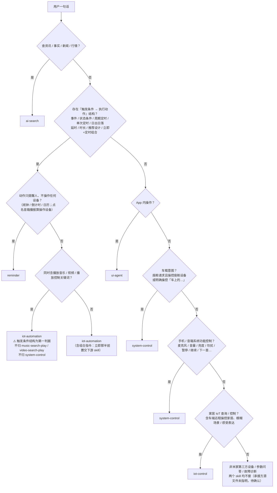
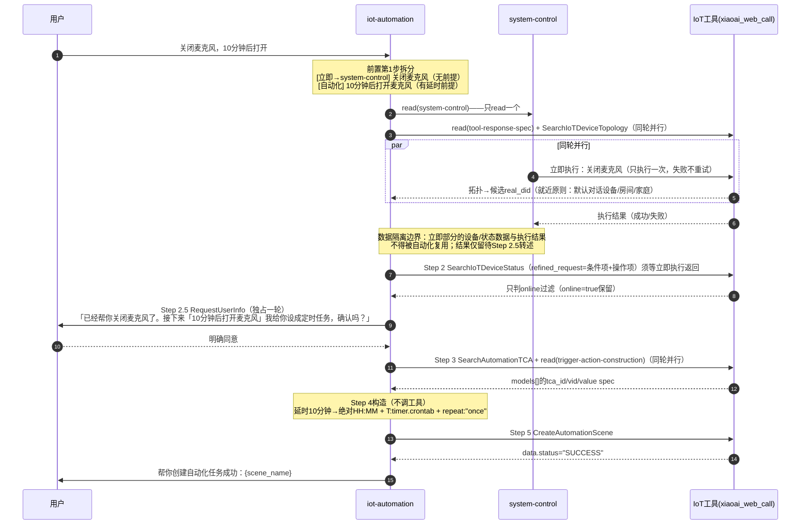
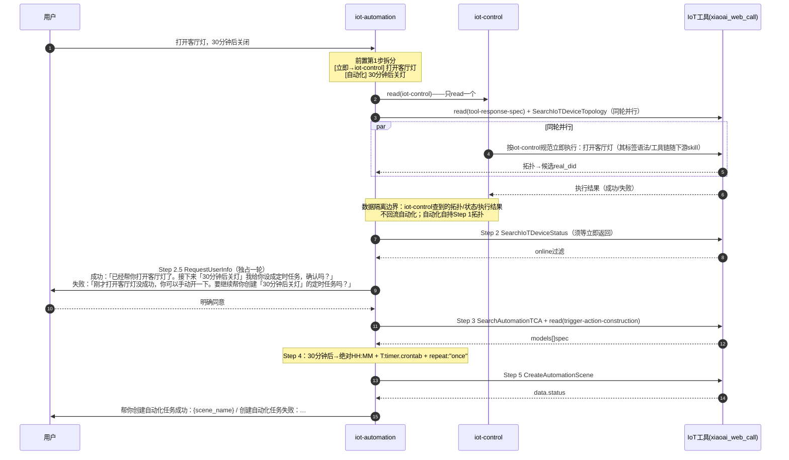

# iot-control 与 iot-automation：对比与协作

> 面向第一次接触 `xiaoaiclaw-ops/skills/iot-control` 与 `xiaoaiclaw-ops/skills/iot-automation` 的开发同学的自学材料。
> 所有工具名、参数名、JSON 字段、错误码、阈值、话术示例均以源文件为准；关键结论后标注 `repo-root 相对路径:行号`。拿不准处显式标注「待确认」。
> 本文行文中的两个 skill 也用全称 `iot-control` / `iot-automation`。

---

## 1. 一句话判别 + 路由判定图

**一句话判别**：**存在一个「作为执行前提的触发条件」（条件 → 动作结构）→ `iot-automation`；「当下无条件、立即执行一次」（含查当下状态）→ `iot-control`**（xiaoaiclaw-ops/skills/iot-automation/SKILL.md:4）。

### 1.1 各路由的完整判据（全部来自源文件）

| 目标 skill | 判据（用户 utterance 特征） | 出处 |
|---|---|---|
| `iot-automation` | 存在「触发条件 → 执行动作」结构：事件/状态条件（"温度超过28度就开空调拉窗帘"）、周期/单次定时（"每天早上7点灯慢慢变亮并拉开窗帘"、"明早8点开一次空调"）、日出日落、相对时间（延时/时长："10分钟后关灯"、"打开空调5分钟"=开启后5分钟关闭）、场景设计/推荐（"设计一个出门就自动关灯关空调启动扫地机的离家模式"）、带条件/周期标记的意向联动（"家里冷了就帮我弄暖和"）、立即+定时/延时组合（"关闭麦克风10分钟后打开"、"打开客厅灯30分钟后关闭"）——**只要含延时/定时成分即路由到本技能** | xiaoaiclaw-ops/skills/iot-automation/SKILL.md:4 |
| `reminder` | 时间类里**只提醒人、不操作任何设备**的闹钟/倒计时/日历（"定个7点闹钟"、"每天8点提醒我吃药"、"10分钟倒计时提醒我"）；判据是「看动作是否操作设备」——点名音箱做播报（`notify_speaker`）算操作设备，归 `iot-automation` | xiaoaiclaw-ops/skills/iot-automation/SKILL.md:33、xiaoaiclaw-ops/skills/iot-automation/SKILL.md:35-38 |
| `music-search-play` / `video-search-play` | ⚠️ 路由判别优先级：query 同时含"定时/条件表达"和"播放音乐/视频"时，**以触发条件结构为第一判据**——存在『每天/每周/工作日 + 时间点 + 设备操作』结构即归 `iot-automation`，不因动作关键词归入 `music-search-play` 或 `video-search-play`；播放控制类（暂停/继续/停止播放/下一首）一旦带延时/时长/定时成分，即归 `iot-automation`，不因"暂停/继续/播放"关键词归入 `music-search-play` 或 `system-control` | xiaoaiclaw-ops/skills/iot-automation/SKILL.md:4 |
| `iot-control` | 当下无条件立即执行的家居设备操控（"打开客厅灯"、"空调调低2度"、"有点冷帮我调节一下"、"我要看电影了把氛围弄一下"）或查当下状态（"空调几度"）；两类适用：**明确指令**（把客厅灯打开、查温湿度、非车端打开空调/风扇/灯、非车端 IoT 状态/耗材/滤芯/耗电量查询、车端明确的家庭 IoT 控制/查询）与**模糊意图**（有点冷调节家里设备、看书加班观影氛围、清洁打扫房间） | xiaoaiclaw-ops/skills/iot-automation/SKILL.md:31-32、xiaoaiclaw-ops/skills/iot-automation/SKILL.md:4；xiaoaiclaw-ops/skills/iot-control/SKILL.md:4 |
| `system-control` | ① 车载意图：座舱请求且操控「座舱设备」，或明确操控「车上的…」（"打开车上的空调/灯"、车端"打开空调/灯"）；② 手机/音箱系统功能控制（麦克风/音量/亮度/勿扰/暂停/继续/下一首等系统开关与播放控制） | xiaoaiclaw-ops/skills/iot-control/SKILL.md:16、xiaoaiclaw-ops/skills/iot-control/SKILL.md:19；xiaoaiclaw-ops/skills/iot-automation/SKILL.md:65 |
| `ui-agent` | App 内操作 | xiaoaiclaw-ops/skills/iot-control/SKILL.md:19 |
| `ai-search` | 查资讯/事实/新闻/行情 | xiaoaiclaw-ops/skills/iot-automation/SKILL.md:4 |
| 两个 skill 都不接 | 非米家生态第三方设备；智能家居的参数问答与故障诊断（"空调为什么不制冷、冰箱的节能系数"）；信息检索/知识查询 | xiaoaiclaw-ops/skills/iot-control/SKILL.md:19、xiaoaiclaw-ops/skills/iot-control/SKILL.md:4 |

**车家准入细节**（判定 `iot-control` 是否成立的前置）：

- 车载意图（任一满足）：请求来自座舱且明确操控「座舱设备」；请求指令明确操控「车上的…」「座舱设备」（xiaoaiclaw-ops/skills/iot-control/references/car-vs-home-intent-judge.md:16-19）。
- 家居意图（任一满足）：明确查询/操控「家/房间里的…」「家居设备」；目标为家居生态设备（扫地机、洗衣机、冰箱等）；请求来自座舱且明确操控「家/房间里的…」（xiaoaiclaw-ops/skills/iot-control/references/car-vs-home-intent-judge.md:32-36）。
- Hard Rules：非明确操控「家/房间里的…」且为车载意图 → 车载意图，**不调用** `iot-control`；否则判定为家居意图才调用 `iot-control`（xiaoaiclaw-ops/skills/iot-control/references/car-vs-home-intent-judge.md:45-46）。
- 常见家居设备**不包含音箱**（xiaoaiclaw-ops/skills/iot-control/references/car-vs-home-intent-judge.md:38-39）；`iot-control` 侧音箱（soundbox）任何路径不得进候选集/`device_id_list`/IoTAgent 目标（xiaoaiclaw-ops/skills/iot-control/SKILL.md:254）。

**待确认**：纯点播（无任何触发条件，如"播放周杰伦的歌"）归 `music-search-play` 是由「触发条件结构为第一判据」这条冲突规则反推的，源文件只给出了冲突场景的优先级，未直接写纯点播的归属。

### 1.2 路由判定图



### 1.3 常见误路由（对照纠正）

| 误判 | 正确路由 | 纠正依据 |
|---|---|---|
| "暂停播放10分钟"因"暂停/播放"关键词归 `music-search-play`/`system-control` | `iot-automation` | 播放控制类一旦带延时/时长/定时成分即归 `iot-automation`（xiaoaiclaw-ops/skills/iot-automation/SKILL.md:4） |
| "每天7点开灯"因含"开灯"归 `iot-control` | `iot-automation` | 定时触发去操作设备归自动化，`iot-control` 只接"当下立刻执行一次"（xiaoaiclaw-ops/skills/iot-automation/SKILL.md:23、xiaoaiclaw-ops/skills/iot-automation/SKILL.md:36） |
| "每天8点提醒我吃药"因"定时"归 `iot-automation` | `reminder` | 只提醒人、不碰设备 → `reminder`；一旦操作设备（含 `notify_speaker` 播报）才归自动化（xiaoaiclaw-ops/skills/iot-automation/SKILL.md:35-38） |
| "暂停主卧音箱播放歌曲，3小时后再继续播放"因带房间名被拆给别的 skill | 整句归 `iot-automation` | 带房间名的「主卧音箱」整句归本技能，不要因为带房间名就丢给别的 skill（xiaoaiclaw-ops/skills/iot-automation/SKILL.md:102-103） |
| 车端"打开空调"进 `iot-control` | `system-control` | 非明确操控「家/房间里的…」且为车载意图 → 车载意图，不调用 `iot-control`（xiaoaiclaw-ops/skills/iot-control/references/car-vs-home-intent-judge.md:45-46） |
| "空调为什么不制冷"进 `iot-control` | 两个 skill 均不接 | 参数问答/故障诊断在 `iot-control` 的不使用列表里（xiaoaiclaw-ops/skills/iot-control/SKILL.md:19） |

---

## 2. 双 skill 对照表

| 维度 | `iot-control` | `iot-automation` |
|---|---|---|
| **定位** | 米家智能家居设备的查询与控制；来源设备（手机/座舱/有屏音箱/无屏音箱）称「主控设备」（xiaoaiclaw-ops/skills/iot-control/SKILL.md:4、xiaoaiclaw-ops/skills/iot-control/SKILL.md:8） | 把「触发条件 → 执行动作」式家庭自动化需求解析为米家自动化创建请求（`triggers`/`conditions` + `actions`），最终调用 `CreateAutomationScene`（xiaoaiclaw-ops/skills/iot-automation/SKILL.md:8-11） |
| **触发结构** | **当下无条件、立即执行一次**，或查当下状态；分「明确指令」与「模糊意图」两类（xiaoaiclaw-ops/skills/iot-control/SKILL.md:4） | **存在作为执行前提的触发条件**（条件→动作结构），覆盖 6 类需求（xiaoaiclaw-ops/skills/iot-automation/SKILL.md:4） |
| **主流程** | `Step 1(检索) → Step 2(解析) → Step 3(筛选入队) → Step 4(执行调度与结果处理) → Step 5(话术)`；终止：队列清空+确认队列清空，或用户拒绝，或连续 2 次同动作失败（xiaoaiclaw-ops/skills/iot-control/SKILL.md:112-113） | 前置 3 步（剥离立即部分 → 拆独立场景 → 拆条件+操作，固定顺序不可跳步）+ 六步 `Step1→2→2.5→3→4→5`，**六步必走、缺一不可**（xiaoaiclaw-ops/skills/iot-automation/SKILL.md:57-59、xiaoaiclaw-ops/skills/iot-automation/SKILL.md:123） |
| **工具链** | 5 工具：`SearchIoTDeviceTopology`（无参）、`SearchIoTDeviceMetaData`、`SearchIoTDeviceStatus`、`IoTAgent`、`RequestUserInfo`，统一经 `xiaoai_web_call`（xiaoaiclaw-ops/skills/iot-control/SKILL.md:74-82） | 5 工具 6 步：`SearchIoTDeviceTopology`(Step 1)、`SearchIoTDeviceStatus`(Step 2)、`RequestUserInfo`(Step 2.5)、`SearchAutomationTCA`(Step 3)、`CreateAutomationScene`(Step 5)；Step 4 构造不调工具（xiaoaiclaw-ops/skills/iot-automation/SKILL.md:115-121、xiaoaiclaw-ops/skills/iot-automation/SKILL.md:354） |
| **用户可见产出** | 标签语法承载：`<concise_summary>`（上屏+TTS）、`<detailed_answer>`（仅上屏结构化明细）、`<ui><id>…</id></ui>`（卡片，N 个 ui.id 逐行输出 N 块）（xiaoaiclaw-ops/skills/iot-control/SKILL.md:380-386、xiaoaiclaw-ops/skills/iot-control/SKILL.md:404-407） | **最终交付物是 Step 5 后给用户的文本结果**：`data.status="SUCCESS"` → `帮你创建自动化任务成功：{scene_name}`；否则 `创建自动化任务失败：{desc 或错误原因}。当前暂不支持该自动化，你可以在米家 App 里手动设置。`；成功只表示自动化已下发到米家侧，不代表设备动作已立即执行（xiaoaiclaw-ops/skills/iot-automation/SKILL.md:125、xiaoaiclaw-ops/skills/iot-automation/SKILL.md:405-407） |
| **确认策略** | **默认能执行就执行**（执行优先原则，xiaoaiclaw-ops/skills/iot-control/SKILL.md:28-29）；反问仅两类允许（Step 3.2 判「直接反问」；`IoTAgent` 返回选择/确认类 `reply` 且 `execution_id` 非空）（xiaoaiclaw-ops/skills/iot-control/SKILL.md:489-491）；且须过**反问准入三门槛**：G1 真歧义、G2 引导 IoT、G3 聚焦控制（只问操控哪台/哪个房间/是否执行高危动作，禁收参数细节）（xiaoaiclaw-ops/skills/iot-control/SKILL.md:499-505）；防退化护栏 P1 可定位优先执行 / P2 高危只问是否执行 / P3 已完成禁追问（xiaoaiclaw-ops/skills/iot-control/SKILL.md:509-512） | **Step 2.5 必经确认**：Step 2 命中后、进 Step 3 前，无论需求是否清晰都必须先 `RequestUserInfo` 并结束本轮等回复，可多轮不限次数，直到意图清楚且用户明确同意（xiaoaiclaw-ops/skills/iot-automation/SKILL.md:235-237）；六种情形（常规复述/设备消歧/条件澄清/可行性失败/默认家房间告知/组合指令立即结果告知）（xiaoaiclaw-ops/skills/iot-automation/SKILL.md:256-283） |
| **输出契约** | **标签语法（最高优先级）**：过程提示只用 `<explanation>`（仅非 `RequestUserInfo` 工具调用前）；最终文本只用 `<concise_summary>`（必要时追加 `<detailed_answer>`）；反问只调 `RequestUserInfo` 且调用前零输出；**标签外禁止自然语言，裸文本被系统丢弃等同没回复**（xiaoaiclaw-ops/skills/iot-control/SKILL.md:22-26） | 无标签语法；核心约束是「等 `CreateAutomationScene` 真实返回再读 `status`/`desc` 下结论，禁止预先输出创建成功/失败」（xiaoaiclaw-ops/skills/iot-automation/SKILL.md:403）；组合指令的立即部分按下游 skill 规范执行（"read 该 skill 后按其规范执行"，xiaoaiclaw-ops/skills/iot-automation/SKILL.md:65） |
| **失败与重试语义** | `Semantic Error`/`Cloud Exception`/返回空/设备无响应类话术 → 重新生成 `refined_request` 重试 1 次，失败标 `failed`；`Client Exception`/不支持类 → 静默跳过**禁止重试**、Step 5 不提及；安全/权限限制 → 标 `restricted` 轻提一句（xiaoaiclaw-ops/skills/iot-control/SKILL.md:347-353）；重试不变量：保持原动作方向不变，仅修属性值落地/参数格式（xiaoaiclaw-ops/skills/iot-control/SKILL.md:355）；终止含连续 2 次相同动作失败（xiaoaiclaw-ops/skills/iot-control/SKILL.md:368） | `CreateAutomationScene` 错误码：`FAIL_TCA_NOT_FOUND` → 回退 Step 3 重查、禁猜 tca_id；`FAIL_MIOT_REJECT` → 不重试同一 trigger 结构、禁微调参数反复试；`FAIL_VALUE_INVALID` → 对照 Step 3 spec 修正后重试 1 次；其他 `FAIL_*`/异常 → 不重试（xiaoaiclaw-ops/skills/iot-automation/references/error-codes.md:5-10）；**同一请求最多 2 次（首次+1 次重试）**，重试须有实质性结构变更（xiaoaiclaw-ops/skills/iot-automation/references/error-codes.md:12-16）；前置立即部分**失败不重试、不改调其他 skill**（xiaoaiclaw-ops/skills/iot-automation/SKILL.md:65）；未走到创建（离线/不支持）也要给总结回复并提示去米家 App（xiaoaiclaw-ops/skills/iot-automation/SKILL.md:409） |

---

## 3. 共享概念对照

### 3.1 同名工具的用法差异

| 概念 | `iot-control` 用法 | `iot-automation` 用法 |
|---|---|---|
| `SearchIoTDeviceTopology` | 无参（**禁止增加任何参数**）（xiaoaiclaw-ops/skills/iot-control/references/tool-spec.md:11）；响应含 `homes[].is_car_home`（`true` 时其下设备不进家居候选）（xiaoaiclaw-ops/skills/iot-control/references/tool-spec.md:25）；`caller_device_type` **锁定其所属家庭为主控家庭**，未指定位置再推理其所在房间（xiaoaiclaw-ops/skills/iot-control/references/tool-spec.md:29）；**同请求最多一次**，禁止回退补拓扑（xiaoaiclaw-ops/skills/iot-control/SKILL.md:126-128） | 无参（`params` 可省略；禁止传 `refined_request`、`device_id_list` 等业务字段）（xiaoaiclaw-ops/skills/iot-automation/references/tool-response-spec.md:21）；**就近原则（必做）**：由带 `caller_device_type` 设备在拓扑的嵌套位置推断 默认对话设备/默认房间/默认家庭（设备对象无 `room_id`/`home_id`），用于到家/离家 `home_id`、就近选播报音箱、默认操作位置（xiaoaiclaw-ops/skills/iot-automation/SKILL.md:193-198、xiaoaiclaw-ops/skills/iot-automation/references/tool-response-spec.md:45）；`devices[].status`/`sub_status` 本步不解读（xiaoaiclaw-ops/skills/iot-automation/references/tool-response-spec.md:43）；多任务每任务 Step 1 重走、禁复用 session 历史（xiaoaiclaw-ops/skills/iot-automation/SKILL.md:124），同轮多场景 `Topology` 只发一次（xiaoaiclaw-ops/skills/iot-automation/SKILL.md:178） |
| `SearchIoTDeviceStatus` | 入参 `refined_request`（string，改写指令）+ `device_id_list`（xiaoaiclaw-ops/skills/iot-control/references/tool-spec.md:66-69）；用于查询类、依赖当前状态再操作的指令（xiaoaiclaw-ops/skills/iot-control/references/tool-spec.md:64）；`service_list` 是功能点推理的**唯一权威源**（MetaData 锚定）（xiaoaiclaw-ops/skills/iot-control/SKILL.md:174）；**还做运行态精筛**：非开关/耗材/环境类查询要过滤已关机（`on=false`，`on` 取 `service_list[].properties[]` 中 `spec_name=on` 的 `value`），开关状态/耗材/环境信息查询禁止过滤（xiaoaiclaw-ops/skills/iot-control/SKILL.md:255）；空 `service_list`/无目标属性 = 「数据未上报」（xiaoaiclaw-ops/skills/iot-control/SKILL.md:364） | 入参 `refined_request`（**条件任务/操作任务标准化子查询列表**，示例为字符串数组）+ `device_id_list`（xiaoaiclaw-ops/skills/iot-automation/SKILL.md:209-210、xiaoaiclaw-ops/skills/iot-automation/references/tool-response-spec.md:82）；**可用性只看 `online`**（`true` 保留/`false` 过滤），**只判 online 不判功能**（xiaoaiclaw-ops/skills/iot-automation/SKILL.md:222-226）；`service_list` 为空/找不到 spec/`access` 非`读写`均不作判据，能力统一 Step 3 TCA 裁定，防误杀（xiaoaiclaw-ops/skills/iot-automation/SKILL.md:227、xiaoaiclaw-ops/skills/iot-automation/references/tool-response-spec.md:101）；**环境传感器以数据为准**：状态里已上报的温/湿度/PM2.5 等即证明传感器存在，禁凭品类常识排除（xiaoaiclaw-ops/skills/iot-automation/SKILL.md:218）；系统 trigger 场景仍须走本步验证 actions 设备在线（xiaoaiclaw-ops/skills/iot-automation/SKILL.md:214） |
| `RequestUserInfo` | 唯一参数 `question_text`；**调用前完全静默**，禁输出任何标签或自然语言（xiaoaiclaw-ops/skills/iot-control/SKILL.md:32、xiaoaiclaw-ops/skills/iot-control/SKILL.md:494-495）；反问仅两类 + 三门槛（见 §2）；`question_text` 格式 A（总结+反问）/格式 B（明细+总结+反问），**不使用标签**（xiaoaiclaw-ops/skills/iot-control/references/tool-spec.md:147-170） | Step 2.5 **必经确认通道**；`params` 直接是 JSON 对象 `{"question_text":"…"}`；`question_text` 里引用设备名/房间名/播报内容一律用中文直角引号 `「」` 整体包裹（不改写、不嵌入其它引号）（xiaoaiclaw-ops/skills/iot-automation/SKILL.md:239-245）；本步只发问不下结论，发问即结束本轮（xiaoaiclaw-ops/skills/iot-automation/SKILL.md:240） |

### 3.2 同名概念的用法差异

| 概念 | `iot-control` | `iot-automation` |
|---|---|---|
| `real_did` | 设备唯一 ID，后续工具 `device_id_list` 的**唯一来源**（xiaoaiclaw-ops/skills/iot-control/references/tool-spec.md:26、xiaoaiclaw-ops/skills/iot-control/references/tool-spec.md:186） | 同样是 `device_id_list` 唯一来源，且 Step 5 请求里所有 `real_did`（triggers/actions/`notify_speaker` 目标音箱）**必须是 Step 1 返回过的真实 ID**，禁止编造/猜测/凭记忆或 session 历史（xiaoaiclaw-ops/skills/iot-automation/SKILL.md:294、xiaoaiclaw-ops/skills/iot-automation/SKILL.md:399） |
| `device_id_list` | **宽集/精筛两段式**：Step 1 阶段先按 Step 3.0 限定目标范围再构建宽集（只做范围召回、不做关机过滤等运行态精筛）（xiaoaiclaw-ops/skills/iot-control/SKILL.md:135-143）；Step 4 的 `device_id_list` **必须来自 Step 3.1 精筛**，禁止复用宽集（xiaoaiclaw-ops/skills/iot-control/SKILL.md:312、xiaoaiclaw-ops/skills/iot-control/SKILL.md:341）；入队前为空 → 禁止入队/工具调用，走「设备未找到」兜底（xiaoaiclaw-ops/skills/iot-control/SKILL.md:308） | 候选 `real_did` 列表（来自 Step 1）直接给 Step 2（xiaoaiclaw-ops/skills/iot-automation/SKILL.md:210）；Step 3 只传 **Step 2.5 确认后**设备、**最多 10 个**，为空时服务端按 user 维度查全部设备、不要默认空传（xiaoaiclaw-ops/skills/iot-automation/SKILL.md:291、xiaoaiclaw-ops/skills/iot-automation/SKILL.md:294）；无宽集/精筛之分，筛选维度是「online + 确认」 |
| `refined_request` | Step 3.3 合并策略执行后、发给 `IoTAgent` 执行器的**可执行指令**（执行器把自然语言翻译为设备操作，不是人类读者）；可由同品类、同执行类别的多条原子指令合并而来，**不等同于原子指令**；合并受 P0-P4 前提约束、单条最多 3 个功能点、**跨品类禁止合并**（xiaoaiclaw-ops/skills/iot-control/SKILL.md:156-158、xiaoaiclaw-ops/skills/iot-control/SKILL.md:269-282） | 把 query 拆成的「条件任务 / 操作任务」**标准化子查询列表**，与前置拆分 list 对应、不遗漏（xiaoaiclaw-ops/skills/iot-automation/SKILL.md:209）；多轮续接时不存在此概念（本 skill 无 `IoTAgent`） |

> 对照记忆点：同一个 `SearchIoTDeviceStatus`，`iot-control` 拿它做**运行态精筛**（关机过滤 + 宽集/精筛分离），`iot-automation` 只拿它做**在线可用性过滤**（只判 `online`），能力判断一律后置给 `SearchAutomationTCA`。

### 3.3 调度并行规则对照

| 维度 | `iot-control` | `iot-automation` |
|---|---|---|
| 阶段划分 | S1 检索 → S2 加载 → S3 执行 → S4 确认（xiaoaiclaw-ops/skills/iot-control/SKILL.md:92-110） | P1 检索 → P2 解析 → P2.5 确认 → P3 能力 → P4 构造 → P5 创建（xiaoaiclaw-ops/skills/iot-automation/SKILL.md:139-155） |
| 同轮并行硬规则 | `read(tool-spec)`+`SearchIoTDeviceTopology` 禁拆轮；`SearchIoTDeviceMetaData`+`SearchIoTDeviceStatus` 同轮；多个 `IoTAgent` 同批同轮（xiaoaiclaw-ops/skills/iot-control/SKILL.md:39） | `read(tool-response-spec)` 与 `Topology` 必须同轮并行；`read(trigger-action-construction)` 与 `SearchAutomationTCA` 必须同轮并行（xiaoaiclaw-ops/skills/iot-automation/SKILL.md:161-167） |
| 禁止模式 | `read(tool-spec)` 单独一轮；先查 Topology 再判断是否需要 scene 等（xiaoaiclaw-ops/skills/iot-control/SKILL.md:86-90） | spec/construct 单独一轮；先查 Topology 再判断立即执行；立即执行排到 Topology 之后；`RequestUserInfo` 与业务工具并行（xiaoaiclaw-ops/skills/iot-automation/SKILL.md:169-175） |
| 独占轮次 | `RequestUserInfo` 独占一轮，同轮严禁与 `IoTAgent` 并行（xiaoaiclaw-ops/skills/iot-control/SKILL.md:41） | P2.5 `RequestUserInfo` 独占一轮，禁与 `Status`/`TCA`/`Create` 并行，发问即结束本轮（xiaoaiclaw-ops/skills/iot-automation/SKILL.md:175） |

### 3.4 关键阈值与硬上限速查

| 项 | 数值 | 出处 |
|---|---|---|
| `SearchIoTDeviceTopology` 同请求次数 | 最多 1 次（`iot-control`）；同轮多场景也只发 1 次（`iot-automation`） | xiaoaiclaw-ops/skills/iot-control/SKILL.md:127；xiaoaiclaw-ops/skills/iot-automation/SKILL.md:178 |
| 单条 `refined_request` 功能点上限 | 3 个（超出拆分调用，P4） | xiaoaiclaw-ops/skills/iot-control/SKILL.md:282 |
| `SearchAutomationTCA` 的 `device_id_list` | 最多 10 个 | xiaoaiclaw-ops/skills/iot-automation/SKILL.md:294 |
| 延时可支持区间 | ≥1 分钟且 ≤24 小时（`<1 分钟` 与 `>24 小时` 不支持） | xiaoaiclaw-ops/skills/iot-automation/references/delay-and-duration.md:19-22 |
| `CreateAutomationScene` 调用上限 | 同一请求最多 2 次（首次 + 1 次重试） | xiaoaiclaw-ops/skills/iot-automation/references/error-codes.md:13 |
| `IoTAgent` 失败终止线 | 连续 2 次相同动作失败 | xiaoaiclaw-ops/skills/iot-control/SKILL.md:113 |
| `time_window.from/to` | 必须成对给全（`HH:MM`），不可只给 `days` | xiaoaiclaw-ops/skills/iot-automation/references/trigger-action-construction.md:24 |
| `repeat` 合法值 | `daily`/`workday`/`freeday`/`once` 或 ISO 周几列表/区间（`"1,3,5"`、`"1-5"`、`"6"`、`"6,7"`）；禁英文星期缩写 | xiaoaiclaw-ops/skills/iot-automation/references/trigger-action-construction.md:55 |

---

## 4. 协作衔接：组合指令全链路

**场景**：一句 query 同时含「立即执行」与「延时/定时」。按前置第 1 步，逐子句判断「这个动作有没有执行前提（时间点/延时/状态条件/事件）？」无前提 → 标 `[立即]`，整体粗路由到**一个**下游 skill（家居设备 → `iot-control`；系统开关与播放控制 → `system-control`）；有前提 → 留作自动化素材（xiaoaiclaw-ops/skills/iot-automation/SKILL.md:61-66）。

**拆分基准示例**（原文）（xiaoaiclaw-ops/skills/iot-automation/SKILL.md:90-94）：

```
query：关闭麦克风，10分钟后打开
拆分：[立即→system-control] 关闭麦克风   [自动化] 10分钟后打开麦克风

query：打开客厅灯，30分钟后关闭
拆分：[立即→iot-control] 打开客厅灯   [自动化] 30分钟后关灯
```

**执行纪律（前置第 1 步）**：只 `read` 一个下游 skill、只执行一次，失败不重试、不改调其他 skill；只执行拆分出的立即指令，不得新增/改写/扩充；成败留到 Step 2.5 告知用户（xiaoaiclaw-ops/skills/iot-automation/SKILL.md:65）。

**数据隔离边界（关键）**：立即部分是独立子任务，它 read 到的设备/状态数据、执行结果**都不得被自动化流程复用或影响**——自动化部分照旧从 Step 1 完整走 Step1→2→2.5→3→4→5，不得跳步、借用其设备数据或改变创建逻辑；调度上立即部分的 `read(下游)`+控制调用与自动化的 `Topology` **同轮并行**，但数据流严格隔离（xiaoaiclaw-ops/skills/iot-automation/SKILL.md:68）。立即部分执行结果**仅在 P2.5 转述，不流入自动化数据**（xiaoaiclaw-ops/skills/iot-automation/SKILL.md:163）。组合指令的 P2 `Status` 须等立即执行返回（读动作后状态）（xiaoaiclaw-ops/skills/iot-automation/SKILL.md:142）。

### 4.1 例一：「关闭麦克风，10分钟后打开」（立即半 → `system-control`）



### 4.2 例二：「打开客厅灯，30分钟后关闭」（立即半 → `iot-control`）



**组合指令拆分速查**（原文 5 例，xiaoaiclaw-ops/skills/iot-automation/SKILL.md:88-103）：

| query | 立即半（前置执行） | 自动化半（六步创建） |
|---|---|---|
| 关闭麦克风，10分钟后打开 | `[立即→system-control] 关闭麦克风` | `10分钟后打开麦克风` |
| 打开客厅灯，30分钟后关闭 | `[立即→iot-control] 打开客厅灯` | `30分钟后关灯` |
| 暂停播放10分钟 | `[立即→system-control] 暂停播放` | `10分钟后继续播放` |
| 音乐继续播放10分钟 | `[立即→system-control] 继续播放` | `10分钟后暂停播放` |
| 暂停主卧音箱播放歌曲，3小时后再继续播放 | `[立即→system-control] 暂停主卧音箱播放`（带房间名的「主卧音箱」整句仍归 `iot-automation`，立即那半连同房间+设备名一起交 `system-control`） | `3小时后继续播放`（Step 3 取 label 含"继续 / 恢复"的 action `tca_id`，不是停止 / 暂停） |

**说明与出处**：

- Step 2.5 情形 6（组合指令立即结果告知）的两条话术模板来自 xiaoaiclaw-ops/skills/iot-automation/SKILL.md:281-283（原文以「关闭麦克风」为例）；例二话术按同一模板推演，属**推断示例**，原文未给出「打开客厅灯」版本。
- 延时换算：`T:timer.crontab` 仅支持绝对时间点（HH:MM）；延时 ≥1 分钟且 ≤24 小时且可知当前时间 → 换算绝对 HH:MM + `repeat:"once"`，复述"我将创建一个 XX:XX 触发的一次性自动化"（xiaoaiclaw-ops/skills/iot-automation/references/delay-and-duration.md:3、xiaoaiclaw-ops/skills/iot-automation/references/delay-and-duration.md:19）。示例："10分钟后关灯"当前 14:30 → `{"tca_id":"T:timer.crontab", "time":"14:40", "repeat":"once"}`（xiaoaiclaw-ops/skills/iot-automation/references/delay-and-duration.md:27）。
- 若 query 的结束动作显式写出，取原文动作："暂停…3小时后继续播放"的自动化半段取 label 含"继续/恢复"的 action `tca_id`，**不是**停止/暂停（xiaoaiclaw-ops/skills/iot-automation/SKILL.md:103、xiaoaiclaw-ops/skills/iot-automation/SKILL.md:328-331）。
- 组合指令中带房间名不改路由："暂停主卧音箱播放歌曲，3小时后再继续播放"整句归 `iot-automation`，立即那半连同房间+设备名「主卧音箱」一起交 `system-control`（xiaoaiclaw-ops/skills/iot-automation/SKILL.md:102-103）。
- P2.5 独占轮次：`RequestUserInfo` 不与任何业务工具并行，发问即结束本轮（xiaoaiclaw-ops/skills/iot-automation/SKILL.md:147、xiaoaiclaw-ops/skills/iot-automation/SKILL.md:175）。
- 多场景（"早7点开灯"+"晚10点关灯"）：Step 2.5 提示用户是多个自动化、建议分开，确认后逐个调用 `CreateAutomationScene`（一次只创建一个）；`Topology` 同轮一次，`Status`/`TCA`/`Create` 各场景独立发起（xiaoaiclaw-ops/skills/iot-automation/SKILL.md:70-75、xiaoaiclaw-ops/skills/iot-automation/SKILL.md:177-181）。

---

## 5. 设计取舍与演进：这些规则是怎么被 badcase 教出来的

> 注：`iot-control` 有 `CHANGELOG.md` 与 `history/SKILL-v1.md`（演进可考）；`iot-automation` 目录下只有 `SKILL.md` + `references/`（无 CHANGELOG/history），其设计理由只能从 SKILL.md 文内的 ⚠️ 与理由段落读出。

### 5.1 版本演进时间线（v1 → 2.1.1）

| 版本 | 关键改动 | 出处 |
|---|---|---|
| 1.0.0 | 5 步工作流（设备检索→原子指令规划→执行队列规划→原子指令执行→话术总结）；Step 2 一个「原子指令规划」塞了 8 个子步骤；`IoTAgent` 参数含 `announcement`（中间播报话术） | xiaoaiclaw-ops/skills/iot-control/CHANGELOG.md:180-188；xiaoaiclaw-ops/skills/iot-control/history/SKILL-v1.md:373-386 |
| 2.0.0 | 工具定义剥离到 `references/tool-spec.md`（关注点分离）；**5 步 → 6 步**重组（过重的 Step 2 拆成 解析 + 筛选入队 两步）；条件判断全面表化 | xiaoaiclaw-ops/skills/iot-control/CHANGELOG.md:148-178 |
| 2.0.1 | 思考过程泄露防护（行动前话术升级为硬格式约束）；多轮续接 query 改写防护（`refined_request`=用户原始回复，禁改写）；全/非全操控双向约束 | xiaoaiclaw-ops/skills/iot-control/CHANGELOG.md:130-146 |
| 2.0.2 | 输出标签对齐 Claw 协议（行动前话术从 `<detailed_answer>` 更正为 `<explanation>`）；上下文隔离重构为**默认切断**策略 | xiaoaiclaw-ops/skills/iot-control/CHANGELOG.md:110-128 |
| 2.0.3 | 文档结构重组为 `[A] 全局规则 / [B] 调度总览 / [C] 主流程` 三分区；三张并行表合一为调度矩阵 + 依赖弧 | xiaoaiclaw-ops/skills/iot-control/CHANGELOG.md:92-108 |
| 2.0.4 | 压缩 Step 5.3/5.4（自检清单 5 条 → 3 条） | xiaoaiclaw-ops/skills/iot-control/CHANGELOG.md:82-90 |
| 2.1.0 | 原子指令对象契约、多卡聚合契约、跨品类禁合并、音箱硬排除、场景闭包与高危覆盖、**RequestUserInfo 独占轮次禁令（Fixed）** | xiaoaiclaw-ops/skills/iot-control/CHANGELOG.md:34-80 |
| 2.1.1 | Step 3.0 位置边界锁定、车端家庭排除（`is_car_home`）、场景闭包位置不补齐、`device_id_list` 构建先限定目标范围 | xiaoaiclaw-ops/skills/iot-control/CHANGELOG.md:6-32 |

### 5.2 被 badcase 教出来的规则

| 规则 | 教训来源 / 坏 case | 为什么这么设计 |
|---|---|---|
| **独占轮次禁令**（`RequestUserInfo` 独占一轮，禁与 `IoTAgent` 并行） | 明确记录于 CHANGELOG：修复评测 `iot-claw-scene_soundbox_260702_2236` 中 **10 个 case 同轮混发 `[IoTAgent, …, RequestUserInfo]`** 的问题，重跑后全部恢复满分（xiaoaiclaw-ops/skills/iot-control/CHANGELOG.md:76-80） | 同轮混发会让"执行结果"和"确认问题"互相踩踏：用户还没回答，执行已经发出去了。故高危场景固定为 Turn1 全部 `IoTAgent`（高置信执行）、Turn2 单独 `RequestUserInfo`（xiaoaiclaw-ops/skills/iot-control/SKILL.md:41） |
| **宽集 / 精筛分离**（Step 1 宽集只召回，Step 3.1 精筛才进 `IoTAgent`） | 2.1.1 把 `device_id_list` 构建改为"先按 Step 3.0 限定目标范围再构建宽集"，并新增合并前提 P0 范围一致（xiaoaiclaw-ops/skills/iot-control/CHANGELOG.md:26-32） | 宽集混入无关设备（跨 home、车家、未知房间、已关机设备）会让执行器误操作；关机过滤等运行态精筛又不能在召回阶段做（会误杀开关状态/耗材/环境查询）（xiaoaiclaw-ops/skills/iot-control/SKILL.md:141-143、xiaoaiclaw-ops/skills/iot-control/SKILL.md:255） |
| **六步必走 + 多任务禁复用中间结果** | 源文件直接点名失败机理："session 历史中的 real_did / tca_id / spec 可能已过时，否则参数错位"（xiaoaiclaw-ops/skills/iot-automation/SKILL.md:124） | 自动化创建是"编译进米家"的动作，参数错位=把错误的自动化固化下来；Step 2.5 必经确认是唯一防线（xiaoaiclaw-ops/skills/iot-automation/SKILL.md:123） |
| **OR/AND 分水岭**（多 trigger 恒 OR；AND 必须 1 trigger + `conditions[]` + `condition_relation:"and"`） | 源文件原话："这条 **OR 是隐式的、极易被忽略**……'两个条件都要成立才执行'绝不能都塞进 `triggers[]`——那样会被当成 OR、语义正好反掉"（xiaoaiclaw-ops/skills/iot-automation/SKILL.md:356） | `triggers[]` 没有 `trigger_relation` 字段可改语义，AND 只能借 `conditions[]` 表达；判别口诀与"关键分水岭"因此而生（xiaoaiclaw-ops/skills/iot-automation/SKILL.md:369-377） |
| **输出标签对齐 Claw 协议**（行动前话术必须是 `<explanation>`） | 2.0.2 修正标签误用（此前用 `<detailed_answer>`），并补"标签协议"消除裸文本歧义（xiaoaiclaw-ops/skills/iot-control/CHANGELOG.md:114-117） | 标签外裸文本会被系统丢弃，等同没回复（xiaoaiclaw-ops/skills/iot-control/SKILL.md:26）；标签语义错位还会造成 TTS 播报错误内容 |
| **思考过程泄露防护** | 2.0.1 新增 4 条错误示例（设备列表泄露、Step 判断逻辑泄露、设备 ID 泄露、执行结果编造）（xiaoaiclaw-ops/skills/iot-control/CHANGELOG.md:134-137） | 原子指令/设备 ID/推理过程是内部决策，泄漏即等于向用户暴露实现细节 |
| **多轮续接禁改写 `refined_request`、禁丢 `prev_execution_id`** | 2.0.1 专项修复（xiaoaiclaw-ops/skills/iot-control/CHANGELOG.md:139-142） | IoTAgent 侧 session 靠 `execution_id` 衔接；改写用户原话或丢 id 会脱离上轮 session，消歧结果错位（xiaoaiclaw-ops/skills/iot-control/references/multi-turn-session-flow.md:31-34） |
| **音箱硬排除 / 跨品类禁合并 / 多卡聚合** | 2.1.0 三项同批新增（xiaoaiclaw-ops/skills/iot-control/CHANGELOG.md:45-55） | 音箱不是可操控家居目标（"播放音乐"需求直接忽略）；跨品类合并会让执行器无法正确翻译；多卡丢弃/合并会导致 UI 卡片与实际执行不一致 |
| **上下文隔离默认切断** | 2.0.2 由"关键词重叠度判定"改为默认切断（xiaoaiclaw-ops/skills/iot-control/CHANGELOG.md:119-122） | 继承历史语义不等于复用历史工具结果；默认切断防"不要关卧室灯"被扩展成"这设备什么都别动"这类过度泛化（否定约束窄化，xiaoaiclaw-ops/skills/iot-control/SKILL.md:62） |
| **组合指令数据隔离**（立即部分数据不进自动化） | `iot-automation` 前置第 1 步的 ⚠️ 隔离条款（xiaoaiclaw-ops/skills/iot-automation/SKILL.md:68） | 立即执行读到的状态是"执行前"的快照，若被自动化六步复用会造成 Step 2 在线/状态判断失真；故数据流严格隔离、仅结果在 P2.5 转述 |
| **`read(construct)` 并入 P3 轮** | 源文件给了三条理由：藏进 TCA 网络往返、避开 P1→P4 四阶段跨度的**上下文蒸发**风险、用户中止则不浪费（xiaoaiclaw-ops/skills/iot-automation/SKILL.md:159） | 静态规格文件没有数据依赖，晚读没有信息损失，反而降低长链路里被遗忘的概率 |
| **延时只支持 1 分钟~24 小时** | `T:timer.crontab` 仅支持绝对时间点、精度分钟级（xiaoaiclaw-ops/skills/iot-automation/references/delay-and-duration.md:3、xiaoaiclaw-ops/skills/iot-automation/references/delay-and-duration.md:20-22） | 秒级无法表达、超 24 小时换算后跨天且用户意图可能已变化、无法验证——宁可拒答并引导米家 App，也不建一个大概率错的自动化 |

**v1 → 现在的结构性取舍**（v1 的问题在现版本的解法）：

- v1 允许"本轮连续会话已存在拓扑就**禁止**再调 `SearchIoTDeviceTopology`"（xiaoaiclaw-ops/skills/iot-control/history/SKILL-v1.md:78）；现版改为**每次新指令按当前请求重新判定、触发条件就必须调用**，禁止因会话历史/压缩摘要跳过（xiaoaiclaw-ops/skills/iot-control/SKILL.md:119-123）。取舍：多花一次调用，换掉"历史工具结果过期"这类错位。
- v1 的 `IoTAgent` 参数表含 `announcement`（xiaoaiclaw-ops/skills/iot-control/history/SKILL-v1.md:377）；现行 `tool-spec.md` 的 `IoTAgent` 参数只有 `refined_request`/`device_id_list`/`prev_execution_id`（xiaoaiclaw-ops/skills/iot-control/references/tool-spec.md:92-96），但 `multi-turn-session-flow.md` 仍提及 `announcement`（xiaoaiclaw-ops/skills/iot-control/references/multi-turn-session-flow.md:9、xiaoaiclaw-ops/skills/iot-control/references/multi-turn-session-flow.md:69）——**口径待确认**。
- v1 的多轮确认/话术集中在 Step 5 混合叙述；现版把"可反问"收紧为反问契约 + 三门槛 + 禁问规则（xiaoaiclaw-ops/skills/iot-control/SKILL.md:489-505、xiaoaiclaw-ops/skills/iot-control/SKILL.md:424-425），取舍：宁可少问，不可乱问（防退化护栏 P1-P3）。
- `iot-automation` 把"确认"做成**必经** Step 2.5（xiaoaiclaw-ops/skills/iot-automation/SKILL.md:237），与 `iot-control` 的"能执行就执行"正好相反——因为自动化是持久化写操作（`CreateAutomationScene`），错了难以撤销（修改/删除自动化不支持，只能去米家 App，xiaoaiclaw-ops/skills/iot-automation/SKILL.md:48-50）。

### 5.3 从两个 skill 提炼出的写法启发

1. **把"何时问用户"写成契约，不要写成建议**：`iot-control` 的反问契约 + 三门槛 + 禁问规则（xiaoaiclaw-ops/skills/iot-control/SKILL.md:489-505、xiaoaiclaw-ops/skills/iot-control/SKILL.md:424-425）与 `iot-automation` 的 Step 2.5 必经（xiaoaiclaw-ops/skills/iot-automation/SKILL.md:237）都是可判定的硬规则，模型无自由裁量空间。
2. **把易错语义显式写"反面示例"**：OR 隐式陷阱（xiaoaiclaw-ops/skills/iot-automation/SKILL.md:356）、系统 trigger 禁用设备 trigger 替代的两条反面示例（xiaoaiclaw-ops/skills/iot-automation/SKILL.md:345-347）、MetaData 锚定正反例（xiaoaiclaw-ops/skills/iot-control/SKILL.md:176-179）——抽象规则 + 一对正反例最抗回退。
3. **调度写成矩阵 + 依赖弧 + 禁止模式三件套**：两个 skill 各自都有（xiaoaiclaw-ops/skills/iot-control/SKILL.md:92-110、xiaoaiclaw-ops/skills/iot-automation/SKILL.md:149-175），比纯文字流程更难被误读。
4. **数据边界用"隔离"条款钉死**：组合指令的立即部分与自动化六步数据流严格隔离（xiaoaiclaw-ops/skills/iot-automation/SKILL.md:68）；`iot-control` 的上下文隔离"默认切断"（xiaoaiclaw-ops/skills/iot-control/SKILL.md:58-64）——同一条思路：继承语义 ≠ 复用工具结果。
5. **拒答优于猜错**：延时 <1 分钟 / >24 小时不支持（xiaoaiclaw-ops/skills/iot-automation/references/delay-and-duration.md:20-22）、TCA 无能力禁止降级兜底（xiaoaiclaw-ops/skills/iot-automation/SKILL.md:309）、设备未找到禁止列替代设备（xiaoaiclaw-ops/skills/iot-control/SKILL.md:439）。

---

## 6. 「该走哪个 skill」速查决策表

| # | 用户 utterance | 路由 | 一句理由 |
|---|---|---|---|
| 1 | 打开客厅灯 | `iot-control` | 当下无条件立即执行一次（xiaoaiclaw-ops/skills/iot-automation/SKILL.md:31） |
| 2 | 空调调低 2 度 / 有点冷帮我调节一下 / 我要看电影了把氛围弄一下 | `iot-control` | 当下无条件立即执行/模糊意图，frontmatter 明确排除（xiaoaiclaw-ops/skills/iot-automation/SKILL.md:4） |
| 3 | 空调几度 | `iot-control` | 查当下状态（xiaoaiclaw-ops/skills/iot-automation/SKILL.md:32） |
| 4 | 打开车上的空调 / 车端说"打开空调" | `system-control` | 车载意图（座舱+座舱设备或明确「车上的…」）（xiaoaiclaw-ops/skills/iot-control/SKILL.md:16） |
| 5 | 车端说"打开家里的灯/空调/风扇" | `iot-control` | 车端远程操控家居设备属家居意图（xiaoaiclaw-ops/skills/iot-control/SKILL.md:17） |
| 6 | 把音量调大 / 打开勿扰 / 暂停播放 | `system-control` | 手机/音箱系统功能与播放控制（xiaoaiclaw-ops/skills/iot-control/SKILL.md:19、xiaoaiclaw-ops/skills/iot-automation/SKILL.md:65） |
| 7 | 在 App 里帮我点个外卖 | `ui-agent` | App 内操作（xiaoaiclaw-ops/skills/iot-control/SKILL.md:19） |
| 8 | 今天有什么新闻 / 股票行情怎么样 | `ai-search` | 查资讯/事实/新闻/行情（xiaoaiclaw-ops/skills/iot-automation/SKILL.md:4） |
| 9 | 定个 7 点闹钟 / 每天 8 点提醒我吃药 / 10 分钟倒计时提醒我 | `reminder` | 只提醒人、不碰任何设备（xiaoaiclaw-ops/skills/iot-automation/SKILL.md:33） |
| 10 | 每天 7 点开灯 / 明早 8 点开一次空调 | `iot-automation` | 定时触发去操作设备（周期与单次都算）（xiaoaiclaw-ops/skills/iot-automation/SKILL.md:23） |
| 11 | 10 分钟后关灯 / 打开空调 5 分钟 | `iot-automation` | 延时/时长后操作设备（"打开空调5分钟"=开后 5 分钟关）（xiaoaiclaw-ops/skills/iot-automation/SKILL.md:24、xiaoaiclaw-ops/skills/iot-automation/SKILL.md:36） |
| 12 | 温度超过 28 度就开空调拉窗帘 | `iot-automation` | 条件/事件触发（条件→动作结构）（xiaoaiclaw-ops/skills/iot-automation/SKILL.md:4） |
| 13 | 设计一个出门就自动关灯关空调启动扫地机的离家模式 | `iot-automation` | 场景自动化设计/推荐（xiaoaiclaw-ops/skills/iot-automation/SKILL.md:4） |
| 14 | 关闭麦克风，10 分钟后打开 | `iot-automation` | 立即+延时组合：含延时成分即归本 skill，立即半前置交 `system-control`（xiaoaiclaw-ops/skills/iot-automation/SKILL.md:25、xiaoaiclaw-ops/skills/iot-automation/SKILL.md:90-91） |
| 15 | 打开客厅灯，30 分钟后关闭 | `iot-automation` | 同上，立即半交 `iot-control`（xiaoaiclaw-ops/skills/iot-automation/SKILL.md:93-94） |
| 16 | 暂停播放 10 分钟 / 音乐继续播放 10 分钟 | `iot-automation` | 播放控制带延时成分，不归 `music-search-play`/`system-control`（xiaoaiclaw-ops/skills/iot-automation/SKILL.md:4） |
| 17 | 每周一三五早上九点自动播放音乐 | `iot-automation` | 定时条件 + 播放并存时，触发条件结构为第一判据（xiaoaiclaw-ops/skills/iot-automation/SKILL.md:4） |
| 18 | 每天晚上 11 点用卧室音箱提醒我该睡觉了 | `iot-automation` | 点名音箱做播报（`notify_speaker`）属操作设备，不算 `reminder`（xiaoaiclaw-ops/skills/iot-automation/SKILL.md:38） |
| 19 | 帮我看看我的自动化任务 / 把刚刚那个自动化时间改成 9 点 | `iot-automation`（管理类：不创建，话术引导去米家 App） | 管理类（查/改/删）仍归本 skill 但不支持对话内完成（xiaoaiclaw-ops/skills/iot-automation/SKILL.md:27、xiaoaiclaw-ops/skills/iot-automation/SKILL.md:46-50） |
| 20 | 空调为什么不制冷 / 冰箱的节能系数 | 两个 skill 均不接 | 参数问答/故障诊断是 `iot-control` 明确排除域（xiaoaiclaw-ops/skills/iot-control/SKILL.md:19）；具体承接 skill 源文件未指明（待确认） |

---

## 附：本文引用的源文件清单

- `xiaoaiclaw-ops/skills/iot-control/SKILL.md`（536 行，version 2.1.1）
- `xiaoaiclaw-ops/skills/iot-control/references/tool-spec.md`
- `xiaoaiclaw-ops/skills/iot-control/references/multi-turn-session-flow.md`
- `xiaoaiclaw-ops/skills/iot-control/references/car-vs-home-intent-judge.md`
- `xiaoaiclaw-ops/skills/iot-control/references/scene-inference-strategy.md`
- `xiaoaiclaw-ops/skills/iot-control/CHANGELOG.md`
- `xiaoaiclaw-ops/skills/iot-control/history/SKILL-v1.md`
- `xiaoaiclaw-ops/skills/iot-automation/SKILL.md`（452 行）
- `xiaoaiclaw-ops/skills/iot-automation/references/trigger-action-construction.md`
- `xiaoaiclaw-ops/skills/iot-automation/references/tool-response-spec.md`
- `xiaoaiclaw-ops/skills/iot-automation/references/delay-and-duration.md`
- `xiaoaiclaw-ops/skills/iot-automation/references/error-codes.md`
- `xiaoaiclaw-ops/skills/iot-automation/references/examples.md`
