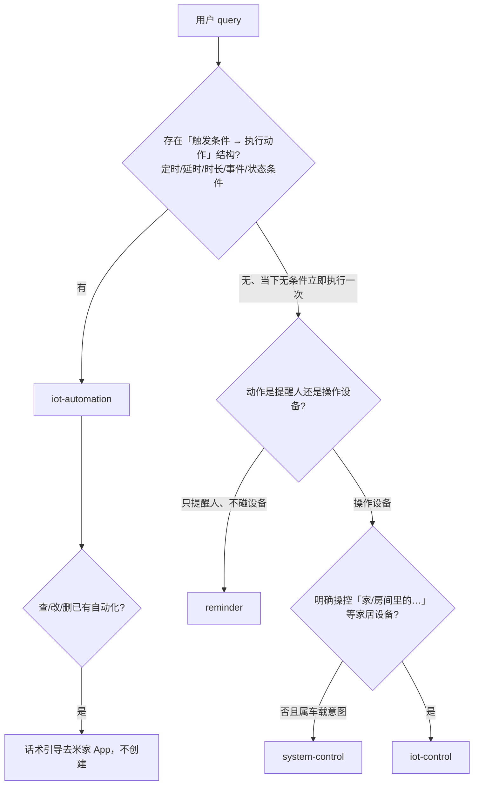
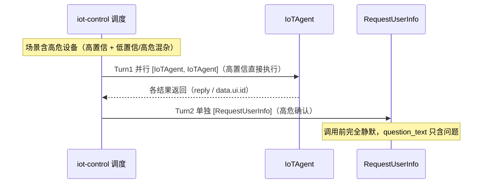
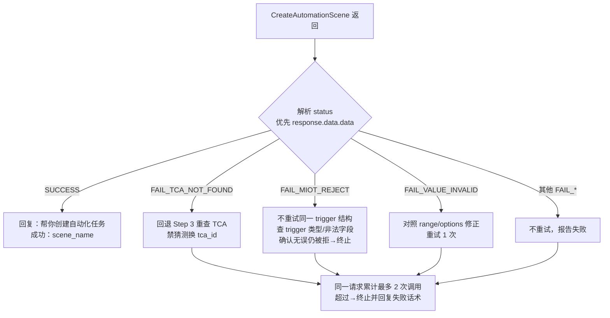

# 04 — 易错点与 FAQ：iot-control × iot-automation

> **读者**：第一次接触 `xiaoaiclaw-ops/skills/iot-control` 与 `xiaoaiclaw-ops/skills/iot-automation` 两个 skill 的开发同学（自学用）。
> **体例**：每条 FAQ = 问题 → 简明答案 → 出处（repo-root 相对路径 + 行号）。全部事实以源文件为准；精读笔记（`learning/learning1023/.notes/`）仅作索引，不作为出处。拿不准的条目显式写「待确认」。
> **内容分组**：A 路由判别 / B 调度与并行 / C 数据与 ID / D 时间语义 / E 确认与反问 / F 输出话术 / G 错误码与重试。

---

## 置顶总结：三条最容易踩的坑

| # | 坑 | 一句话规则 | 出处 |
|---|---|---|---|
| 1 | 同轮混发 `[IoTAgent, …, RequestUserInfo]` | `RequestUserInfo` 必须独占一轮（最高优先级禁令）；高危确认要等 `IoTAgent` 结果返回后**下一轮单独发** | `xiaoaiclaw-ops/skills/iot-control/SKILL.md:41`；`xiaoaiclaw-ops/skills/iot-automation/SKILL.md:175` |
| 2 | 把「且」的多个条件塞进 `triggers[]` | 多条 trigger **恒 OR**；「两个条件都要成立」必须拆成 1 个 trigger + 其余进 `conditions[]` + `condition_relation:"and"` | `xiaoaiclaw-ops/skills/iot-automation/SKILL.md:356`、`:370` |
| 3 | 编造 / 复用 `real_did`、`tca_id` | 设备 ID 只来自本轮 `SearchIoTDeviceTopology` 返回；TCA 值只来自 Step 3 spec；多任务/跨轮一律从 Step 1 重走 | `xiaoaiclaw-ops/skills/iot-automation/SKILL.md:124`、`:294`、`:399` |

## 源文件地图

| 主题 | 路径 |
|---|---|
| control 主流程（Step 1–5） | `xiaoaiclaw-ops/skills/iot-control/SKILL.md` |
| control 工具参数/响应 | `xiaoaiclaw-ops/skills/iot-control/references/tool-spec.md` |
| control 多轮续接 | `xiaoaiclaw-ops/skills/iot-control/references/multi-turn-session-flow.md` |
| 车/家准入判定 | `xiaoaiclaw-ops/skills/iot-control/references/car-vs-home-intent-judge.md` |
| 场景矩阵与高危设备 | `xiaoaiclaw-ops/skills/iot-control/references/scene-inference-strategy.md` |
| automation 主流程（前置 + 六步） | `xiaoaiclaw-ops/skills/iot-automation/SKILL.md` |
| 创建请求构造规格 | `xiaoaiclaw-ops/skills/iot-automation/references/trigger-action-construction.md` |
| automation 工具响应规格 | `xiaoaiclaw-ops/skills/iot-automation/references/tool-response-spec.md` |
| 延时/时长换算 | `xiaoaiclaw-ops/skills/iot-automation/references/delay-and-duration.md` |
| 错误码与重试 | `xiaoaiclaw-ops/skills/iot-automation/references/error-codes.md` |
| 输出示例 A–H | `xiaoaiclaw-ops/skills/iot-automation/references/examples.md` |

---

## A. 路由判别

#### A1. 车端说「打开空调」归谁？「打开家里的空调」呢？
**答**：车端说「打开空调/灯」（未带「家里的」限定）判为**车载意图** → `system-control`，不进 `iot-control`；车端明确说「打开家里的灯/空调/风扇」（家居生态设备）才进 `iot-control`。关键锚点是指令里是否显式出现「家/房间里的…」「家居设备」。
> 出处：`xiaoaiclaw-ops/skills/iot-control/SKILL.md:14-17`；`xiaoaiclaw-ops/skills/iot-control/references/car-vs-home-intent-judge.md:45-46`

#### A2. 「定个7点闹钟」和「每天7点开灯」为什么归不同 skill？
**答**：时间类归属判据是**动作是否操作设备**——只提醒人、不碰设备（「定个7点闹钟」「10分钟倒计时提醒我」）→ `reminder`；操作设备（「每天7点开灯」「明早8点开一次空调」「10分钟后关灯」「打开空调5分钟」）→ `iot-automation`（含单次定时、延时、时长）。
> 出处：`xiaoaiclaw-ops/skills/iot-automation/SKILL.md:33`、`:35-38`；`xiaoaiclaw-ops/skills/iot-automation/SKILL.md:23-24`

#### A3. 「暂停播放10分钟」为什么不是 music-search-play？
**答**：路由判别以**触发条件结构为第一判据**：播放控制类（暂停/继续/停止播放/下一首）一旦带延时/时长/定时成分即归 `iot-automation`，不因「暂停/继续/播放」关键词归入 `music-search-play` 或 `system-control`。拆分为「立即暂停播放」（前置交 `system-control` 执行）+「10分钟后继续播放」（建定时自动化）。同理，「定时/条件 + 播放音乐」存在『每天/每周/工作日 + 时间点 + 设备操作』结构时也不归 `music-search-play` / `video-search-play`。
> 出处：`xiaoaiclaw-ops/skills/iot-automation/SKILL.md:4`（frontmatter 路由判别优先级）；`xiaoaiclaw-ops/skills/iot-automation/SKILL.md:25`、`:96-97`

#### A4. 「打开客厅灯」和「打开客厅灯30分钟后关闭」分别归谁？
**答**：前者是当下无条件立即执行一次 → `iot-control`；后者含延时成分 → `iot-automation` 的**组合指令**：拆成「[立即→iot-control] 打开客厅灯」+「[自动化] 30分钟后关灯」，立即部分在前置阶段先 `read` 下游 skill 执行掉，执行结果留到 Step 2.5 告知用户。
> 出处：`xiaoaiclaw-ops/skills/iot-automation/SKILL.md:31-32`、`:25`、`:93-94`

#### A5. 查询 / 修改 / 删除已有自动化为什么引导去米家 App？
**答**：管理类三请求都不在对话里完成、必须话术引导：①查已创建自动化 → `我没法直接查询米家 App 里的完整自动化列表，建议你在米家 App 里确认一下哪些实际生效了。`；②改/删已创建任务（只要已执行到 `CreateAutomationScene`，无论创建成功还是失败）→ `暂不支持修改或删除已创建的自动化，你可以在米家 App 里手动修改或关掉它。`；③`SearchAutomationTCA` 查询后无对应能力 → `这个设备暂不支持这样的自动化，建议你在米家 App 里手动创建。`（禁止尝试其他工具或提示「用文本指令/语音指令操作一下」）。且不得基于对话历史、记忆或「我的记录」列任务。
> 出处：`xiaoaiclaw-ops/skills/iot-automation/SKILL.md:27`、`:44-53`

#### A6. App 内操作、设备参数问答、故障诊断归谁？
**答**：App 内操作 → `ui-agent`；手机/音箱系统功能控制、车载意图 → `system-control`；设备参数问答与故障诊断（如「空调为什么不制冷」「冰箱的节能系数」）、非米家生态第三方设备、信息检索/知识查询 → `iot-control` 不处理。
> 出处：`xiaoaiclaw-ops/skills/iot-control/SKILL.md:4`（frontmatter）、`:19`

#### A7. TCA 查完发现设备没有对应能力，为什么不许兜底？
**答**：设备控制类意图（开关、调节、进入/退出某模式）穷举 TCA 后确无对应 action/trigger 即判**不支持**，走不支持话术引导米家 App。两类兜底被明令禁止：① 不得改用 `notify_speaker` 播报/念出该功能名（播报改不了设备状态）；② 不得塞进「文本指令/执行文本」类 action tca_id 下发。穷举前不得因字面不一致判不支持（须语义/近义穷举所有 options）。
> 出处：`xiaoaiclaw-ops/skills/iot-automation/SKILL.md:306`、`:308-309`、`:318`

#### A8. 音箱到底能不能碰？
**答**：两个 skill 口径不同、别混：`iot-control` 中音箱（soundbox）**任何路径硬排除**——不得进候选集、不得传入 `device_id_list`、不得作 IoTAgent 目标，场景推理里「播放音乐/背景音乐」类需求直接忽略；`iot-automation` 中**点名音箱做播报**（`notify_speaker`）属操作设备，归本 skill。另外 control 中电视仅限开关。
> 出处：`xiaoaiclaw-ops/skills/iot-control/SKILL.md:254`、`:183-184`；`xiaoaiclaw-ops/skills/iot-automation/SKILL.md:38`

---

## B. 调度与并行

#### B1. 哪些调用必须同轮并行（禁止拆轮）？
**答**：同一单元格/同一批的组合必须同轮并行；跨阶段按依赖弧顺序。

| skill | 必须同轮并行的组合 | 出处 |
|---|---|---|
| iot-control | `read(tool-spec)` + `SearchIoTDeviceTopology`（+ `read(scene-inference-strategy)`） | `xiaoaiclaw-ops/skills/iot-control/SKILL.md:39`、`:71-72` |
| iot-control | `SearchIoTDeviceMetaData` + `SearchIoTDeviceStatus`（相对调节等） | `xiaoaiclaw-ops/skills/iot-control/SKILL.md:39`、`:132` |
| iot-control | 多个 `IoTAgent`（同批直接执行-操控类） | `xiaoaiclaw-ops/skills/iot-control/SKILL.md:39`、`:336` |
| iot-automation | `read(tool-response-spec)` + `SearchIoTDeviceTopology` | `xiaoaiclaw-ops/skills/iot-automation/SKILL.md:162` |
| iot-automation | `read(trigger-action-construction)` + `SearchAutomationTCA` | `xiaoaiclaw-ops/skills/iot-automation/SKILL.md:167` |

> 出处：上表逐行标注；依赖弧见 `xiaoaiclaw-ops/skills/iot-control/SKILL.md:109-110`、`xiaoaiclaw-ops/skills/iot-automation/SKILL.md:141-147`

#### B2. RequestUserInfo 为什么必须独占轮次？
**答**：这是两个 skill 共有的**最高优先级禁令**：`RequestUserInfo` 必须独占一轮，同一轮严禁与 `IoTAgent`（control）/`SearchIoTDeviceStatus`/`SearchAutomationTCA`/`CreateAutomationScene`（automation P2.5）并行，发问即结束本轮。场景含高危时：先在当轮发全部 `IoTAgent`（高置信执行），等结果返回后下一轮单独发 `RequestUserInfo`（高危确认）——❌ `[IoTAgent, IoTAgent, RequestUserInfo]` 同轮 → ✅ Turn1 `[IoTAgent, IoTAgent]`，Turn2 `[RequestUserInfo]`。该禁令修复过评测 `iot-claw-scene_soundbox_260702_2236` 中 10 个 case 同轮混发的问题。
> 出处：`xiaoaiclaw-ops/skills/iot-control/SKILL.md:41`；`xiaoaiclaw-ops/skills/iot-automation/SKILL.md:147`、`:175`；`xiaoaiclaw-ops/skills/iot-control/CHANGELOG.md:76-80`

#### B3. 为什么禁止拆轮？哪些是明示的禁止模式？
**答**：拆轮会造成上下文蒸发与结果跳读。control 的 S1 禁止模式：`read(tool-spec)` 单独一轮；`read(tool-spec)`+`read(scene-inference-strategy)` 后单独查 Topology；`read(tool-spec)`+Topology 后单独 `read(scene-inference-strategy)`；先查 Topology 再判断是否需要 scene。automation 的 P1/P3 禁止模式：`read(tool-response-spec)` 单独一轮；`read(trigger-action-construction)` 单独一轮或与 TCA 拆成两轮；先查 Topology 再判断是否需要立即执行；组合指令把立即执行排到 Topology 之后轮次。
> 出处：`xiaoaiclaw-ops/skills/iot-control/SKILL.md:86-90`；`xiaoaiclaw-ops/skills/iot-automation/SKILL.md:169-173`

#### B4. 多任务 / 跨轮为什么不许跳步、复用 session 中间结果？
**答**：automation 明文规定「多任务跳步」禁令：同一对话要创建多个自动化时，每个任务都必须从 Step 1 重新完整走流程，无论前面是否已查过拓扑/状态/TCA、也无论是否有相似历史 session 记录，都不得跳步或复用上一任务的中间结果——**session 历史中的 `real_did` / `tca_id` / spec 可能已过时，否则参数错位**。跨轮创建多自动化一律从 P1 全量重走。control 同理：每次新指令后 Topology/MetaData/Status 都按当前请求重新判定，禁止因会话历史/压缩摘要/上一轮工具结果跳过。
> 出处：`xiaoaiclaw-ops/skills/iot-automation/SKILL.md:124`、`:181`；`xiaoaiclaw-ops/skills/iot-control/SKILL.md:119-123`

#### B5. read(trigger-action-construction) 为什么放 P3 轮、不放 P1？
**答**：construct 是 P4 的构造规格（静态、无数据依赖），与 TCA 同轮读可以把本地文件读藏进 TCA 网络往返，且避开 P1→P4 四阶段跨度的上下文蒸发风险；仅在 P2.5 确认后才读，用户中止则不浪费。P3 启动规则要求它与 `SearchAutomationTCA` 同轮并行。
> 出处：`xiaoaiclaw-ops/skills/iot-automation/SKILL.md:159`、`:167`

#### B6. 组合指令的立即部分为什么要和 Topology 同轮，数据却要隔离？
**答**：调度上，立即部分的 `read(下游 skill)` + 控制调用与自动化的 `Topology` **同轮并行**（调度矩阵组合指令行）；但数据流**严格隔离**：立即部分是独立子任务，`read` 下游 skill 只为完成它，执行完即结束，它 read 到的设备/状态数据、执行结果都不得被自动化流程复用或影响——自动化部分照旧从 Step 1 完整走 Step1→2→2.5→3→4→5，不得因前置执行过就跳步、借用设备数据或改变创建逻辑。立即部分成败只在 Step 2.5 转述。
> 出处：`xiaoaiclaw-ops/skills/iot-automation/SKILL.md:65`、`:68`、`:154`、`:163`

#### B7. 同批多个 IoTAgent 为什么必须同轮并行？Topology 为什么最多查一次？
**答**：control 规定同批所有直接执行-操控类必须同轮并行 `IoTAgent`，禁止逐个等待或边执行边补同批队列（仅重试、多轮续接、用户明确顺序任务或条件依赖允许串行），一句 `<explanation>` 覆盖整批。`SearchIoTDeviceTopology` 在当前请求内最多一次：S1 已获拓扑后禁止因场景推理不确定、候选缺失或房间不匹配重查，Step 4 执行阶段也禁止回退补拓扑。
> 出处：`xiaoaiclaw-ops/skills/iot-control/SKILL.md:336`、`:126-128`

---

## C. 数据与 ID

#### C1. `real_did` 从哪来？能填什么？
**答**：只来自 `SearchIoTDeviceTopology` 返回的 `devices[].real_did`，它是后续工具 `device_id_list` 的**唯一来源**。automation 侧同样硬性：Step 3 `SearchAutomationTCA` 的 `device_id_list` 最多 10 个，每个 `real_did` 必须来自 Step 1 返回，禁止编造/猜测/凭记忆或 session 历史填写；Step 5 请求里所有 `real_did`（triggers / actions / `notify_speaker` 目标音箱）同样禁止编造、猜测、拼凑。设备标识统一用 `real_did`，`device_id` 不是合法字段。
> 出处：`xiaoaiclaw-ops/skills/iot-control/references/tool-spec.md:26`、`:186`；`xiaoaiclaw-ops/skills/iot-automation/SKILL.md:294`、`:399`；`xiaoaiclaw-ops/skills/iot-automation/references/trigger-action-construction.md:64`

#### C2. 宽集 vs 精筛有什么区别？
**答**：Step 1 阶段的 `device_id_list` 是**宽集**——先按 Step 3.0 限定目标范围再在范围内按位置+品类/子品类/设备名召回，此阶段只构建范围内宽集、不做关机过滤等运行态精筛。宽集**仅用于 Step 1 加载**（MetaData/Status）；精筛在 Step 3.1；Step 4 的 `device_id_list` 必须来自 Step 3.1 精筛，禁止直接复用 Step 1 的 MetaData/Status 宽集。
> 出处：`xiaoaiclaw-ops/skills/iot-control/SKILL.md:135-143`、`:312`、`:341`

#### C3. `homes[].is_car_home` 是什么？为 true 怎么处理？
**答**：拓扑中标记「车端家庭」的字段；`true` 时其下**所有设备不纳入家居操控候选**——Step 3.0 排除规则要求 `is_car_home=true` 的 home 不进入家居候选，且不得从车家补设备；无候选时按兜底话术处理。
> 出处：`xiaoaiclaw-ops/skills/iot-control/references/tool-spec.md:25`；`xiaoaiclaw-ops/skills/iot-control/SKILL.md:228-229`

#### C4. 禁止编造 `tca_id` / `real_did` 的后果是什么？
**答**：两层后果。流程层：Step 3 返回空（`models[]` 无该设备或为空数组）必须终止流程、走 Step 2.5 可行性失败分支告知「该设备暂不支持自动化操作」，**禁止凭猜测编造 tca_id 继续 Step 4/5**。接口层：`tca_id` 是服务端分配的不透明 ID（格式 `T:{sc_id}` / `A:{sa_id}`），传非法字段/超范围值会得到 `FAIL_TCA_NOT_FOUND`、`FAIL_MIOT_REJECT` 或 `FAIL_VALUE_INVALID`。
> 出处：`xiaoaiclaw-ops/skills/iot-automation/SKILL.md:299`、`:304`；`xiaoaiclaw-ops/skills/iot-automation/references/tool-response-spec.md:212-213`；`xiaoaiclaw-ops/skills/iot-automation/references/error-codes.md:7`；`xiaoaiclaw-ops/skills/iot-automation/references/trigger-action-construction.md:66`

#### C5. 环境传感器为什么「以数据为准」？
**答**：设备状态里出现的环境数值属性（温度/湿度/PM2.5/光照/CO₂ 等）**即代表该传感器真实存在**，是后续可用的触发源候选，必须带入 Step 3 交由 TCA 裁定合法值；**不得因「这类设备通常不带某传感器」的品类常识**，在 Step 2 把已上报的属性排除或判定不存在（例：空调状态报了湿度值，说明它能感知湿度、可作湿度触发源，不能凭「空调只控温」否掉）。同理，「设备是否具备某传感器/环境感知触发能力」不属于 Step 2.5 可判的品类失败，一律留给 Step 3 TCA 裁定。
> 出处：`xiaoaiclaw-ops/skills/iot-automation/SKILL.md:218`、`:274`

#### C6. Step 2 为什么只看 `online`、不判功能？
**答**：设备可用性**只看 `online`**（`online=true` 保留、`false` 过滤），能力是否支持统一交给 Step 3 的 TCA 查询裁定。不要因 `service_list` 为空、找不到对应 `spec_id`、或 `access` 非「读写」就判不支持——那会误杀（例：音箱播放/暂停等能力并不体现在 `service_list` 里）。`access`（`只读`/`读写`）也不作为能否纳入自动化的判据。
> 出处：`xiaoaiclaw-ops/skills/iot-automation/SKILL.md:216`、`:222-227`；`xiaoaiclaw-ops/skills/iot-automation/references/tool-response-spec.md:95`、`:101`

#### C7. 房间/家庭归属和 `home_id` 从哪来？
**答**：设备对象**本身不含 `room_id`/`home_id`**（真实响应无此字段），房间/家庭归属只能靠拓扑嵌套层级推断（设备所在 `rooms[]` → 外层 `homes[]`）。`home_id` 取 Step 1 拓扑中对应家庭的 `id`（或 `homes[].id`），到家/离家 trigger（`T:location.enter_fence` / `T:location.leave_fence`）必须填写。带 `caller_device_type` 的设备即当前对话设备，由其嵌套位置推出默认对话设备/默认房间/默认家庭；定位不到时不要臆造，留到 Step 2.5 让用户确认。
> 出处：`xiaoaiclaw-ops/skills/iot-automation/references/tool-response-spec.md:45`、`:37`；`xiaoaiclaw-ops/skills/iot-automation/SKILL.md:193-201`

---

## D. 时间语义

#### D1. 「N分钟后做X」怎么落成自动化？
**答**：`T:timer.crontab` 仅支持**绝对时间点（HH:MM）**，不支持「从当前时刻起延迟 N 秒/分钟/小时」。延时 ≥1 分钟且 ≤24 小时、且能从 system prompt 时间信息确定当前精确时间时，**换算为绝对时间**（当前时间 + 延时 → 目标 HH:MM），构造 `T:timer.crontab` + `repeat:"once"`，并在 Step 2.5 向用户复述「我将创建一个 XX:XX 触发的一次性自动化」确认后创建。例：14:30 说「10分钟后关灯」→ `{"tca_id":"T:timer.crontab", "time":"14:40", "repeat":"once"}`。
> 出处：`xiaoaiclaw-ops/skills/iot-automation/references/delay-and-duration.md:3`、`:19`、`:27`

#### D2. 时长类「打开空调5分钟」怎么拆？相反动作怎么取？
**答**：拆成**起始动作**（原操作）+ **结束动作**（起始动作的**相反动作**），结束触发时刻 = 起始时刻 + 时长。相反动作按操作类型取反，别一律写成「关闭/停止」：开 ↔ 关、播放 ↔ 停止、**暂停 ↔ 继续（恢复播放）**；若 query 已把结束动作显式写出（如「暂停…3小时后继续播放」的「继续播放」），直接用原文动作。起始是「当下立即」→ 立即半前置执行，只建结束那条 `repeat:"once"` 延时自动化；起始是「周期定时」→ 起始、结束都是 `T:timer.crontab` 周期自动化、是两条独立自动化（按多场景逐个创建），结束继承起始的周期，Step 2.5 必须把两条自动化的时间点 + 重复日都复述核对。
> 出处：`xiaoaiclaw-ops/skills/iot-automation/references/delay-and-duration.md:7`、`:9-13`

#### D3. 跨天时重复日怎么处理？
**答**：结束钟点 = 起始钟点 + 时长，若 ≥ 24:00 则对 24h 取模落到次日；**一旦落到次日，结束自动化的重复日要相对起始整体后移一天**——ISO 周几列表逐个 +1（`7→1` 回绕，如 `"1-6"`→`"2-7"`）、`daily` 仍 `daily`。例：「每天晚上10点开加湿器2小时」→ 开 `{time:"22:00", repeat:"daily"}` + 关 `{time:"00:00", repeat:"daily"}`；「每周一到六晚10点开2小时」→ 开 `{time:"22:00", repeat:"1-6"}` + 关 `{time:"00:00", repeat:"2-7"}`。起始用 `workday`/`freeday` 且跨天时无法机械 +1，回 Step 2.5 向用户澄清结束日期。
> 出处：`xiaoaiclaw-ops/skills/iot-automation/references/delay-and-duration.md:10-12`

#### D4. `workday` / `freeday` / ISO 周几的语义差别？
**答**：`repeat` 仅接受 `daily` / `workday` / `freeday` / `once`，或 ISO 周几数字列表/区间（`"1,3,5"` 周一三五、`"1-5"` 周一到周五、`"6"` 周六、`"6,7"` 周末；1=周一…7=周日），**禁止英文星期缩写**。涉及节假日语义用 `workday`（**法定工作日**，跟随国家法定节假日安排：节假日放假、调休日照常上班）/ `freeday`（**法定节假日/休息日**）；`"1-5"` 等 ISO 周几表示**固定星期几**，用于用户明确点名星期几的场景。
> 出处：`xiaoaiclaw-ops/skills/iot-automation/references/trigger-action-construction.md:55`、`:97`；`xiaoaiclaw-ops/skills/iot-automation/references/trigger-action-construction.md:85`

#### D5. `time_window` 和定时 trigger 怎么分？
**答**：先判「触发点」还是「生效区间」：触发点（那一刻发生即触发）→ `triggers[]`（如 `T:timer.crontab`、`T:cloud.sunrise/sunset`、到家/离家）；生效区间（只约束自动化在哪个时段/星期才允许生效、**自身不触发**）→ `time_window`。`from`/`to`（HH:MM）**必须成对给全**（全天写 `from:"00:00"` + `to:"23:59"`，不可只给 `days`）；`days` 只允许 `workday` / `freeday` / `daily`，默认每天。**边界**：已有真实触发器（事件/设备状态/到家离家）又叠加「仅工作日/某时段内才生效」时，时间限定写进 `time_window`，**不要再加第二个 `T:timer.crontab`**——否则会把它变成定时触发，语义就错了。`time_window` 严禁放定时/日出/日落等触发性时间点。
> 出处：`xiaoaiclaw-ops/skills/iot-automation/references/trigger-action-construction.md:24`、`:100-103`；`xiaoaiclaw-ops/skills/iot-automation/SKILL.md:359`、`:373`

#### D6. 用户没说周期时，默认周期语义是什么？
**答**：按「触发类型默认周期语义」表，且 Step 2.5 **必须告知用户默认值**：

| 触发类型 | 未声明周期时的默认 | Step 2.5 话术要求 |
|---|---|---|
| 事件/状态触发（「当…就…」「开门就…」） | 每天循环、长期有效 | 告知「已为您按【默认】设为每天循环生效，想改成仅一次可以告诉我」 |
| 定时/延时触发（「8点关窗帘」「10分钟后关灯」） | 单次（`repeat:"once"`） | 复述「将创建一个 XX:XX 触发的一次性自动化」 |
| 用户明确说「每天/每次/工作日/每周几」 | 按声明（`daily` / `workday` / ISO 周几） | 复述确认所选周期 |

「当…就…」类状态/事件触发**不追问周期与时间点**，只告知默认、让用户知晓可改。
> 出处：`xiaoaiclaw-ops/skills/iot-automation/SKILL.md:379-387`

#### D7. <1 分钟 / >24 小时为什么不支持？当前时间不确定怎么办？
**答**：延时 <1 分钟（秒级精度）不支持——`T:timer.crontab` 精度为分钟级，Step 2.5 话术：`当前自动化暂不支持秒级定时，建议直接对设备说"XX秒后关闭"或在米家 App 中设置`；延时 >24 小时不支持——换算后目标时刻已跨天、用户意图可能已变化且无法验证，话术：`当前自动化暂不支持超过24小时的延时触发，建议在米家 App 中设置`；无法确定当前精确时间时**追问**：`RequestUserInfo` 询问用户希望在几点执行，转为绝对时间处理。两类不支持都对应 Step 2.5 情形 4「可行性失败」。
> 出处：`xiaoaiclaw-ops/skills/iot-automation/references/delay-and-duration.md:20-24`

---

## E. 确认与反问

#### E1. iot-control 什么情况才允许反问？
**答**：仅两类（反问契约，最高优先级）：① Step 3.2 判为「直接反问」（模糊指令命中低置信/高风险设备或位置指向性不满足）；② `IoTAgent` 返回选择/确认类 `reply` 且 `execution_id` 非空。且须同时过三门槛：G1 真歧义（拓扑/场景无法消解；已可唯一确定→直接执行）、G2 引导 IoT（反问能引导回具体操控/查询）、G3 聚焦控制（问操控哪台/哪个房间/是否执行高危动作；禁止收集主观偏好或参数细节如「调到几度」）。已查询、已成功、设备未找到、功能不支持时**不得反问**。
> 出处：`xiaoaiclaw-ops/skills/iot-control/SKILL.md:488-497`、`:499-505`

#### E2. iot-automation 为什么必经 Step 2.5？
**答**：六步必走、缺一不可（Step1→2→**2.5 必须先用 `RequestUserInfo` 确认设备与条件**→3→4→5）。Step 2.5 **无论需求是否清晰都不例外**，是本 skill 唯一允许「本轮不创建」的环节；本步只发问、不下结论，发出即结束本轮，禁止同轮继续 Step 3/Step 5 工具或输出创建成功。**可多轮、不限次数**：意图不清、设备/条件未敲定或用户未明确同意创建，就每轮发问等回复；直到意图完全清楚且用户明确确认才继续 Step 3→4→5。P2.5→P3 是人为门控（禁预取）。
> 出处：`xiaoaiclaw-ops/skills/iot-automation/SKILL.md:123`、`:235-240`、`:285-287`、`:144`

#### E3. 高危设备怎么问？
**答**：高危设备（厨电、大功率发热、洗涤、电源/开关、饮水/液体、开窗器，及「临时外出/关全屋」场景的冰箱）在**非用户显式指定设备+动作**时必须先确认、禁止直接执行。反问只问「是否执行」（P2）：`question_text` 必须是风险确认（如 `{"question_text":"是要帮你把电暖器打开吗？"}`），**禁止收集参数**（「调到几度/太热还是太冷」，应直接执行或给默认）。时序上：同场景非高危高置信设备仍直接入队执行，高危确认必须在执行轮之后**单独一轮**发起（独占轮次禁令），禁止与高置信 `IoTAgent` 同轮。用户原文显式操控该设备及动作（如「启动洗衣机洗衣服」）则按明确指令直接执行。
> 出处：`xiaoaiclaw-ops/skills/iot-control/references/scene-inference-strategy.md:28-38`、`:40-44`；`xiaoaiclaw-ops/skills/iot-control/SKILL.md:511`、`:525`

#### E4. RequestUserInfo 调用前后能说话吗？question_text 怎么写？
**答**：调用前**完全静默**——不输出 `<explanation>`、`<concise_summary>`、`<detailed_answer>` 或任何自然语言，直接且仅输出工具调用；`question_text` 只包含要用户回答的问题，其中不使用标签。control 有两种内容格式：格式 A（总结+反问，如 `主卧两盏灯都关着。要帮你打开吗？`）、格式 B（总结+反问+明细列表，明细用 `- 设备名：状态` 罗列）。automation 侧 `params` 直接是 JSON 对象 `{ "question_text": "……" }`，凡引用设备名/房间名/播报内容一律用中文直角引号 `「」` 整体包裹、内容不可改写（如 `确认用「客厅空调」制冷到 26 度吗？`）。
> 出处：`xiaoaiclaw-ops/skills/iot-control/SKILL.md:32`、`:494-496`；`xiaoaiclaw-ops/skills/iot-control/references/tool-spec.md:147-170`；`xiaoaiclaw-ops/skills/iot-automation/SKILL.md:241-245`

#### E5. 设备选择消歧可以主动发起吗？
**答**：两类消歧权限不同：**设备选择消歧**（「你想用哪台洗衣机」）必须由 `IoTAgent` 返回触发（`reply` 含选择/确认意图且 `execution_id` 非空），**严禁查完拓扑主动发起**；**家庭/房间位置消歧**仅在主控无房间锚点、用户用「这个房间/这里」指代、拓扑多家庭/房间无法唯一定位这类真歧义时主动发起（示例：`你有王府园、远洋、安屿那三个家，要操作哪个家的哪个房间？`），能唯一确定（仅一个家庭，或仅一房间含目标设备）则直接执行。
> 出处：`xiaoaiclaw-ops/skills/iot-control/SKILL.md:520-521`、`:514-517`

#### E6. automation Step 2.5 有哪几种确认情形？
**答**：六种情形（都要停在本轮等回复）：① 常规（设备唯一+条件清晰）→ 复述设备与条件问「确认创建吗？」；**`T:timer.crontab` 触发必须复述具体时间点（几点几分）与重复频率（每天/工作日/休息日/仅一次/具体周几）**，事件/状态触发不复述时间点、改为告知默认每天循环。② 设备消歧 → 给默认再反问并告知可改选，默认优先级：默认房间（对话音箱所在房间）的设备 > 客厅 > 第一个在线设备；播报音箱按就近原则（默认房间 > 触发涉及的房间 > 客厅 > 第一个在线音箱）。③ 条件澄清 → 追问缺参（阈值/房间/时间），仅定时/延时触发才追问时间，并给建议值。④ 可行性失败 → 全部离线或品类明显不匹配时提示失败、不进 Step 3。⑤ 默认家/房间告知与确认（多家庭必须告知默认家/默认房间；单家庭不提默认家；定位不到对话音箱让用户指定）。⑥ 组合指令 → 把立即部分的执行结果一并告知（成功说已执行，失败提示手动操作），再请用户确认是否创建延时/定时自动化。
> 出处：`xiaoaiclaw-ops/skills/iot-automation/SKILL.md:256-283`（情形编号 1–6）

---

## F. 输出话术

#### F1. 三个标签怎么用？裸文本会怎样？
**答**：输出语法契约是最高优先级、贯穿全流程：过程提示只用 `<explanation>`（仅上屏、仅非 `RequestUserInfo` 工具调用前，有且只能有该标签）；最终文本只用 `<concise_summary>`（上屏+TTS），必要时追加 `<detailed_answer>`（仅上屏、仅结构化列查询明细/设备状态列表）；反问/确认只调用 `RequestUserInfo`，调用前不输出任何标签。**标签外禁止自然语言，裸文本会被系统丢弃，等同没回复**。Step 5 禁止复述已展示过的过程话术。
> 出处：`xiaoaiclaw-ops/skills/iot-control/SKILL.md:22-26`、`:380-386`、`:35-37`

#### F2. `<ui>` 卡片与多卡聚合规则是什么？
**答**：`data.ui.id` 非空时必须出卡，无 UI 卡片时禁止任何卡片描述；`<ui>` 独占一行、禁止前后引导文本。**多卡聚合契约**：每个 SUCCESS 的 `IoTAgent` 返回一个 `data.ui.id` 对应一张卡，N 个并行 `IoTAgent` 产生 N 个 `ui.id` 就逐行输出 N 个 `<ui>` 块（按 Step 3.4 队列顺序、位于 `<concise_summary>` 之后），**禁止丢弃、合并或只取首个**。示例：`<concise_summary>客厅空调已打开了。</concise_summary>\n<ui><id>47e557</id></ui>`；多卡 ✅ `<concise_summary>客厅观影环境已经调好了。</concise_summary>\n<ui><id>32b9a1</id></ui>\n<ui><id>a5970c</id></ui>\n<ui><id>9ada4c</id></ui>`。有查询明细时，明细和 `<ui>` 一起放入 `<detailed_answer>`。
> 出处：`xiaoaiclaw-ops/skills/iot-control/SKILL.md:398-416`、`:485`

#### F3. 最终回复为什么禁问号？
**答**：非反问路径的最终回复必须句号结束，不得包含问号、疑问语气或后续建议（5.2.1.1 最终回复禁问规则）。禁止：查询后问是否要开/关/调；设备未找到后询问设备名、房间或是否接入米家；操控成功后问「还需要别的吗」；推荐替代设备或引导继续操作。确需反问时按 5.4 直接调用 `RequestUserInfo`（H2 纯文本禁问）。
> 出处：`xiaoaiclaw-ops/skills/iot-control/SKILL.md:424-425`、`:450`、`:475`

#### F4. H1–H5 禁令分别是什么？
**答**：

| 编号 | 禁令 |
|---|---|
| H1 | 模板死线：`<concise_summary>` 必须严格套 5.2 对应模板；`<detailed_answer>` 仅客观结构化罗列数据，严禁评价/发散 |
| H2 | 纯文本禁问：非反问路径禁止问号或疑问语气；确需反问按 5.4 调用 `RequestUserInfo` |
| H3 | 严禁评价与发散：禁止担忧/评价执行效果或替代方案；禁止用「不过/而且/另外/顺便/如果」等转折假设词引出附加信息 |
| H4 | 物理边界幻觉：严禁承诺/提议/暗示物理动作（「帮你搬过去」「我去看看」「我来收拾」）；仅是数字网关，只能发网络控制指令 |
| H5 | 客观精简：不夸张拟人（如「不用担心/啦」），不过度安慰，杜绝推销 |

> 出处：`xiaoaiclaw-ops/skills/iot-control/SKILL.md:474-478`（自检清单见 `:480-485`）

#### F5. 查询/操控话术有哪些固定模板？
**答**：`<concise_summary>` 必须且只能选对应模板、句号结束。查询类：`[对象][位置词]的[属性]是[状态/数值]。`（例 `主卧现在的温度是26度。`）、多设备聚合（≥5）`家里目前有[数量]个[品类]是[状态]的。`（例 `家里目前有6个灯是开着的。`）、数据缺失 `暂时没有获取到[对象]的[属性]数据。`。操控类：全部成功 `已经帮你[动作]了[执行对象]（，[极简目的]）。` 或 `[执行对象]已经[动作]了。`（例 `客厅空调已经打开了。`）；部分成功 `[成功对象]已经[动作]了；[失败对象]因[原因]未操作成功。`；全部失败 `因为[客观原因]，暂时没办法帮你[动作][执行对象]。`；条件操控 `发现[符合条件的对象]是[当前状态]的，已帮你[动作]。`；意向性/场景类**不允许出现设备名**，只描述整体氛围/效果（❌`已经帮你把窗帘关上了，空调打开了。` ✅`好的，客厅环境已经调好了。`）。
> 出处：`xiaoaiclaw-ops/skills/iot-control/SKILL.md:441-451`、`:453-467`

#### F6. automation 创建成功/失败的话术是什么？
**答**：本 skill 最终交付物是 Step 5 后给用户的文本结果。必须等 `CreateAutomationScene` 真实返回响应体、读取其中 `status`/`desc` 再判断（优先取 `response.data.data`，没有时取 `response.data`；envelope 的 `code` 是字符串 `"200"`），工具未返回前禁止预先输出成功/失败。成功（`status="SUCCESS"`）→ `帮你创建自动化任务成功：{scene_name}`（可顺带简述触发条件与执行动作）；失败（`FAIL_*` / 缺 `status` / 工具异常）→ `创建自动化任务失败：{desc 或错误原因}。当前暂不支持该自动化，你可以在米家 App 里手动设置。`。Step 2 判离线不可用、Step 2.5/Step 3 判不支持而未走到创建时，也要给总结回复说明原因并提示去米家 App。成功只表示自动化已下发到米家侧，不代表设备动作已立即执行。
> 出处：`xiaoaiclaw-ops/skills/iot-automation/SKILL.md:403-409`、`:125`

#### F7. 反问话术里能不能出现标签 / 引号？
**答**：control 的 `question_text` **不使用标签**（格式 A/B 均为纯文本 + 可选 `- 明细` 列表）；automation 的 `question_text` 用 `「」` 包裹原始数据（设备名/房间名/播报内容），不改写、不嵌入其它引号、不用英文双引号，长文原样包裹（含中英混排/无标点也不拆开）。注意一处口径张力：`tool-spec.md` 一方面要求 IoTAgent 返回 UI 卡片（`data.ui.id` 非空）时 `question_text` 末尾须包含 UI 卡片标签，另一方面又说 `question_text` 中不使用标签——UI 卡片以何种形式进入 `question_text`「待确认」。
> 出处：`xiaoaiclaw-ops/skills/iot-control/references/tool-spec.md:145`、`:170`；`xiaoaiclaw-ops/skills/iot-automation/SKILL.md:243-245`

---

## G. 错误码与重试

#### G1. control 的 IoTAgent 五类结果分别怎么处理？
**答**：

| 结果类型 | 处理方式 |
|---|---|
| `SUCCESS`（含 miot_status `SM_PRE_REPLY`） | 记录 `reply` 与 `ui.id`，按多卡聚合契约全量输出，继续队列；严禁因 `SM_PRE_REPLY` 回退 Step 1 重查 |
| `data.reply` 含选择/确认意图且 `execution_id` 非空 | 入确认队列，主队列继续；主队列清空后按 Step 5.5 发起确认 |
| `Semantic Error` / `Cloud Exception` / 返回空 / 设备无响应类话术（不理我/未响应/超时/网络波动） | 重新生成 `refined_request` 重试 1 次，失败标记 `failed` |
| `Client Exception` / 不支持类话术 | 标记后静默跳过，**禁止重试**，Step 5 禁止提及 |
| 安全/权限限制类话术 | 标记 `restricted`，Step 5 轻提一句（不提供绕过建议） |

> 出处：`xiaoaiclaw-ops/skills/iot-control/SKILL.md:347-353`；`xiaoaiclaw-ops/skills/iot-control/references/tool-spec.md:107-115`

#### G2. control 的「重试不变量」是什么？
**答**：重试 `refined_request` 必须保持原动作方向（开/关/调节）不变，**仅修正属性值落地/参数格式，不得改写动作或翻转方向**。终止条件之一是「连续 2 次相同动作失败」。
> 出处：`xiaoaiclaw-ops/skills/iot-control/SKILL.md:355`、`:368`

#### G3. 携带 prev_execution_id 的多轮续接重试有什么例外？
**答**：多轮续接（传 `prev_execution_id`）遇 `Semantic Error` 时**禁止改写 `refined_request`**：用相同 `prev_execution_id` + 用户原始回复重试 1 次，仍失败标记 `failed`；禁止丢弃 `prev_execution_id` 后改写重试。`refined_request` 在续接时填用户回复内容（如「第二个」「确认」「都关掉」，用户原话不要改写），`device_id_list` 用确认队列记录的列表。首次调用**禁止**传 `prev_execution_id`。
> 出处：`xiaoaiclaw-ops/skills/iot-control/SKILL.md:321`、`:357-359`；`xiaoaiclaw-ops/skills/iot-control/references/tool-spec.md:96`、`:113`

#### G4. automation 的 FAIL_* 错误码怎么处理？
**答**：

| 错误码 | 含义 | 处理 |
|---|---|---|
| `FAIL_TCA_NOT_FOUND` | tca_id 在该设备的 TCA 列表中不存在 | 回退 Step 3 重新查该设备 TCA；确认无 TCA 则告知设备不支持。禁止凭猜测换 tca_id 重试 |
| `FAIL_MIOT_REJECT`（AppSceneService Edit failed） | 平台拒绝该自动化配置 | **不重试同一 trigger 结构**；检查 trigger 类型是否正确（离家/到家用系统 trigger 而非设备 trigger）、参数是否含非法字段；确认无误仍被拒则终止并报告失败 |
| `FAIL_VALUE_INVALID` | 参数值超出范围或格式错误 | 检查 value/vid 是否超出 Step 3 spec 的 range/options，修正后重试 1 次 |
| 其他 `FAIL_*` / 工具异常 | 未知错误 | 不重试，直接报告失败 |

> 出处：`xiaoaiclaw-ops/skills/iot-automation/references/error-codes.md:5-10`

#### G5. 「最多 2 次」指什么？
**答**：同一个 `CreateAutomationScene` 请求（**含参数微调**）最多调用 2 次 = 首次 + 1 次重试；超过 2 次失败 → 终止流程，向用户回复失败话术。多场景（同轮多自动化）时 P5 逐个创建，正是为了保护「同请求最多 2 次」的重试计数语义。
> 出处：`xiaoaiclaw-ops/skills/iot-automation/references/error-codes.md:3`、`:13`、`:16`；`xiaoaiclaw-ops/skills/iot-automation/SKILL.md:413`、`:180`

#### G6. FAIL_MIOT_REJECT 为什么不许微调参数重试？
**答**：该错误表明 trigger/action **结构本身被平台拒绝**。收到后禁止仅改参数细节（如加 `value_kind`、`time`、`home_id` 等字段）反复尝试；重试必须有**实质性的结构变更**（如更换 trigger 类型、更换设备），而非仅调整字段。常见根因自查：离家/到家误用设备 trigger（应 `T:location.leave_fence` / `T:location.enter_fence`）、trigger 对象传了非法字段（`value_kind` 禁传、`time`/`repeat` 仅限 `T:timer.crontab`）。
> 出处：`xiaoaiclaw-ops/skills/iot-automation/references/error-codes.md:8`、`:14-15`；`xiaoaiclaw-ops/skills/iot-automation/references/trigger-action-construction.md:59-66`

#### G7. 哪些参数错误会直接触发 FAIL_VALUE_INVALID？
**答**：① range 类 action 的 `value` 超出 Step 3 `range`（须落在 `min/max` 内）；② enum / bool_simple 的 trigger/action 在 spec 带 `options[]` 时漏填 `vid`（必须按 label 语义从 `options[]` 选，如「开」→`vid:1`、「制冷」→`vid:1`）；③ `notify_speaker` 缺目标音箱 `real_did`。范围类 trigger 的 `operator_vid` 为 `1/2/3` 时传 `value`、为 `4` 时传 `min` + `max`。
> 出处：`xiaoaiclaw-ops/skills/iot-automation/references/trigger-action-construction.md:52`、`:72-75`；`xiaoaiclaw-ops/skills/iot-automation/references/tool-response-spec.md:215`

---

## 附：口径不一致 / 待确认清单

1. **`announcement` 字段是否为 IoTAgent 真实入参「待确认」**：`xiaoaiclaw-ops/skills/iot-control/references/multi-turn-session-flow.md:9`、`:69` 在确认队列与续接调用表中出现 `announcement`，但 `xiaoaiclaw-ops/skills/iot-control/references/tool-spec.md:92-96` 的 IoTAgent 参数表只有 `refined_request` / `device_id_list` / `prev_execution_id`，调用示例（`:102`）也未含它。
2. **`question_text` 与 UI 卡片标签的形式「待确认」**：`xiaoaiclaw-ops/skills/iot-control/references/tool-spec.md:145` 要求 UI 卡片时 `question_text` 末尾须含 UI 卡片标签，`:170` 又说 `question_text` 中不使用标签（另见 F7）。
3. **envelope 解码优先级两处口径不一「待确认」**：`xiaoaiclaw-ops/skills/iot-automation/references/tool-response-spec.md:17` 说取 `data.answer`（个别情况嵌一层为 `data.data.answer`），而同文件 `:167` 与 `xiaoaiclaw-ops/skills/iot-automation/SKILL.md:297` 说**优先取 `data.data.answer`**，其次 `data.answer`，最后 `data`。实操按后者（`data.data.answer` 优先）执行。
4. **秒级延时话术与「不提示文本指令」口径张力「待确认」**：`xiaoaiclaw-ops/skills/iot-automation/SKILL.md:52` 禁止提示用户「用文本指令/语音指令操作一下」等替代方案，但 `xiaoaiclaw-ops/skills/iot-automation/references/delay-and-duration.md:20` 的秒级延时话术建议「直接对设备说『XX秒后关闭』」。两者场景不同（能力缺失 vs 精度不支持），但话术口径不统一。
5. **示例里的 tca_id/占位符不是真实值（非待确认，防误抄）**：`xiaoaiclaw-ops/skills/iot-automation/references/examples.md` 示例 E/F/G 用中文占位（如 `T:开锁事件`、`A:关窗帘`），`xiaoaiclaw-ops/skills/iot-control/references/tool-spec.md:49` 等示例把 `device_id_list` 占位符写成字符串形态——真实值必须以工具返回为准（`examples.md:3`、`:175` 已注明）。

