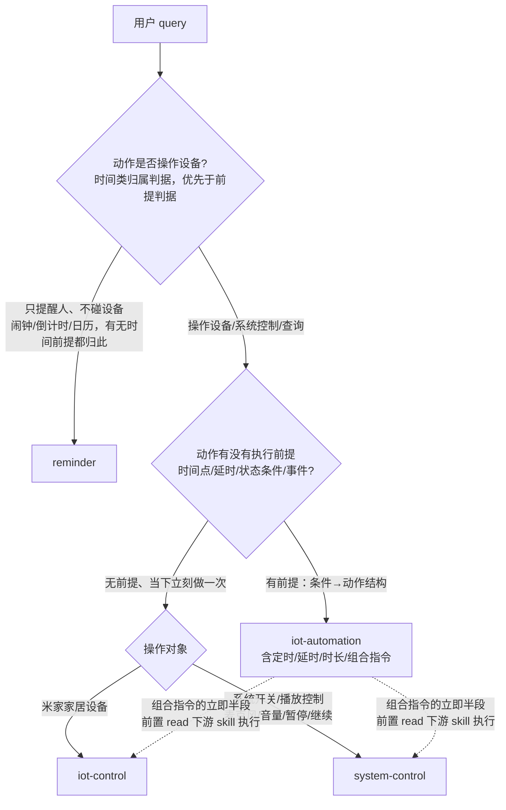
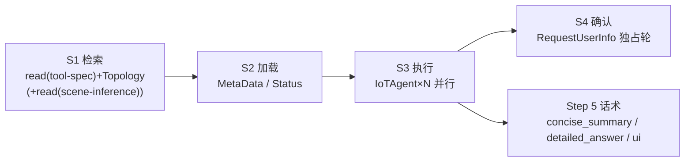
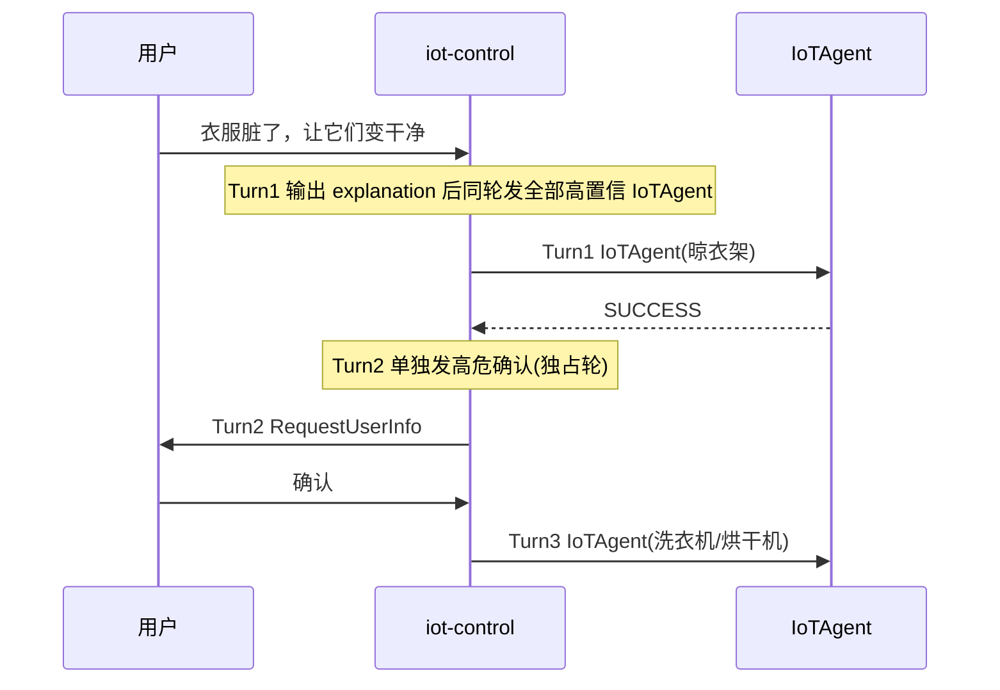

# 05 · 自测练习 — iot-control 与 iot-automation

> **适用读者**：第一次接触 `xiaoaiclaw-ops/skills/iot-control` 与 `xiaoaiclaw-ops/skills/iot-automation` 的开发同学。
> **使用方式**：先独立作答（建议限时 60 分钟），再对照文末「答案与解析」。所有题目均可由源文件规则**唯一作答**，不设开放题。
> **事实基线**：题干与答案中的工具名、参数名、字段路径、错误码、阈值、条数上限均与源文件逐条核对；如与精读笔记冲突，以源文件为准。

---

## 0. 知识地图（作答前 5 分钟速览）

### 0.1 两个 skill 的路由分水岭



> **时间类归属判据优先**：只提醒人、不碰设备的闹钟/倒计时/日历（如「每天8点提醒我吃药」）一律 → `reminder`，与有无时间前提无关；一旦操作设备（含定时/延时/时长）才进前提判据（`xiaoaiclaw-ops/skills/iot-automation/SKILL.md:35`）。

### 0.2 iot-control 主流程与调度骨架



### 0.3 iot-automation 六步骨架

| 步骤 | 调用 | 关键约束 |
|---|---|---|
| 前置 | 理解拆分；组合指令先 `read` 一个下游 skill 执行立即部分 | 立即部分数据与自动化严格隔离 |
| Step 1 | `SearchIoTDeviceTopology` | 无参；就近原则定默认家/房间/对话设备 |
| Step 2 | `SearchIoTDeviceStatus` | 只看 `online` 过滤，不判功能 |
| Step 2.5 | `RequestUserInfo` | **必经**，可多轮，发问即结束本轮 |
| Step 3 | `SearchAutomationTCA` | 设备类合法值唯一来源 |
| Step 4 | 构造请求 JSON | triggers/conditions/time_window 分水岭 |
| Step 5 | `CreateAutomationScene` | 最多 2 次调用，必须给总结回复 |

---

## 一、基础题（B1–B6）

### B1（概念题）路由分水岭判据
1. 用一句话分别写出 `iot-control` 与 `iot-automation` 的判别核心（提示："立即执行一次" vs "满足条件时自动执行"）。
2. 判断下列 4 条 utterance 各归属哪个 skill（`iot-control` / `iot-automation` / `reminder` / `system-control`）：
   - (a) 「打开客厅灯」
   - (b) 「10分钟后关灯」
   - (c) 「每天8点提醒我吃药」
   - (d) 「暂停播放10分钟」

### B2（概念题）iot-control 工具参数速查
补全下表「必要参数」列（写参数名即可）：

| 工具 | 必要参数 | 用途 |
|---|---|---|
| `SearchIoTDeviceTopology` | ? | 获取家庭/房间/设备拓扑 |
| `SearchIoTDeviceMetaData` | ? | 查询功能点/模式/取值范围 |
| `SearchIoTDeviceStatus` | ? | 查询当前状态 |
| `IoTAgent` | ? | 执行操控队列 |
| `RequestUserInfo` | ? | 反问/确认 |

并回答：`IoTAgent` 还有一个可选参数叫什么？什么场景才允许传？

### B3（概念题）输出标签契约
说出 `<explanation>`、`<concise_summary>`、`<detailed_answer>` 三个标签各自的行为（上屏/TTS）与用途，并回答：反问路径下允许输出哪些标签？

### B4（概念题）iot-automation 六步流程
1. 按顺序写出主干六步的工具调用。
2. 哪一步是"必经、可多轮、发问即结束本轮"的确认环节？
3. 同一对话要创建第二个自动化时，能否复用第一个任务查过的 `real_did`/`tca_id`？为什么？

### B5（判断题）
> "为了提高效率、减少返回量，调用 `SearchIoTDeviceTopology` 时可以传入 `refined_request` 参数限定到某个房间。"

判断对错，并说明违反哪条规则。

### B6（判断题）
> "`refined_request` 是发给用户看的执行说明，应写得礼貌完整，例如：'麻烦帮您把客厅的窗帘关上，营造观影氛围'。"

判断对错，并给出正确写法。

---

## 二、进阶题（A1–A6）

### A1（场景题 · 车家判别）
对下列 4 条请求逐一判定：是否调用 `iot-control`？若不是，路由到哪个 skill？
- (a) 请求来自座舱：「打开车上的空调」
- (b) 请求来自座舱：「打开家里的灯」
- (c) 请求来自手机：「打开空调」
- (d) 请求来自座舱：「打开空调」（无"车上/家里"限定词）

### A2（场景题 · 原子指令合并）
用户（手机、单家庭、主控无房间锚点）说：
- (a) 「打开客厅和卧室灯，再把灯亮度调高。」
- (b) 「打开空调，设置为制热，温度设为26度，再把风速调到低速。」

对每一句回答：拆成哪些原子指令？最终合并成几条 `IoTAgent` 调用？每条 `refined_request` 怎么写？是否触发 P4 功能点上限？

### A3（场景题 · 多卡话术）
用户说「我想在客厅看电视，帮我营造下轻松舒适的氛围」，明确部分与模糊部分分别处理后，同轮并行 3 条 `IoTAgent`（关闭客厅窗帘 / 打开客厅空调 / 打开客厅电视），全部 `SUCCESS`，`data.ui.id` 依次为 `32b9a1`、`a5970c`、`9ada4c`。
1. 执行前那句 `<explanation>` 应写什么？
2. 写出最终上屏输出（含全部标签与卡片）。

### A4（场景题 · AND/OR 分水岭）
用户说：「每天晚上10点，如果客厅灯还亮着并且窗帘也开着，就关灯拉上窗帘。」
1. 给出 `CreateAutomationScene` 请求的结构骨架（`scene_name` 可自拟，设备 `tca_id` 可用语义占位，但 `time`/`repeat` 要写具体值）。
2. 为什么不能把"灯还亮着""窗帘还开着"都放进 `triggers[]`？

### A5（场景题 · 延时换算）
当前时间 14:30，对下列请求逐一说明处理方式（能构造的写出 trigger 的 `time`/`repeat`；不支持的写出兜底话术要点）：
- (a) 「10分钟后关灯」
- (b) 「14秒后停止播放」
- (c) 「25小时后关空调」
- (d) 「打开卧室空调5分钟」

### A6（场景题 · 系统 trigger 强制映射）
- (a) 「离家就关灯关新风拉窗帘」：`triggers[]` 必须用哪个 `tca_id`？必填字段是什么？为什么禁止用人体传感器"无人移动"替代？
- (b) 「每天晚上九点开启睡眠模式」：为什么禁止用设备事件触发器替代？给出 trigger 关键字段。
- (c) 「工作日门锁开锁的时候，关闭窗帘」："工作日"这个时间限定放哪里？要不要再加一条 `T:timer.crontab`？

---

## 三、挑战题（C1–C6）

### C1（场景题 · 模糊场景推理 + 高危设备）
用户（手机、目标范围=客厅）说：「衣服脏了，让它们变干净。」目标范围内有：洗衣机、烘干机、智能晾衣架。
1. 命中哪个场景？候选品类闭集是什么？
2. 三台设备分别"直接执行"还是"直接反问"？依据哪条规则？
3. 用 Turn 序列写出执行时序（哪一轮发什么工具），并写出 `RequestUserInfo` 的 `question_text` 示例。

### C2（场景题 · 组合指令拆分）
对下列两条 query，分别回答：(1) `[立即]` 与 `[自动化]` 两半怎么拆、各路由到哪；(2) 自动化半段的 action 应取哪个 TCA 语义；(3) 前置立即部分的数据有什么隔离要求？
- (a) 「音乐继续播放10分钟」
- (b) 「暂停主卧音箱播放歌曲，3小时后再继续播放」

### C3（场景题 · 错误重试）
1. `CreateAutomationScene` 首次返回 `FAIL_VALUE_INVALID`，按规则修正后重试 1 次，第二次返回 `FAIL_MIOT_REJECT`。还能发第三次吗？分别写出这三个错误码（含 `FAIL_TCA_NOT_FOUND`）各自的处理方式与硬性调用上限。
2. `iot-control` 侧：`IoTAgent` 返回 `Semantic Error` 时的重试规则是什么？若该调用携带 `prev_execution_id`，规则有何不同？

### C4（场景题 · 位置边界锁定）
拓扑含 3 个 home：「王府园」「远洋」、以及 `is_car_home=true` 的「车载家」；主控设备（无屏音箱）在王府园客厅。用户说：「把客厅弄暖和。」
1. 目标家庭与目标范围如何确定？
2. 哪些设备明确不进入候选？
3. 若客厅没有温度类设备，能否用远洋家的温湿度计补状态、或用远洋家的空调补操控？最终兜底话术按什么模板写？

### C5（场景题 · 时长类跨天换算）
用户说：「每周一到六晚10点开加湿器2小时。」
1. 这是几条自动化？每条的 trigger（`time` + `repeat`）分别是什么？
2. 说明跨天重复日后移的规则（含 `7→1` 回绕）。
3. Step 2.5 必须向用户复述什么？

### C6（判断题 · 上下文隔离）
判断下列各轮是否允许继承上一轮 IoT 语义槽位，并各指出依据规则：
- (a) 上轮「打开空调」，本轮「温度调到30」
- (b) 上轮「帮我准备PARTY」，本轮「关闭地下室空调」
- (c) 上轮「不要关卧室灯」，本轮「把卧室灯调暗」
- (d) 上轮「查询室内湿度」，本轮「温度呢」

---

## 答案与解析

### B1 答案
1. **分水岭**：`iot-control` 处理"当下无条件、立即执行一次"的家居设备控制/查询；`iot-automation` 处理"满足条件时自动执行"的「触发条件 → 执行动作」规则。判别要点是**是否存在一个作为执行前提的触发条件**。
   考察点：两 skill 路由边界。出处：`xiaoaiclaw-ops/skills/iot-automation/SKILL.md:4`、`xiaoaiclaw-ops/skills/iot-automation/SKILL.md:31`。
2. (a) `iot-control`；(b) `iot-automation`（延时类）；(c) `reminder`（只提醒人、不碰设备）；(d) `iot-automation`（含延时成分即归本技能，立即那半"暂停播放"在前置交 `system-control` 执行）。
   考察点：时间类归属判据（看动作是否操作设备）+ 播放控制带延时的路由优先级。
   出处：`xiaoaiclaw-ops/skills/iot-automation/SKILL.md:33`、`xiaoaiclaw-ops/skills/iot-automation/SKILL.md:35`、`xiaoaiclaw-ops/skills/iot-automation/SKILL.md:4`、`xiaoaiclaw-ops/skills/iot-automation/SKILL.md:96`。

### B2 答案
| 工具 | 必要参数 |
|---|---|
| `SearchIoTDeviceTopology` | 无（`params: {}`，禁止增加任何参数） |
| `SearchIoTDeviceMetaData` | `refined_request`、`device_id_list` |
| `SearchIoTDeviceStatus` | `refined_request`、`device_id_list` |
| `IoTAgent` | `refined_request`、`device_id_list` |
| `RequestUserInfo` | `question_text` |

可选参数：`prev_execution_id`——**仅多轮续接场景**（用户确认/选择后）传入，首次调用禁止传入。
考察点：工具参数契约。出处：`xiaoaiclaw-ops/skills/iot-control/SKILL.md:76`、`xiaoaiclaw-ops/skills/iot-control/references/tool-spec.md:11`、`xiaoaiclaw-ops/skills/iot-control/references/tool-spec.md:96`。

### B3 答案
| 标签 | 行为 | 用途 |
|---|---|---|
| `<concise_summary>` | 上屏 + TTS | 操控结果、查询摘要、失败/受限/兜底短结果 |
| `<detailed_answer>` | 仅上屏 | 仅结构化列查询明细/设备状态列表；严禁主观评价、原因分析、操控建议 |
| `<explanation>` | 仅上屏 | 仅工具调用过程提示，Step 5 禁止复述 |

反问路径：**不输出任何标签或自然语言**，直接调用 `RequestUserInfo`；且调用 `RequestUserInfo` 前也不输出任何标签。标签外禁止自然语言（裸文本被系统丢弃）。
考察点：输出语法契约。出处：`xiaoaiclaw-ops/skills/iot-control/SKILL.md:381`、`xiaoaiclaw-ops/skills/iot-control/SKILL.md:22`、`xiaoaiclaw-ops/skills/iot-control/SKILL.md:394`。

### B4 答案
1. 前置（理解拆分，组合指令先 `read` 下游 skill 执行立即部分）→ Step 1 `SearchIoTDeviceTopology` → Step 2 `SearchIoTDeviceStatus` → Step 2.5 `RequestUserInfo` → Step 3 `SearchAutomationTCA` → Step 4 构造 → Step 5 `CreateAutomationScene`。
2. **Step 2.5**（必须先用 `RequestUserInfo` 跟用户确认设备与条件，可多轮、不限次数）。
3. **不能**。多任务跳步禁令：每个任务都必须从 Step 1 重新完整走流程，session 历史中的 `real_did`/`tca_id`/`spec` 可能已过时，复用会导致参数错位。
   考察点：六步必走 + 多任务跳步禁令。出处：`xiaoaiclaw-ops/skills/iot-automation/SKILL.md:115`、`xiaoaiclaw-ops/skills/iot-automation/SKILL.md:123`、`xiaoaiclaw-ops/skills/iot-automation/SKILL.md:124`。

### B5 答案
**错**。`SearchIoTDeviceTopology` 参数固定为空对象，**禁止增加任何参数**；且必须与 `read(tool-spec)` 同轮并行。想限定范围只能靠 Step 3.0 位置边界锁定在候选筛选阶段收窄，不能靠工具入参。
考察点：工具参数约束 + S1 并行规则。出处：`xiaoaiclaw-ops/skills/iot-control/references/tool-spec.md:11`、`xiaoaiclaw-ops/skills/iot-control/SKILL.md:71`。

### B6 答案
**错**。`refined_request` 是发给 `IoTAgent` 执行器的可执行指令（执行器把自然语言翻译为设备操作，**不是人类读者**）；语体要求纯命令、只写"做什么"，场景目标/氛围/感受词**不写入**指令。正确写法：`关闭客厅窗帘`（"营造观影氛围"属氛围词，违规）。
考察点：原子指令对象契约的语体约束（合并后仍生效）。出处：`xiaoaiclaw-ops/skills/iot-control/SKILL.md:156`、`xiaoaiclaw-ops/skills/iot-control/SKILL.md:159`、`xiaoaiclaw-ops/skills/iot-control/SKILL.md:303`。

### A1 答案
- (a) **不调用 `iot-control`** → `system-control`（座舱请求且操控座舱设备/明确操控"车上的…"）。
- (b) **调用 `iot-control`**（车端远程操控家居设备属家居意图）。
- (c) **调用 `iot-control`**（查询/操控米家家居设备）。
- (d) **不调用 `iot-control`** → `system-control`。冲突规则：指令非明确操控"家/房间里的…/家居设备"且为车载意图时判车载；车端"打开空调/灯"（无限定）按车载意图处理。

考察点：车家判别硬规则与冲突优先级。出处：`xiaoaiclaw-ops/skills/iot-control/references/car-vs-home-intent-judge.md:14`、`xiaoaiclaw-ops/skills/iot-control/references/car-vs-home-intent-judge.md:30`、`xiaoaiclaw-ops/skills/iot-control/references/car-vs-home-intent-judge.md:43`、`xiaoaiclaw-ops/skills/iot-control/SKILL.md:14`。

### A2 答案
**(a)** 原子指令：①`打开` + `灯`（位置：客厅和卧室）②`调高亮度` + `灯`。二者同品类（灯）、同设备集合（客厅+卧室灯的并集）、动作无冲突（开 + 调亮度，非反向/非同属性不同值）→ **合并为 1 条 `IoTAgent`**，`refined_request` 保留原始位置，如 `打开客厅和卧室的灯并调高亮度`（P1 位置忠实；❌ 写成 `打开灯` 会丢位置）；功能点 2 个，不触发 P4。

**(b)** 原子指令：①打开 ②设置为制热 ③温度设为26度 ④风速设置为低速。同品类同设备集合本可合并，但功能点 4 个 **超过 P4 上限 3** → **拆成 2 条并行 `IoTAgent`**：`打开空调，设置为制热，温度设为26度` + `风速设置为低速`（属性值用"设置为"句式）。

考察点：原子指令校验清单、合并前提 P0-P4、动作无冲突、P4 超限拆分。出处：`xiaoaiclaw-ops/skills/iot-control/SKILL.md:158`、`xiaoaiclaw-ops/skills/iot-control/SKILL.md:276`、`xiaoaiclaw-ops/skills/iot-control/SKILL.md:294`、`xiaoaiclaw-ops/skills/iot-control/SKILL.md:300`、`xiaoaiclaw-ops/skills/iot-control/SKILL.md:301`、`xiaoaiclaw-ops/skills/iot-control/SKILL.md:179`。

### A3 答案
1. `<explanation>` 用场景多品类模板：`正在帮你布置客厅观影环境。`（并行 `IoTAgent` 只输出一句整体说明，禁止逐设备输出或夹带设备盘点）。
2. 最终输出（标签 + 每个 SUCCESS `ui.id` 一行 `<ui>`，按队列顺序）：

```
<concise_summary>客厅观影环境已经调好了。</concise_summary>
<ui><id>32b9a1</id></ui>
<ui><id>a5970c</id></ui>
<ui><id>9ada4c</id></ui>
```

要点：意向性/场景类操控的 `<concise_summary>` **不允许出现设备名**，只描述整体氛围/效果；3 个 `ui.id` 必须全量逐行输出，禁止丢弃/合并/只取首个；反问路径之外不得带问号。
考察点：多卡聚合契约 + 意向性场景话术模板 + explanation 模板。出处：`xiaoaiclaw-ops/skills/iot-control/SKILL.md:53`、`xiaoaiclaw-ops/skills/iot-control/SKILL.md:404`、`xiaoaiclaw-ops/skills/iot-control/SKILL.md:415`、`xiaoaiclaw-ops/skills/iot-control/SKILL.md:460`。

### A4 答案
1. 结构骨架（参照示例 G）：

```json
{
  "scene_name": "10点灯亮且窗帘开则关灯关窗帘",
  "triggers": [
    {"tca_id": "T:timer.crontab", "time": "22:00", "repeat": "daily"}
  ],
  "conditions": [
    {"real_did": "<灯 real_did>", "tca_id": "<灯开关状态 T:>", "vid": 1},
    {"real_did": "<窗帘 real_did>", "tca_id": "<窗帘开合状态 T:>", "vid": 1}
  ],
  "condition_relation": "and",
  "actions": [
    {"real_did": "<灯 real_did>", "tca_id": "<关灯 A:>"},
    {"real_did": "<窗帘 real_did>", "tca_id": "<关窗帘 A:>"}
  ]
}
```

2. 因为 `triggers[]` 多条之间**恒为 OR**（任一发生即触发），没有 AND 语义、也没有 `trigger_relation` 字段可改。"灯还亮着**并且**窗帘也开着"是"都要满足"的守卫，塞进 `triggers[]` 会被当成"任一满足即触发"，语义正好反掉。正确拆法：**1 个时间点 trigger + 其余状态进 `conditions[]` + `condition_relation:"and"`**（condition 必须是可查询的状态，不是瞬时事件）。
   另：`time`/`repeat` 只允许出现在 `T:timer.crontab` 上。

考察点：triggers/conditions/time_window 三者判别 + AND/OR 分水岭 + 传参闭合白名单。出处：`xiaoaiclaw-ops/skills/iot-automation/SKILL.md:356`、`xiaoaiclaw-ops/skills/iot-automation/SKILL.md:370`、`xiaoaiclaw-ops/skills/iot-automation/references/examples.md:127`、`xiaoaiclaw-ops/skills/iot-automation/references/trigger-action-construction.md:63`。

### A5 答案
- (a) 支持：换算绝对时间 14:30+10min → `{"tca_id":"T:timer.crontab", "time":"14:40", "repeat":"once"}` + 关灯 action；Step 2.5 必须复述"我将创建一个 14:40 自动关灯的一次性自动化，确认吗？"。
- (b) **不支持**（<1 分钟，秒级精度，`T:timer.crontab` 仅分钟级）：`RequestUserInfo` 回复"当前自动化暂不支持秒级定时，建议直接对设备说"XX秒后关闭"或在米家 App 中设置"。
- (c) **不支持**（>24 小时）：`RequestUserInfo` 回复"当前自动化暂不支持超过24小时的延时触发，建议在米家 App 中设置"。
- (d) 时长类 = 起始动作 + 相反动作（开↔关）：起始"打开卧室空调"当下立即执行（前置走 `iot-control`），本 skill 只建结束那条一次性自动化：`{"tca_id":"T:timer.crontab", "time":"14:35", "repeat":"once"}` + 关空调 action；复述"我将创建一个 14:35 自动关闭卧室空调的一次性自动化，确认吗？"。

考察点：延时/时长换算、边界（≥1min 且 ≤24h）、相反动作取反、复述要求。出处：`xiaoaiclaw-ops/skills/iot-automation/references/delay-and-duration.md:7`、`xiaoaiclaw-ops/skills/iot-automation/references/delay-and-duration.md:17`、`xiaoaiclaw-ops/skills/iot-automation/references/delay-and-duration.md:26`。

### A6 答案
- (a) 必须用 `{"tca_id":"T:location.leave_fence", "home_id": <拓扑中该家庭的 id>}`；必填字段 `home_id`（取自 Step 1 拓扑 `homes[].id`）。禁止设备 trigger 替代：人体传感器只检测单个房间的移动状态，不代表全家离人；"离家/出门/不在家"关键词 MUST 映射到 GPS 地理围栏系统 trigger。
- (b) 用户给了明确时间点，必须用 `{"tca_id":"T:timer.crontab", "time":"21:00", "repeat":"daily"}`。设备事件是"设备状态变化时触发"，不等于"到了某个时间点触发"。
- (c) "工作日"是生效限定，放 `time_window`：`{"from":"00:00","to":"23:59","days":"workday"}`（`from`/`to` 必须成对写全，不可只给 `days`）；门锁开锁是唯一触发点，**不要**再加第二个 `T:timer.crontab`，否则语义变成定时触发。

考察点：系统 trigger 强制映射表 + 时间条件映射约定（触发点 vs 生效区间）。出处：`xiaoaiclaw-ops/skills/iot-automation/SKILL.md:335`、`xiaoaiclaw-ops/skills/iot-automation/SKILL.md:345`、`xiaoaiclaw-ops/skills/iot-automation/references/trigger-action-construction.md:83`、`xiaoaiclaw-ops/skills/iot-automation/references/trigger-action-construction.md:100`、`xiaoaiclaw-ops/skills/iot-automation/references/examples.md:108`。

### C1 答案
1. 触发词归一：「脏衣服、衣服变干净、洗衣服」→ **洗衣晾衣**场景；候选品类闭集 = 高置信品类 `洗衣机、烘干机、干衣机、晾衣架`（本题目标范围内有洗衣机、烘干机、智能晾衣架，均在闭集内；矩阵外品类不得擅自召回）。
2. **智能晾衣架 → 直接执行**（高置信、非高危）；**洗衣机、烘干机 → 直接反问**（洗涤类属高危设备；用户仅表达场景/目标"让它们变干净"、未显式指定设备与动作，按高危覆盖优先级进入直接反问，禁止直接执行）。高危待确认不得导致整体跳过：非高危高置信设备仍照常入队执行。
3. 时序（`RequestUserInfo` 独占轮次禁令）：



`question_text` 示例（高危反问只问"是否执行"，禁止收集参数）：`是要帮你把洗衣机和烘干机打开吗？`
❌ 同轮发 `[IoTAgent(晾衣架), RequestUserInfo]`；❌ 问"洗多久/什么模式"。

考察点：场景闭包、高危覆盖优先级、独占轮次禁令、P2 高危反问护栏。出处：`xiaoaiclaw-ops/skills/iot-control/references/scene-inference-strategy.md:23`、`xiaoaiclaw-ops/skills/iot-control/references/scene-inference-strategy.md:133`、`xiaoaiclaw-ops/skills/iot-control/references/scene-inference-strategy.md:33`、`xiaoaiclaw-ops/skills/iot-control/references/scene-inference-strategy.md:40`、`xiaoaiclaw-ops/skills/iot-control/SKILL.md:41`、`xiaoaiclaw-ops/skills/iot-control/SKILL.md:511`。

### C2 答案
**(a) 「音乐继续播放10分钟」**
1. `[立即→system-control] 继续播放`；`[自动化] 10分钟后暂停播放`（时长类：起始立即 + **相反动作**，暂停↔继续成对，不是"停止"）。
2. 自动化半段动作是**暂停**，Step 3 取 `label` 含"暂停"的 action `tca_id`。
3. 隔离：立即部分是独立子任务，`read` 下游 skill 只为完成它；其读到的设备/状态数据与执行结果**不得**被自动化流程复用；自动化部分照旧从 Step 1 完整走六步；立即部分成败只在 Step 2.5 转述。

**(b) 「暂停主卧音箱播放歌曲，3小时后再继续播放」**
1. `[立即→system-control] 暂停主卧音箱播放`（带房间名的"主卧音箱"整句归本技能，立即那半连同房间+设备名一起交 `system-control`）；`[自动化] 3小时后继续播放`。
2. 自动化半段必须取 `label` 含"**继续/恢复**"的 action `tca_id`，**不是**停止/暂停——动作在 query 里被显式写出时按原文那个动作取 TCA，别被同句前半的"暂停"带偏。
3. 同 (a)。

考察点：前置拆分、相反动作取反、播放控制五动作互不替代、数据隔离。出处：`xiaoaiclaw-ops/skills/iot-automation/SKILL.md:65`、`xiaoaiclaw-ops/skills/iot-automation/SKILL.md:68`、`xiaoaiclaw-ops/skills/iot-automation/SKILL.md:96`、`xiaoaiclaw-ops/skills/iot-automation/SKILL.md:103`、`xiaoaiclaw-ops/skills/iot-automation/SKILL.md:328`、`xiaoaiclaw-ops/skills/iot-automation/references/delay-and-duration.md:7`。

### C3 答案
1. **不能发第三次**。硬性规则：同一个 `CreateAutomationScene` 请求（含参数微调）**最多调用 2 次**（首次 + 1 次重试），超过 2 次 → 终止并向用户回复失败话术。各错误码处理：
   | 错误码 | 处理 |
   |---|---|
   | `FAIL_TCA_NOT_FOUND` | 回退 Step 3 重新查该设备 TCA；确认无 TCA 则告知设备不支持；禁止凭猜测换 `tca_id` 重试 |
   | `FAIL_MIOT_REJECT` | **不重试同一 trigger 结构**；检查 trigger 类型（离家/到家必须系统 trigger）与非法字段；确认无误仍被拒 → 终止并报告失败；禁止仅改参数细节反复重试，重试必须有实质性结构变更 |
   | `FAIL_VALUE_INVALID` | 检查 `value`/`vid` 是否超出 Step 3 spec 的 `range`/`options`，修正后**重试 1 次** |
   | 其他 `FAIL_*`/工具异常 | 不重试，直接报告失败 |

2. `Semantic Error`/`Cloud Exception`/返回空/设备无响应类：重新生成 `refined_request` 重试 1 次，失败标记 `failed`；重试不变量——保持原动作方向（开/关/调节）不变，仅修正属性值落地/参数格式，不得翻转方向。**携带 `prev_execution_id` 时例外**：禁止改写 `refined_request`，用相同 `prev_execution_id` + 用户原始回复重试 1 次，仍失败标记 `failed`；禁止丢弃 `prev_execution_id` 后改写重试。

考察点：错误码表 + 重试上限 + 多轮续接重试例外。出处：`xiaoaiclaw-ops/skills/iot-automation/references/error-codes.md:5`、`xiaoaiclaw-ops/skills/iot-automation/references/error-codes.md:12`、`xiaoaiclaw-ops/skills/iot-control/SKILL.md:351`、`xiaoaiclaw-ops/skills/iot-control/SKILL.md:355`、`xiaoaiclaw-ops/skills/iot-control/SKILL.md:357`。

### C4 答案
1. 目标家庭：用户未明确家庭名，拓扑存在 `caller_device_type` 主控设备 → 锁定**主控设备所在家庭 = 王府园**；目标范围：用户明确"客厅" → **该房间**。
2. 不进候选：`is_car_home=true` 的「车载家」下所有设备；明确房间指令下，未知家庭/未知房间设备（除非用户明确点名该设备）；远洋家的任何设备（不得跨 home 召回、不得从其他家庭/房间/车家补设备）。
3. **都不能**。辅助查询设备（温湿度计、空气检测仪等）也必须在目标范围内，不得用目标范围外设备补状态或环境信息；更不得用远洋家的空调补操控。目标范围内无匹配设备时按 5.2.2/5.2.4 兜底，意向性/场景类话术模板：`[范围]暂时没有可以[目标效果]的智能设备。` 句号结束，不反问、不推荐。

考察点：Step 3.0 位置边界锁定、is_car_home 排除、辅助设备范围约束、兜底话术。出处：`xiaoaiclaw-ops/skills/iot-control/SKILL.md:225`、`xiaoaiclaw-ops/skills/iot-control/SKILL.md:228`、`xiaoaiclaw-ops/skills/iot-control/SKILL.md:229`、`xiaoaiclaw-ops/skills/iot-control/SKILL.md:140`、`xiaoaiclaw-ops/skills/iot-control/SKILL.md:463`、`xiaoaiclaw-ops/skills/iot-control/references/tool-spec.md:25`。

### C5 答案
1. **两条自动化**（起始是"周期定时"，起始/结束都是 `T:timer.crontab` 周期自动化，按多场景逐个创建，结束继承起始的周期）：
   - 开：`{"tca_id":"T:timer.crontab", "time":"22:00", "repeat":"1-6"}`
   - 关：`{"tca_id":"T:timer.crontab", "time":"00:00", "repeat":"2-7"}`
2. 跨天规则：结束钟点 = 起始钟点 + 时长，≥24:00 对 24h 取模落到次日；一旦落到次日，结束自动化的重复日相对起始整体后移一天——ISO 周几列表逐个 +1（**7→1 回绕**，`"1-6"`→`"2-7"`）；`daily` 仍 `daily`；起始用 `workday`/`freeday` 且跨天时无法机械 +1，须回 Step 2.5 向用户澄清。本题 22:00+2h=次日 00:00，故关的重复日后移。
3. Step 2.5 必须把**两条**自动化各自的时间点 + 重复日都复述给用户核对（对应情形 1 定时复述要求）。

考察点：时长类周期拆两条、跨天后移、复述契约。出处：`xiaoaiclaw-ops/skills/iot-automation/references/delay-and-duration.md:10`、`xiaoaiclaw-ops/skills/iot-automation/references/delay-and-duration.md:13`、`xiaoaiclaw-ops/skills/iot-automation/SKILL.md:258`。

### C6 答案
- (a) **允许继承**（连续操控：上轮"打开空调"→本轮"温度调到30"）。
- (b) **必须切断**（当前轮是已明确房间和目标的完整指令"关闭地下室空调"；且 PARTY 属必须切断的新场景类，压缩摘要/被中断任务不得进入本轮）。
- (c) **继承否定约束但窄化**：历史"不要关卧室灯"只禁止字面动作"关闭"，不禁止调暗/调暖色温 → 本轮"调暗"可执行。
- (d) **允许继承**（连续查询：上轮"查询室内湿度"→本轮"温度呢"）。

注意：继承语义不等于复用历史工具结果；每次新指令后 Topology/MetaData/Status 都按当前请求重新判定，禁止因历史工具结果跳过调用。
考察点：上下文隔离规则（默认切断/允许继承/否定窄化/必须切断）。出处：`xiaoaiclaw-ops/skills/iot-control/SKILL.md:59`、`xiaoaiclaw-ops/skills/iot-control/SKILL.md:61`、`xiaoaiclaw-ops/skills/iot-control/SKILL.md:62`、`xiaoaiclaw-ops/skills/iot-control/SKILL.md:63`、`xiaoaiclaw-ops/skills/iot-control/SKILL.md:120`。

---

## 附：自评参考

| 得分档 | 建议 |
|---|---|
| 18 题全对 | 可直接参与 skill 规则改动评审 |
| 错 1–4 题 | 重点回读错题对应的源文件章节 |
| 错 5 题以上 | 建议先读 `xiaoaiclaw-ops/skills/iot-control/SKILL.md` 与 `xiaoaiclaw-ops/skills/iot-automation/SKILL.md` 全文再重做 |

> 拿不准的细节一律回源文件核对；若源文件未覆盖，标记「待确认」，不要猜。
