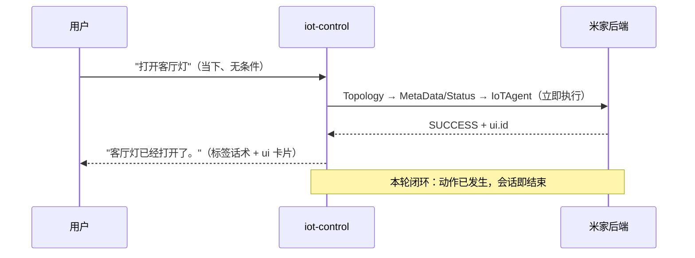
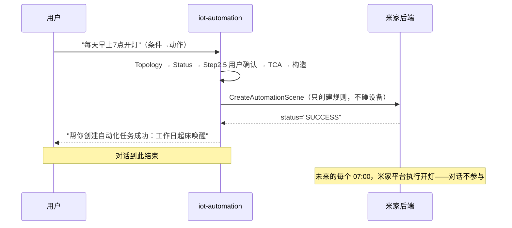

# 06 · 为什么是两个 Skill —— iot-control 与 iot-automation 的拆分逻辑

> **要回答的问题**：这两个 skill 都是"对 IoT 设备的控制"，功能看上去很相近，为什么不合并成一个？合并成一个岂不是更高效？
> **读法**：本文是全套材料的"设计层"收尾——01/02 讲"各自怎么运作"，03 讲"怎么分工协作"，本文讲"**为什么这么切**"。所有论断均标注源文件行号；工程侧结论来自 `src/` 实际代码。

---

## 1. 先把直觉摆上桌

"都是控制 IoT 设备" 这个直觉**对了一半**：

- ✅ **对的一半**：两个 skill 的设备域完全重叠——都是米家拓扑里的灯、空调、窗帘、扫地机；连"查设备"用的工具都有三个同名（`SearchIoTDeviceTopology` / `SearchIoTDeviceStatus` / `RequestUserInfo`）。
- ❌ **差的一半**：它们**控制的不是同一类东西**。iot-control 控制的是**设备**（让某台灯现在亮起来）；iot-automation 控制的根本不是设备，而是一条**规则**（让米家平台在未来的某个条件下替你操作设备）。

这个差别不是措辞游戏，它向下贯穿了工具链、数据模型、确认策略、错误处理、输出契约**每一个工程维度**。下文逐层展开。

---

## 2. 核心答案：一句话 + 两张时序图

> **iot-control 的交付物是"一次已发生的设备动作"；iot-automation 的交付物是"一条尚未生效的未来规则"。**
> 前者本轮闭环、动作即刻发生；后者对话结束时**什么都没发生**——设备动作发生在未来的每个触发时刻，执行主体是米家平台，不是这个对话（`xiaoaiclaw-ops/skills/iot-automation/SKILL.md:125`："成功只表示自动化已下发到米家侧，不代表设备动作已立即执行"）。

### 2.1 iot-control：本轮闭环

### 2.2 iot-automation：创建规则，动作在未来

**一旦看清"交付物不同"，拆分的必然性就浮现了**：执行主体不同（IoTAgent 通道 vs 米家规则引擎）、生命周期不同（一次性 vs 持久）、可撤销性不同（开错灯再关一下 vs 规则创建后对话侧不能改删，`xiaoaiclaw-ops/skills/iot-automation/SKILL.md:44-53`）。这三个"不同"分别决定了下文的工具链差异、确认策略差异、错误语义差异。

---

## 3. 六个维度的结构性差异（拆分的实质内容）

### 3.1 工具链：执行通道完全不同

两个 skill 的工具白名单在 `src` 里有硬编码映射（`src/auto-reply/reply/utils.ts:89-102`，笔者已核对源码）：

| 工具 | iot-control | iot-automation | 说明 |
|---|---|---|---|
| `SearchIoTDeviceTopology` | ✅ | ✅ | 共享：查拓扑 |
| `SearchIoTDeviceStatus` | ✅ | ✅ | 共享：查在线状态 |
| `RequestUserInfo` | ✅ | ✅ | 共享：反问/确认 |
| `SearchIoTDeviceMetaData` | ✅ | ❌ | control 独有：查功能点 |
| `IoTAgent` | ✅ | ❌ | control 独有：**即时执行通道** |
| `SearchAutomationTCA` | ❌ | ✅ | automation 独有：查自动化能力 |
| `CreateAutomationScene` | ❌ | ✅ | automation 独有：**规则创建通道** |

注意两点：

- **交集只有 3 个"查询/交互"类工具**，真正定义各自能力的执行类工具零交集。所谓"功能相近"，相近的只是外围查询；核心执行路径完全是两套。
- **iot-automation 里根本没有 `IoTAgent`**——它从头到尾不直接操控任何设备。这直接证伪了"两个 skill 都是对设备的控制"：automation 对设备做的唯一事情是**引用**它们（把 `real_did` 写进 triggers/actions 的 JSON）。

**合并的后果**：白名单变成 7 个工具同时可见。模型每一轮都要在"即时执行通道"（IoTAgent）和"规则创建通道"（CreateAutomationScene）之间做选择，选错通道的代价是实质性的（该开灯的时候创建了一条"开灯规则"，灯没开）。工具面越大，误调用率越高——skill 拆分正是把每个 skill 的工具面压到最小。

### 3.2 数据模型：MetaData vs TCA，两套异构的"能力描述体系"

- **iot-control 以 `service_list` 为唯一权威源**：原子指令的属性值必须来自 MetaData 的可选值/范围，"禁止臆造设备不具备的功能"（`xiaoaiclaw-ops/skills/iot-control/SKILL.md:174`、`xiaoaiclaw-ops/skills/iot-control/references/tool-spec.md:56`）。
- **iot-automation 明确规定 `service_list` 仅供参考、不作判据**："`service_list` 为空、或其中找不到目标操作对应的 spec，都不**不代表**设备不支持该自动化——能力支持与否统一由 Step 3 的 TCA 查询裁定"（`xiaoaiclaw-ops/skills/iot-automation/references/tool-response-spec.md:101`、`xiaoaiclaw-ops/skills/iot-automation/SKILL.md:227`）。

**同一个字段，一个 skill 里是圣经，另一个 skill 里明确降级为"仅供参考"**——这不是矛盾，而是两种执行模型需要不同的能力描述：

| | iot-control（自然语言执行） | iot-automation（结构化构造） |
|---|---|---|
| 执行载体 | `refined_request` 是**自然语言**，由 IoTAgent 翻译成设备操作（`xiaoaiclaw-ops/skills/iot-control/SKILL.md:156`） | 请求是**结构化 JSON**，`tca_id`/`vid`/`operator_vid`/`value` 必须逐一来自 TCA spec（`xiaoaiclaw-ops/skills/iot-automation/SKILL.md:299`） |
| 需要的能力描述 | 功能点语义（"风速可调低速/中速/高速"） | 合法值清单（`options[]` 的 `vid`、`range` 的 `min/max`、`operator_vid` 1-4 的语义，`xiaoaiclaw-ops/skills/iot-automation/references/tool-response-spec.md:209-217`） |
| 时间语义 | 无（"现在"就是现在） | 一整套：`T:timer.crontab` 只收绝对 HH:MM、相对延时须换算、跨天重复日后移、`workday`/`freeday` 节假日语义（`xiaoaiclaw-ops/skills/iot-automation/references/delay-and-duration.md:3`、`xiaoaiclaw-ops/skills/iot-automation/references/trigger-action-construction.md:55,91-103`） |

合并意味着一个 skill 同时维护两套能力观 + 一套复杂时间语义，模型每轮都要先判断"我现在处在哪个解释框架里"。

### 3.3 确认策略：执行优先 vs 必经确认——由"不可逆性"决定

这是两个 skill 在交互模式上最鲜明的反差：

| | iot-control | iot-automation |
|---|---|---|
| 默认姿态 | **执行优先原则**："除非判为直接反问或 IoTAgent 返回确认/选择，所有可定位目标都必须执行/查询"（`xiaoaiclaw-ops/skills/iot-control/SKILL.md:29`）；反问要过三门槛 G1 真歧义/G2 引导 IoT/G3 聚焦控制（`xiaoaiclaw-ops/skills/iot-control/SKILL.md:499-507`） | **Step 2.5 必经确认**："必须先用 `RequestUserInfo` 向用户发问……**无论需求是否清晰**都不例外，这是本 skill 唯一允许'本轮不创建'的环节"，可多轮不限次数（`xiaoaiclaw-ops/skills/iot-automation/SKILL.md:237`） |
| 确认时机 | 例外（真歧义/高危设备/IoTAgent 触发） | 规则（每次创建前） |

**为什么相反？看错误成本**：

- control 开错一盏灯，用户说一句"关掉"就修正了——动作一次性、可即时撤销，所以默认直接干，快比稳重要。
- automation 创建错一条规则，错误会在**未来的每个触发时刻重复发生**（每天 7 点开错灯），而对话侧**不能修改/删除已创建的自动化**——只能引导用户去米家 App（`xiaoaiclaw-ops/skills/iot-automation/SKILL.md:44-53`）。持久 + 难撤销，所以确认从"例外"变成"必经"。

> **设计启示**：确认强度应当与动作的不可逆性成正比。这条规律比"多问总没错"精确得多——control 的演进方向恰恰是**压缩反问**（防退化护栏 P1 可定位优先执行，`xiaoaiclaw-ops/skills/iot-control/SKILL.md:510`），因为对一次性动作来说，多问是在消耗用户耐心。

### 3.4 失败与重试语义：瞬态故障 vs 结构校验

| | iot-control（IoTAgent） | iot-automation（CreateAutomationScene） |
|---|---|---|
| 失败典型 | `Semantic Error`/`Cloud Exception`/设备无响应——**瞬态故障** | `FAIL_TCA_NOT_FOUND`/`FAIL_MIOT_REJECT`/`FAIL_VALUE_INVALID`——**平台对规则结构的校验拒绝** |
| 重试策略 | 重新生成 `refined_request` 重试 1 次，保持动作方向不变；`Client Exception` 静默跳过禁止重试；连续 2 次同动作失败终止（`xiaoaiclaw-ops/skills/iot-control/SKILL.md:347-359,368`） | 按错误码分类：`FAIL_VALUE_INVALID` 修正后重试 1 次；`FAIL_MIOT_REJECT` **禁止微调参数重试**（结构被拒，微调无意义）；同一请求最多 2 次（`xiaoaiclaw-ops/skills/iot-automation/references/error-codes.md:3-16`） |

两套语义不能混：拿 control 的"换个说法再试一次"去对付 `FAIL_MIOT_REJECT`，会变成无意义的重试风暴；拿 automation 的"结构校验"去处理设备超时，会错杀本可重试成功的指令。

### 3.5 输出契约：标签语法 vs 文本总结

- control 有一套**最高优先级的输出语法契约**：`<explanation>`（过程）/`<concise_summary>`（上屏+TTS）/`<detailed_answer>`（明细）/`<ui><id>`（卡片），"标签外禁止自然语言；裸文本会被系统丢弃，等同没回复"（`xiaoaiclaw-ops/skills/iot-control/SKILL.md:22-26,380-416`）。
- automation 的交付物是 Step 5 后的**文本总结**：成功"帮你创建自动化任务成功：{scene_name}"、失败"创建自动化任务失败：…"（`xiaoaiclaw-ops/skills/iot-automation/SKILL.md:405-409`）。

（两套契约为何复杂度不同，源文件未说明原因，此处不做推断；差异本身见上表即事实。）

### 3.6 会话结构：多轮续接 vs 一次性创建流

- control 有**确认队列 + `prev_execution_id` 多轮续接**机制：IoTAgent 返回选择/确认类 reply 时暂存，主队列清空后再逐条确认（`xiaoaiclaw-ops/skills/iot-control/references/multi-turn-session-flow.md:9-10`、`xiaoaiclaw-ops/skills/iot-control/SKILL.md:319-324`）——因为即时控制天然产生"执行 → 用户追问 → 续接"的会话流。
- automation 的多轮只发生在 Step 2.5 的确认循环里，一旦创建完成流程即终止；且**跨轮创建第二个自动化必须从 Step 1 全量重走**，禁复用 session 历史的 `real_did`/`tca_id`/`spec`（`xiaoaiclaw-ops/skills/iot-automation/SKILL.md:124,181`）——因为规则参数有强时效性。

---

## 4. 合并会发生什么：三个具体的规则冲突

如果只看"都是 IoT"，合并似乎顺理成章。但把两个 skill 的规则并排放，会发现**同名概念上有正面相撞的硬规则**——合并后无法两全：

### 冲突一：音箱（soundbox）的双重身份

- iot-control **硬排除**音箱："音箱（soundbox）在任何路径下均不得进入候选集、不得传入 `device_id_list`、不得作为 IoTAgent 目标"（`xiaoaiclaw-ops/skills/iot-control/SKILL.md:254`；另见 :183"禁止操作音箱"）。
- iot-automation **主动选用**音箱：`notify_speaker` 动作需要指定目标音箱 `real_did`，还有一套"就近选默认房间音箱"的规则（`xiaoaiclaw-ops/skills/iot-automation/SKILL.md:263,391`、`xiaoaiclaw-ops/skills/iot-automation/references/trigger-action-construction.md:75`）。

深看一层，两者其实**在更底层是一致的**——都拒绝"音箱作为被控设备"：automation 也规定 Step 3 查到的音箱"文本播报"类 tca_id **一律丢弃**，播报只能走封装字段 `kind:"notify_speaker"`（`xiaoaiclaw-ops/skills/iot-automation/SKILL.md:301`）。差异在于：automation 的场景里音箱有"播报媒介"这个合法身份（提醒人），而 control 的场景里根本没有这个动作类型。**拆分线画在"能力通道"上，而不是"设备"上**——这正是单看设备域会觉得"功能相近"、看执行模型才发现"根本不同"的原因。合并后，"音箱能不能进 `device_id_list`"这一条规则就得写成"如果是即时控制则禁止、如果是 notify_speaker 则必须"，每条类似规则都要挂条件分支，规则复杂度爆炸。

### 冲突二：`service_list` 的相反地位

见 §3.2——一边"唯一权威源、禁止臆造"，一边"仅供参考、不作判据"。合并后这条规则无从写起，只能拆成两节各自声明适用前提，等于在文档内部重建了 skill 边界。

### 冲突三：话术契约的互斥

control 要求最终回复必须句号结束、禁问号、严格套模板（`xiaoaiclaw-ops/skills/iot-control/SKILL.md:425`）；automation 的 Step 2.5 确认话术天然**以问号结尾**（"确认创建吗？"，`xiaoaiclaw-ops/skills/iot-automation/SKILL.md:258-267`）。两套契约并存于一个 skill，模型每轮先要自判"我现在受哪套契约约束"——这正是拆分要消灭的认知负担。

---

## 5. "合并更高效"的三个常见理由，逐条检验

### 理由一："它们共享那么多工具和概念" → 共享的是外围，不是内核

共享的 3 个工具（Topology/Status/RequestUserInfo）是**查询与交互**工具，后端本来就是同一批接口；共享的概念（`real_did`、拓扑、家庭/房间）是**设备域知识**。工具和概念的复用不需要以 skill 合并为代价——它们已经在两个 skill 里各自被正确使用了。真正不共享的部分（IoTAgent vs CreateAutomationScene、MetaData vs TCA、两套确认/重试/输出语义）才是 skill 的身份内核。

### 理由二："组合指令要跨 skill，麻烦" → 跨界协作已有标准机制，且边界清晰恰恰是它的前提

"关闭麦克风，10分钟后打开"这类一句话含两半的指令，automation 的**前置拆分**机制已完整解决：立即半 read 下游 skill（iot-control/system-control）执行掉，自动化半走六步创建，数据流严格隔离（`xiaoaiclaw-ops/skills/iot-automation/SKILL.md:25,57-68`）。注意这个机制的**前提**恰恰是两个 skill 边界清晰——模型必须先能判断"哪半是立即、哪半是规则"，拆分才可行。合并消除边界的同时也消除了这个判断的依据；保留边界 + 提供委托协议，才是既享受专注又覆盖交叉场景的解法。

### 理由三："维护一份文档比两份省事" → 单份已经太重，合并是翻倍

- 体量：iot-control SKILL.md 536 行 + 4 个 references；iot-automation SKILL.md 452 行 + 5 个 references（全套约 2700 行）。合并 ≈ 1000 行主文件 + 9 个 references，而单次对话只需要其中一条流程。
- 演进节奏独立：control 的 CHANGELOG 主线是位置边界锁定、合并规则 P0-P4、输出契约、独占轮次 badcase 修复（`xiaoaiclaw-ops/skills/iot-control/CHANGELOG.md:6-80`）；automation 的主线是调度矩阵、触发白名单、时间语义、渐进式披露拆分（git `33ada40b35` "拆分渐进式披露结构，新增调度矩阵并收敛离线判断与触发白名单"）。两条线几乎不相交——合并后每次 badcase 修复都要在同一个巨型文件里动刀，回归风险叠加。
- token 成本是这两个 skill 的**一等公民约束**：control 2.1.0 专门做过"全文压缩净减约 318 行"（`xiaoaiclaw-ops/skills/iot-control/CHANGELOG.md:71-72`）；两个 skill 都有精细的"reference 同轮加载"纪律（control：`read(tool-spec)` 必须与 Topology 同轮、禁止单独一轮，`xiaoaiclaw-ops/skills/iot-control/SKILL.md:68-90`；automation：P1/P3 同轮规则，`xiaoaiclaw-ops/skills/iot-automation/SKILL.md:159-175`）。**在连 300 行都要省的系统里，把 2700 行捆在一起让每次对话全量面对，方向正好反了。**

---

## 6. 平台架构的本意：小而专的 skill 是加载模型的基本假设

拆分不是这两个 skill 的局部决定，而是整个平台的设计取向：

1. **Description 路由**："Agent 根据这段文字决定是否触发 Skill"，且"**description 的写作质量直接影响 Skill 的触发准确率**"（`xiaoaiclaw-ops/skill-dev-guide.md:182-187`）。注意两个 skill 的 description 各自花了大量篇幅**互相划界**——automation 的 description 明写"判别要点：存在一个作为执行前提的触发条件……区别于 iot-control 的『当下无条件、立即执行一次』"（`xiaoaiclaw-ops/skills/iot-automation/SKILL.md:4`）。合并后这段"划界文字"失去对象，description 要同时描述两类语义，路由判据从**结构特征**（有无条件→动作结构）退化为**关键词权重**，误路由率上升。
2. **skill2funcs 白名单**：每个 skill 映射一组工具（`src/auto-reply/reply/utils.ts:89-102,317-320`）——skill 是工具可见性的隔离单位，拆分让工具面最小化（见 §3.1）。
3. **tag→skill 预加载**：路由标签直接映射到 skill（`"设备控制": ["system-control", "iot-control"]`、`"家用设备状态查询": ["iot-control"]`，`src/auto-reply/reply/utils.ts:216,255`；`"自动化": ["iot-automation"]` 走配置侧映射）。skill 粒度 = 预加载粒度，粒度越细，单轮注入的上下文越省。
4. **六级加载源 + 上游 52 个 bundled skills**（`xiaoaiclaw-ops/skill-dev-guide.md:82-93`）：平台生态本身就是"多个小 skill"而非"少数巨型 skill"的组织方式。

---

## 7. 反事实检验：什么情况下"合并"才是对的？

拆分不是教条。如果以下任一条件成立，合并反而更合理——逐一对照现实：

| 合并的合理条件 | 现实情况 | 结论 |
|---|---|---|
| 两者共享执行通道（同一执行器、同一数据模型），只是参数不同 | 执行器零交集（IoTAgent vs CreateAutomationScene），能力模型异构（MetaData vs TCA） | ❌ 不满足 |
| 其中一个是低频边缘功能，撑不起独立维护 | 两者都是高频主流意图："打开客厅灯"和"每天 7 点开灯"都是日常 top 需求，各自有独立评测集和演进历史 | ❌ 不满足 |
| 路由判别无法可靠区分（用户表达天然含混、无结构特征可依） | 判据是清晰的结构特征：**有无执行前提**（时间点/延时/事件/持续条件），automation 的 description 甚至为组合指令定义了优先级（含延时/定时成分即归 automation，`xiaoaiclaw-ops/skills/iot-automation/SKILL.md:4,25`） | ❌ 不满足 |

三条全不满足 → 拆分是正确选择。反过来，这三条也是评估**任何**两个 skill 该不该合并的通用检查表。

---

## 8. 给 skill 设计者的五条启示

1. **拆分线画在"执行模型"上，不画在"设备域"上**。用户眼里"都是控制家电"，工程眼里是"即时指令 vs 持久规则"两种执行模型。找拆分线时问：交付物是什么？谁执行？何时生效？可否撤销？
2. **确认强度 ∝ 动作不可逆性**。一次性可逆动作 → 执行优先、反问设门槛（control）；持久难撤销动作 → 必经确认（automation）。
3. **工具白名单是 skill 边界的工程落点**。判断两个 skill 是否该合并，先看合并后工具面是否扩大、两条"执行通道"是否同时可见。
4. **跨 skill 协作用"委托 + 数据隔离"解决，不用合并消除边界**。组合指令的前置拆分机制（read 下游 skill、执行即结束、数据不回流）是可复用的模式。
5. **Description 是路由合同，边界要双向写**。每个 skill 的 description 都应包含"什么时候不是我、该去哪"——两个 skill 互相指认，路由才稳（`xiaoaiclaw-ops/skills/iot-automation/SKILL.md:4` 末段的判别优先级是范本）。

---

## 附：本文引用的源文件清单

| 源文件 | 用途 |
|---|---|
| `xiaoaiclaw-ops/skills/iot-control/SKILL.md` | 执行优先原则、调度矩阵、输出契约、音箱硬排除、反问三门槛 |
| `xiaoaiclaw-ops/skills/iot-control/references/tool-spec.md` | service_list 权威源、IoTAgent 结果处理 |
| `xiaoaiclaw-ops/skills/iot-control/references/multi-turn-session-flow.md` | 确认队列与多轮续接 |
| `xiaoaiclaw-ops/skills/iot-control/CHANGELOG.md` | 独占轮次 badcase、全文压缩 318 行 |
| `xiaoaiclaw-ops/skills/iot-automation/SKILL.md` | 前置拆分与数据隔离、六步必走、Step 2.5 必经确认、管理类不支持、notify_speaker 就近原则、TCA 唯一来源 |
| `xiaoaiclaw-ops/skills/iot-automation/references/tool-response-spec.md` | service_list 非判据、TCA spec 结构 |
| `xiaoaiclaw-ops/skills/iot-automation/references/trigger-action-construction.md` | 传参白名单、notify 字段、时间映射 |
| `xiaoaiclaw-ops/skills/iot-automation/references/delay-and-duration.md` | 绝对时间约束 |
| `xiaoaiclaw-ops/skills/iot-automation/references/error-codes.md` | FAIL_* 分类与重试上限 |
| `src/auto-reply/reply/utils.ts` | skill2funcs 工具白名单（:89-102）、tag2skills（:216,255）——已逐一核对源码 |
| `xiaoaiclaw-ops/skill-dev-guide.md` | 六级加载源、description 质量与触发准确率 |
