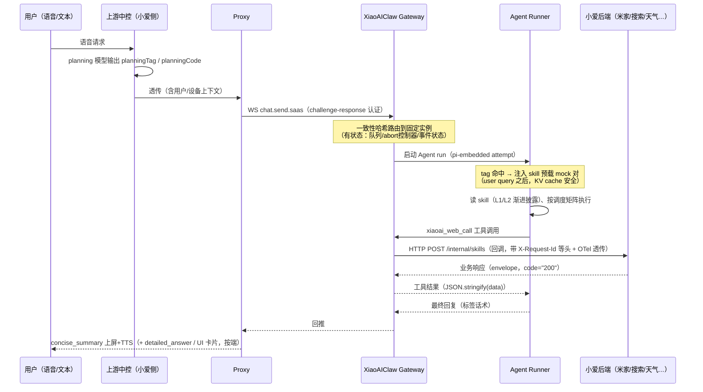

# 07 · 面试沉淀：小爱语音 Agent 平台（XiaoAIClaw 二开）工作全景

> **用途**：个人技术沉淀。面试前通读 1–2 遍，做到能脱稿讲清：部门在这块具体做什么、技术栈是什么、难点是什么、怎么解决的。
> **用法**：§0 是电梯陈述（必须背熟）；§5 是核心弹药（8 个"难点故事"，每个按"现象→本质→方案→效果"展开）；§7 是追问预案；§8 是需要你自己补的个人信息。
> **事实口径**：所有工程断言均在仓库内可溯源（标注路径）；不确定的、属于个人经历的信息显式标了【按实际补充】，别把我编的当成你经历的。

---

## 0. 电梯陈述（背熟）

### 30 秒版

> 我们部门基于一个开源的多渠道 AI 助手网关框架做二次开发，把它改造成小爱同学的语音 Agent 平台，服务手机、音箱、TV、车机等多端。我的工作围绕几块：一是把框架 SaaS 化——对接上游中控和米家后端，语音请求经 proxy 进网关，Agent 通过统一的 `xiaoai_web_call` 回调通道调用小爱侧工具；二是自研 Skill 体系，现在有 29 个生产 skill，覆盖 IoT 控制、自动化、内容搜索播放、地图导航等；三是语音场景特有的工程问题——延迟（我们做了 tag 预加载、工具结果预注入、skill 内工具同轮并行的调度矩阵）、上下文成本（三级渐进式披露）、工具调用正确性（靠结构化契约和 badcase 驱动的规则沉淀）；四是稳定性与可观测性——OTel 全链路追踪、一致性哈希路由、会话迁移到 Redis 这些。

### 3 分钟版（在 30 秒版基础上展开）

> 展开讲三个有代表性的点：
>
> **① 延迟**。语音助手对首响延迟极敏感，而通用 Agent 框架"模型自己发现要读 skill → read 一轮 → 再调工具"的模式太慢。我们的解法分两层：平台层做**预加载**——上游中控的 planning 模型会输出意图标签（planningTag/planningCode），网关按 tag→skill 映射把 skill 全文以 mock 的 tool-call/tool-result 对直接注入本轮，省掉一轮模型推理；为了不破坏 KV cache，注入位置放在用户 query 之后而不是 system prompt 里。Skill 层做**调度矩阵**——每个 skill 的文档里明确规定哪些工具必须同轮并行（比如读规格文件和查设备拓扑必须同轮）、哪些必须独占轮次（反问类工具），模型照着矩阵执行，把轮次数压到最少。
>
> **② 上下文成本**。29 个 skill 的 description 常驻系统提示词（有 150 个 skill / 3 万字符的硬上限），激活后整个 SKILL.md 进入上下文，所以必须做三级渐进式披露：主文件只放决策逻辑，枚举数据和大表拆到 references/ 按需加载。我们做过一轮全部 skill 的上下文效率评估，iot-control 还专门做过全文压缩，净减 318 行。
>
> **③ 正确性**。让 LLM 生成结构化工具参数（比如米家自动化的 JSON）很容易幻觉——编设备 ID、编能力 ID。我们的做法是给每个 skill 定"唯一合法值来源"：设备 ID 只能来自拓扑工具的实时返回，自动化能力 ID 只能来自 TCA 查询，参数有闭合白名单（传非法字段直接被平台拒绝）；再配合 badcase 驱动的规则沉淀——比如某次评测 10 个 case 因反问工具和执行工具同轮混发而丢分，复盘后就立了"反问必须独占轮次"的最高优先级禁令，重跑全部恢复满分。这套方法论本质上是**用文档工程代替传统编码，把领域约束编码成模型的执行契约**。

---

## 1. 业务与部门定位

### 1.1 产品形态

- **小爱同学语音助手**的 Agent 化升级：用户对手机/音箱/TV/车机/手表说话，背后由 LLM Agent 完成意图理解、多轮对话、工具调用（控制设备、搜内容、查天气、设提醒……）。
- 多端形态差异大：有屏/无屏（输出契约不同——无屏端只吃 TTS 摘要，有屏端还要上屏明细和 UI 卡片）、手机/车机/手表（能力域和 skill 可见性不同）。
- 端侧入口是小爱 App（miui_voiceassist），用户身份、设备上下文（Normalized client context）随请求带入。

### 1.2 技术路线：为什么基于开源框架二开

- **基座**：开源多渠道 AI 助手网关（上游仓库），核心是 **Gateway 控制平面 + Channel 渠道抽象 + Agent（Pi）** 架构（`xiaoaiclaw-ops/architecture.md:7-27`）。它自带会话管理、多渠道接入、工具体系、扩展（extensions）机制、52 个内置 skill。
- **为什么二开而不是自研**：会话/路由/工具调用这些控制面能力是通用且成熟的，自研投入产出比低；我们的价值增量在**小爱业务侧**——SaaS 化对接、领域 skill、多端适配、语音场景的延迟和稳定性工程。
- **二开工程原则**：所有自研内容收敛在 `xiaoaiclaw-ops/` 目录（skill、K8s 清单、运维脚本、设计文档），与上游目录物理隔离，rebase 时零冲突；受保护的定制文件有专门的 protection list 跟踪（`xiaoaiclaw-ops/sync-history/customization-protection-list.md`）；上游 bug 和临时 workaround 记录在 `upstream-tracker.md`，每次同步上游前过一遍。上游 33 个 extensions 我们只保留 7 个（飞书通道、记忆系统、OTel 诊断等），控制攻击面和镜像体积（`xiaoaiclaw-ops/CLAUDE.md`）。

### 1.3 部门工作全景（六大块）

| # | 工作块 | 一句话 |
|---|---|---|
| 1 | SaaS 接入层 | 语音请求从上游中控/proxy 进网关的整条链路 + 多端身份模型 |
| 2 | 自研 Skill 体系 | 29 个生产 skill 的设计、加载、可见性控制 |
| 3 | 性能优化 | 预加载（tag 预载 + 工具结果预注入）、skill 内调度并行 |
| 4 | 可观测性 | OTel 全链路、首包埋点、监控大盘 |
| 5 | 稳定性 | 路由、会话存储、熔断、内存、优雅部署 |
| 6 | 质量体系 | 例行评测、跨 run 归因分析、E2E 测试、badcase 驱动迭代 |

---

## 2. 端到端链路（一张图讲清）

**讲的时候强调三点**：
1. 网关是**有状态**的（用户队列、abort 控制器、Agent 事件状态、MCP 连接），所以多实例必须做会话粘性路由（这是一致性哈希的动机，见 §5-6）。
2. **工具调用是"回调"模式**：Agent 不直连业务后端，统一经 `xiaoai_web_call` → 网关 → `/internal/skills` 回调地址 → 小爱侧后端。好处是鉴权、追踪、重试、脱敏全部收口在一处（`docs/xiaoai/tech-analysis/xiaoai-web-call-implementation.md`）。
3. **输出走标签契约**：`<concise_summary>`（上屏+TTS）、`<detailed_answer>`（仅上屏）、`<explanation>`（过程提示）、`<ui><id>`（卡片），标签外裸文本会被系统丢弃——这是语音多端形态决定的输出协议。

---

## 3. 工作分解与关键设计

### 3.1 SaaS 接入层

- **通道**：上游 Channel 抽象对接的是 IM 渠道，我们主用的是 SaaS 通道（`chat.send.saas`，WS + challenge-response 认证）；飞书作为内部运营通道保留（`xiaoaiclaw-ops/CLAUDE.md` Extensions 表）。
- **上游对接**：proxy 透传中控的 `planningTag`/`planningCode` 和用户设备上下文（`xiaoaiclaw-ops/docs/feat/tag-based-skill-preload.md`）。
- **多端身份模型**：同一 main agent 用 `AGENTS-TV.md` / `AGENTS-Phone.md` / `AGENTS-SoundBox.md` 按端拆分人格与能力边界，避免一端人设修改污染另一端（`xiaoaiclaw-ops/docs/knowledge/02-core-business/arch-xiaoai-agents.md:31-50`）。
- **调试设施**：`manage.sh saas-tui --mask-uid` 本地模拟 SaaS 请求；零侵入 curl mock 注入机制（`XIAOAICLAW_DEV_INJECT_JSON` + PATH 前置 wrapper）给本地请求注入测试设备上下文（`xiaoaiclaw-ops/skill-dev-guide.md:356-500`）。

### 3.2 自研 Skill 体系

- **规模**：29 个生产 skill（2026-06 时 27 个，持续增长；`find xiaoaiclaw-ops/skills` 验证），覆盖 IoT 控制与自动化、内容搜索播放（音乐/电台/诗词/视频/广播）、地图导航、天气/新闻/搜索、提醒、电话、车机助手、视觉问答等。草稿放 `skills-draft/` 不自动加载。
- **加载机制**：六级加载源，自研 skill 走 `skills.load.extraDirs`（ConfigMap 配置），容器内只读挂载，本地 Volume 热重载（改 SKILL.md 下次对话即生效，`xiaoaiclaw-ops/skill-dev-guide.md:78-113`）。
- **三级渐进式披露**：L0 = name+description 常驻（~97 字符/skill，上限 150 skill / 30,000 字符）；L1 = SKILL.md 正文按需激活；L2 = references/ 深度按需（`docs/xiaoai/tech-analysis/skill-context-efficiency-evaluation.md:12-28`）。**这是 skill 工程的第一性原则：上下文窗口是公共财产，只注入模型不知道的信息。**
- **设备可见性过滤**：soft（软分区，未引用的 skill 为通用）与 strict（严格白名单）两级，appId > deviceType 优先级，命中即返回（`xiaoaiclaw-ops/docs/knowledge/02-core-business/arch-skill-system.md:93-137`）。例：手表只看到 2 个 skill。
- **工具白名单（skill2funcs）**：每个 skill 映射一组可用工具，如 `iot-control` → Topology/MetaData/Status/IoTAgent/RequestUserInfo 五件套，`iot-automation` 换成 Topology/Status/TCA/Create/RequestUserInfo（`src/auto-reply/reply/utils.ts:89-102`）。**skill 是工具可见性的隔离单位**——这是拆分 skill 粒度的工程落点。
- **开发流程**：`skill/<name>` 分支 → 本地 Podman 热重载验证 → merge 到 `deploy/p4t` 集群验证 → MR 到 main（`xiaoaiclaw-ops/skill-dev-guide.md:18-38`）。

### 3.3 性能优化：预加载

语音场景延迟预算极紧，"模型发现要读 skill → read 工具一轮 → 再调业务工具"的模式多花一轮推理。两层预载方案（`xiaoaiclaw-ops/docs/knowledge/02-core-business/arch-skill-system.md:74-91`）：

| 机制 | 触发 | 注入形式 | 省掉什么 |
|---|---|---|---|
| tag-skill 预载 | `planningTag` 命中 `saas.tagSkillPreload` | skill 全文的 `skill_read` mock 对 | 一轮模型推理 + skill_read 工具调用 |
| 工具结果预注入 | `planningCode` 命中 `saas.toolResultPreload` | `read`/`xiaoai_web_call` 的 mock 结果对 | 固定工具（如拓扑）的往返 |

**三个工程细节（面试加分点）**：
1. **KV cache 安全**：注入位置在用户 query **之后**，以 mock 的 assistant toolCall + toolResult 对出现，不动 system prompt——system prompt 变了整个前缀缓存全废。
2. **三方去重**：已进 system prompt 的预载名单 + 会话历史里已有的 skill_read/同名工具调用 + 配置内重复，三重检查防止同一内容注入两遍。
3. **降级路径**：单条载荷失败只注入成功的，全部失败短路为空 mock，回退到原生流程——预载是优化不是依赖。

### 3.4 可观测性

- **OTel 全链路**：diagnostics-otel 扩展，工具调用 → HTTP 客户端 span 正确父子挂载（tool.execute 在独立 async 栈，用 requestId 重建 parent context 解决上下文传播断裂，`docs/xiaoai/tech-analysis/xiaoai-web-call-implementation.md:143-155`）；trace context 通过 HTTP header 透传给下游。
- **本地全家桶**：`xiaoaiclaw-ops/o11y/`（otel-collector + Jaeger + Prometheus + Grafana），一个脚本拉起。
- **业务监控**：端到端首包埋点 + 监控大盘 V9 + 并发度/排队深度修正（commit `a0051c8761`）。
- **典型线上问题**：OTel 指标无界维度导致实例指标整体失联——收敛为有界维度修复（commit `a9be79a20e`）。这个故事说明：可观测性系统本身也会吃掉自己的可观测性。

### 3.5 稳定性

| 主题 | 问题 | 解法 | 证据 |
|---|---|---|---|
| 实例路由 | 有状态网关多实例；原取模哈希扩缩容时 99.9% 用户迁移引发 WS 重建风暴；限制区不部署 ZK 服务发现失效 | 接 Nacos 服务发现 + 一致性哈希环（迁移率降到 ~0.1%）；cron 选举也用哈希环分片 | `xiaoaiclaw-ops/docs/consistent-hash-routing-requirements.md` |
| 会话存储 | JFS 文件存储在多实例/hotload 下的问题 | session 读写迁移到 Redis（Matrix Redis ACL） | commits `373ad76479`、`3aa025191c`；`xiaoaiclaw-ops/k8s/secret.yaml:7` |
| 工具循环 | 模型陷入工具死循环，熔断误伤其他 run | 熔断按 run 隔离 + critical 阈值去抖 + abort 兜底话术 | commit `9d139e9a63`；loopDetection 配置 |
| 内存泄漏 | manifest registry 缓存泄漏（两轮修复） | 缓存治理 V2 | commits `f5b123e117`、`c7001e58f3`；`docs/fix-heap-memory-leak-manifest-registry-cache.md` |
| 误判 failover | Redis 存储层超时被误判为模型超时，触发模型切换 | 分层错误归因 | commit `8cc2b3c40d` |
| 中断竞态 | abort/abortedLastRun 竞态 | 修复文档化 | `docs/chat-abort-abortedLastRun-race-fix.md` |
| 优雅部署 | 滚动更新时在途请求 | graceful deployment 方案 | `docs/graceful-deployment-*.md` |

### 3.6 质量体系（badcase 驱动的闭环）

- **例行评测**：周期性跑评测集（case 含 record.json / trajectory.json / raw.json），产出例行评测报告（如 2026-10-20/21 两期，`/home/zzy/code/analyze/` 下有归档）。
- **评测分析 skill 化**：把"分析评测结果"本身做成 skill（`analyze-xiaoaiclaw-eval-results`：统一解析两种输入格式、输出中文分析报告 + 问题分类 + 轨迹/并行/效率指标；`compare-xiaoaiclaw-eval-runs`：跨 run 对比、badcase 归因、失败类型拆解到具体 case、可用率变化归因到具体代码改动、反事实验证方案）。**用 Agent 分析 Agent 的评测——这是吃自己狗粮的典型。**
- **E2E 测试**：33 case / 7 tier，覆盖 15/19 功能域（SaaS 核心、安全沙箱、工具、Agent 管理、生命周期、扩展），`python3 xiaoaiclaw-ops/e2e/run.py`（`xiaoaiclaw-ops/CLAUDE.md` E2E 节）。
- **单测**：vitest + V8 覆盖率阈值 70%；核心链路（预载注入时序、设备过滤、去重语义）都有专项测试。
- **badcase → 规则**：skill 的 CHANGELOG 记录每条规则的来历（例：iot-control 2.1.0 的"RequestUserInfo 独占轮次禁令"修复评测 10 个 case，重跑满分；`xiaoaiclaw-ops/skills/iot-control/CHANGELOG.md:76-80`）。

---

## 4. 技术栈速查

| 层 | 技术 | 备注 |
|---|---|---|
| 语言/运行时 | TypeScript（ESM）+ Node 22 + Bun（TS 直跑） | pnpm workspace；Oxlint/Oxfmt |
| 框架基座 | 开源 Agent 网关（Gateway/Channel/Agent，上游） | 二开隔离在 xiaoaiclaw-ops/ |
| 模型 | 小米自研 mimo 系列（如 mimo-claw-0301）+ mify 代理接入多模型 | model fallback 链；alias 在内部 hook 不生效需完整路径 |
| 工具通道 | `xiaoai_web_call` 统一回调（HTTP POST /internal/skills） | $uuid 模板、重试由下游 `is_retry_allowed` 控制、BigInt 精度保护 |
| 本地开发 | Rootless Podman + Compose，Volume 热重载 | manage.sh 封装全部操作 |
| 生产部署 | K8s（Matrix 平台），Gateway 端口 18789 | 镜像分层 Dockerfile.base |
| 服务发现/路由 | Nacos + 一致性哈希环 | 替代 ZK（限制区不可用） |
| 会话/存储 | Redis（Matrix Redis ACL） | 从 JFS 迁移 |
| 可观测 | OTel（OTLP）→ collector + Jaeger + Prometheus + Grafana | 首包埋点、大盘 V9 |
| 配置 | Apollo / K8s ConfigMap，`$include` 分环境 skill URL | 热更新 |
| 测试 | vitest（70% 阈值）+ 自研 E2E（33 case/7 tier）+ 评测集 + rubric | |

---

## 5. 难点与解决方案（面试核心：8 个故事）

> 每个故事按"现象 → 本质 → 方案 → 效果/证据"讲。面试时挑 2–3 个展开，其余备着。

### 故事 1：语音场景的延迟（预加载体系）

- **现象**：通用 Agent 框架里，模型要先"发现"需要某个 skill，调 `skill_read` 读入，下一轮才能用——多一轮模型推理，首响变慢。语音用户对延迟的容忍远低于打字用户。
- **本质**：信息（skill 内容）到达模型的时机太晚；而把它全塞进 system prompt 又会撑爆常驻上下文且破坏缓存。
- **方案**：tag 预载 + 工具结果预注入（§3.3）。上游 planning 模型的意图标签在请求进来之前就知道"大概要用什么 skill"，网关按映射把内容以 mock 工具调用对注入到 user query 之后。同时 skill 内部用调度矩阵规定工具同轮并行纪律，压缩执行轮次。
- **效果**：省一轮模型推理 + 工具往返；KV cache 零破坏（注入点在 query 后）；有注入时序/去重/BVT 三层测试保障（`arch-skill-system.md:85-90`）。

### 故事 2：上下文成本（渐进式披露 + 效率治理）

- **现象**：29 个 skill 常驻描述 + 激活后整份正文 + references，上下文开销随 skill 数量线性增长；而语音场景的模型预算有限。
- **本质**：skill 文档是"写给模型的代码"，注入即成本；**上下文窗口是公共财产**。
- **方案**：三级披露（L0/L1/L2）；主文件只留决策逻辑，枚举/大表/示例全部下沉 references/；对全部 skill 做过一轮上下文效率评估（识别出"枚举内联"“结构重复""description 冗长"四类问题并给出优先级建议）；iot-control 专项压缩净减 318 行。
- **效果**：L0 常驻 ~600 tokens（24 skill 时），远低于 30k 上限；激活成本按需化。评估报告：`docs/xiaoai/tech-analysis/skill-context-efficiency-evaluation.md`。

### 故事 3：LLM 工具调用的幻觉（结构化契约）

- **现象**：让模型生成米家自动化 JSON 时会编造设备 ID（real_did）、能力 ID（tca_id）、传非法字段。
- **本质**：自由文本生成没有"合法值"概念；领域值（设备拓扑、能力清单）是**运行时数据**，不可能写死在文档里。
- **方案**：每个 skill 定义"唯一合法值来源"链——`real_did` 只能来自 Topology 实时返回、`tca_id`/`vid`/范围只能来自 TCA 查询 spec、参数有闭合白名单（`value_kind` 禁传、`time/repeat` 仅限定时 trigger）；编造的值会被平台校验拒绝（FAIL_* 错误码），skill 文档里把错误码 → 处置动作（回退重查/终止）也写成规则。**让"猜"在结构上无路可走。**
- **效果**：错误码分类处置 + 同请求最多 2 次的硬上限，避免重试风暴（`xiaoaiclaw-ops/skills/iot-automation/references/error-codes.md`）。

### 故事 4：badcase 驱动的规则沉淀（方法论）

- **现象**：评测中 10 个 case 因模型把反问工具（RequestUserInfo）和执行工具（IoTAgent）放在同一轮而丢分——用户还没回答，确认和执行混在一起，输出协议被打乱。
- **本质**：文档没规定轮次排布时，模型按"能并行就并行"的通用倾向行事；但反问是**对话控制流**（发问即结束本轮等回复），和工具并行是两类语义。
- **方案**：立"独占轮次禁令"为最高优先级规则（高危场景：Turn1 全部执行工具 → Turn2 单独反问），写进 SKILL.md 并回补场景策略文档；CHANGELOG 记录 case 编号。
- **效果**：重跑全部恢复满分（`xiaoaiclaw-ops/skills/iot-control/CHANGELOG.md:76-80`）。**方法论提炼：skill 工程的迭代单位是 badcase——每个 case 沉淀为一条可执行规则，规则进文档、进自检清单，用评测回归验证。**

### 故事 5：多端/多家庭路由正确性

- **现象**：车机端说"打开空调"应该控制车里空调（走 system-control），却去开了家里的空调；或反过来。多家庭用户跨家庭误召回（"把客厅弄暖和"查到了另一个家的设备）。
- **本质**：同一个口语表达在不同端、不同家庭上下文里目标完全不同；路由判据必须是**结构特征**（有无"家里的"锚点、家庭归属），不能是关键词。
- **方案**：skill 准入判定的 reference 化（`car-vs-home-intent-judge.md` 的 Hard Rules）；拓扑返回 `is_car_home` 标记车端家庭硬排除；`caller_device_type` 锁定主控家庭 + 位置边界锁定（Step 3.0：先定目标范围再召回，禁止跨 home 补设备）；设备级 skill 可见性过滤（soft/strict 两级）控制每端看到的 skill 面。
- **效果**：2.1.1 版本专门收敛位置边界与车端排除（`CHANGELOG.md:6-32`）。

### 故事 6：多轮交互的状态管理

- **现象**：即时控制天然产生"执行 → 工具要求用户选择 → 用户回复 → 续接"的多轮流；直接让模型"重新理解"用户回复会改写指令导致语义漂移（"第二个"被改写成设备名）。
- **本质**：对话状态（execution_id、候选列表）在工具返回里，不在模型上下文里；续接必须是**协议续接**而不是**重新理解**。
- **方案**：确认队列（IoTAgent 返回选择/确认意图 + execution_id 非空时暂存）+ `prev_execution_id` 续接参数（refined_request = 用户原话**禁止改写**）；上下文默认切断策略（当前指令可独立理解即新建子会话，防历史污染）；自动化 skill 反向规则：跨任务禁复用 session 历史的 ID（会过时导致参数错位）。
- **证据**：`xiaoaiclaw-ops/skills/iot-control/references/multi-turn-session-flow.md`、`CHANGELOG.md:139-142`（多轮续接 query 改写防护）。

### 故事 7：有状态网关的生产化（路由 + 会话 + 熔断）

- **现象**：多实例部署后用户请求落到不同实例，队列/abort 控制器/事件状态全乱；扩缩容时取模哈希让 99.9% 用户换实例，WS 重建风暴；限制区不部署 ZK，服务发现直接失效。
- **本质**：上游框架假设单实例/家庭场景，生产 SaaS 要求水平扩展 + 稳定会话粘性。
- **方案**：Nacos 服务发现 + 一致性哈希环（迁移率 ~0.1%）；cron 选举改哈希环分片；会话从 JFS 迁 Redis；工具循环熔断按 run 隔离（不误伤并发 run）+ 去抖 + abort 兜底话术；Redis 超时与模型超时分层归因（不再误触发模型 fallback）；优雅部署处理在途请求。
- **效果**：多实例稳定运行 + 扩缩容平滑（`docs/consistent-hash-routing-*.md`、`docs/graceful-deployment-*.md`）。

### 故事 8：防泄漏（内容安全 + prompt 泄露）

- **现象**：模型把内部推理、工具调用细节、系统提示词内容泄漏到最终回复；L4 防泄漏命中后升级 thinking 重跑时，又因会话历史末尾是 assistant 消息导致 `Cannot continue` 报错，误触发模型切换。
- **本质**：两难——防泄漏要中断重跑，重跑又依赖会话状态的正确形态；错误分层不清会把重跑失败升级成模型切换。
- **方案**：skill 层输出契约（标签外文本被丢弃、Step 1-3 推理过程禁止输出、tool_calls 泄露专项优化 commit `f3ac36b217`）；回复准则细化 16 条红线（`af1b30e6cf`）；leak-guard 重放轮的 continue 修复（`docs/leak-guard-continue-assistant-tail-fix.md`）；各类异常 stop/超限都有兜底话术且接云配（`ddd9473630`、`5cd5f01f5c`）。
- **效果**：语音场景的回复始终是受控话术，异常时也有可预期的兜底。

---

## 6. 深挖示例：IoT 双 skill（把学习材料串成一个可讲的案例）

面试官若追问"举个具体 skill 的设计"，用这个（细节在 01/02/03/06 号文档，这里给讲法骨架）：

1. **为什么拆两个**：交付物不同——iot-control 交付"一次已发生的设备动作"（本轮闭环），iot-automation 交付"一条未来才生效的规则"（执行主体是米家平台）。执行通道零交集（IoTAgent vs CreateAutomationScene）、能力模型异构（MetaData vs TCA）、确认策略相反（执行优先 vs 必经确认，由不可逆性决定：开错灯可再关，规则创建后对话侧不能改删）。
2. **iot-control 的骨架**：五步主流程（检索→解析→筛选入队→执行调度→话术）+ 调度矩阵（7 条路径 × S1–S4 工具编排）+ 原子指令合并（P0–P4 前提，同品类才合并、单条最多 3 个功能点）+ 反问三门槛（G1 真歧义/G2 引导 IoT/G3 聚焦控制）+ 输出标签契约。
3. **iot-automation 的骨架**：前置拆分（组合指令"关闭麦克风，10分钟后打开"——立即半委托下游 skill 执行、数据流隔离）+ 六步必走（Topology→Status→**用户确认**→TCA→构造→Create）+ triggers/conditions/time_window 三者判别（多 trigger 恒 OR，AND 必须拆 1 trigger + conditions）+ 延时换算（相对时间→绝对 HH:MM，跨天重复日后移）。
4. **最有讲头的设计**：确认强度与不可逆性成正比；"唯一合法值来源"防幻觉；调度矩阵把并行决策从模型判断变成文档规定；badcase → 规则 → 评测回归的闭环。

---

## 7. 常见追问与回答要点

| 追问 | 回答要点 |
|---|---|
| 为什么用文档（prompt）写这些规则，不写成代码？ | 领域知识（话术模板、判别口径、业务例外）变更频率远高于代码，文档 + 热重载的迭代速度是代码发版无法比的；结构性的硬约束（参数白名单、错误码校验）留在平台/下游服务里，文档管"决策逻辑"。两层各司其职。 |
| 这些规则模型真的会遵守吗？怎么保证？ | 不靠单点保证：① description 路由准确率（触发对了才谈执行）；② 规则进自检清单（输出前必过）；③ 评测集回归（badcase 修完必须有重跑证据）；④ 硬约束不放在文档里——放平台校验（白名单/错误码拒绝）。**文档管概率，平台管底线。** |
| 延迟具体多少？优化了多少？ | 【按实际补充：首包 P50/P99 数字、预载上线前后对比】。讲机制即可：省一轮推理 + 工具往返，约等于一个模型轮次的延迟。 |
| 模型怎么选的？ | 小米自研 mimo 系列，经 mify 代理统一接入；有 model fallback 链；thinking 参数可按场景升级（leak-guard 命中升级 thinking 重跑就是一例）。【按实际补充：当前主模型版本】 |
| 和 function calling 原生方案比，你们的 skill 方案好在哪？ | skill 是"包"的单位：description（路由）+ 正文（行为）+ references（数据）+ 工具白名单（skill2funcs）+ 可见性过滤，是一个完整的分发与隔离单元；function calling 只解决"调用格式"，不解决"29 个能力域如何在多端按需分发、上下文按需注入"的问题。 |
| 评测怎么做？指标是什么？ | 例行评测（case 级 record/trajectory/raw）+ 分析 skill 自动出报告（问题分类、轨迹/并行/效率指标）+ 跨 run 对比做 badcase 归因（失败类型拆解、归因到具体提交、反事实验证方案）+ rubric 人工评审。【按实际补充：可用率等核心指标口径】 |
| 上下文超限怎么办？ | compaction（safeguard 模式）+ 渐进式披露控制源头 + skill 压缩治理；超限也有云配兜底话术。 |
| 最难的 bug？ | 从 §5 挑一个你真参与过的讲（推荐故事 4 或 7——一个讲方法论，一个讲分布式工程）。【按实际补充你的亲历细节】 |
| 团队怎么分工协作？ | 平台/稳定性、skill 工程、评测质量、上游同步几条线；MR 流程 + protection list + deploy/p4t 预发验证。【按实际补充：人数、你所在线】 |
| 上游更新怎么跟进？ | 自研内容物理隔离在 xiaoaiclaw-ops/（rebase 零冲突）+ upstream-tracker 记录绕过方案（每次同步前评估哪些可移除）+ 定制文件保护清单。 |

---

## 8. 需要你自己补充的个人信息（占位清单)

> 材料只能提供部门级事实；个人贡献部分必须自己填，面试官一定会问"**你**做了什么"。

- [ ] 你负责的工作线（skill 工程 / 平台稳定性 / 评测 / 全栈）与时间跨度
- [ ] 你亲手做过的 1–2 个 skill 或 1–2 个稳定性修复（把 §5 对应故事的"现象/方案"换成你的第一手细节：当时怎么发现的、怎么定位的、改动是什么）
- [ ] 你可披露的量化结果（评测分数变化、延迟数字、badcase 率、内存曲线）
- [ ] 团队规模与协作方式（你所在子团队几个人、和产品/评测怎么配合）
- [ ] 一段 15 分钟的完整项目叙事（建议骨架：业务背景 → 我的角色 → 难点 → 方案取舍 → 结果 → 反思/如果重来）

---

## 附：数字弹药库（记得住的关键数字）

| 数字 | 含义 | 出处 |
|---|---|---|
| 29 | 生产 skill 数量（2026-10，6 月为 27） | `find xiaoaiclaw-ops/skills` |
| 52 | 上游内置 bundled skill 数 | `skill-dev-guide.md:87` |
| 33 → 7 | 上游 extensions 总数 → 保留数 | `xiaoaiclaw-ops/CLAUDE.md` |
| 6 级 | skill 加载源优先级层级 | `skill-dev-guide.md:82-91` |
| 3 级 | 渐进式披露（L0 常驻 / L1 正文 / L2 references） | 效率评估报告 |
| ~97 字符 / ~24 tokens | 单 skill L0 常驻开销 | 效率评估报告 |
| 150 个 / 30,000 字符 | L0 注入硬上限 | `workspace.ts:482-517` |
| 318 行 | iot-control 2.1.0 全文净减 | `CHANGELOG.md:71-72` |
| 10 个 case | 独占轮次禁令修复的评测 case 数（重跑满分） | `CHANGELOG.md:76-80` |
| 99.9% → ~0.1% | 哈希方案升级后扩缩容用户迁移率 | `consistent-hash-routing-requirements.md` |
| 33 case / 7 tier / 15/19 域 | 二开 E2E 覆盖 | `xiaoaiclaw-ops/CLAUDE.md` |
| 70% | vitest V8 覆盖率阈值 | 根 `AGENTS.md` |
| 18789 | Gateway 端口 | `xiaoaiclaw-ops/CLAUDE.md` |
| 2700 行 | iot-control + iot-automation 全部文档行数（skill 是"写给模型的代码"的体量感） | `wc -l` 实测 |
| 2 次 | CreateAutomationScene 同请求调用硬上限 | `error-codes.md:13` |
| 2 个 | 一个 skill 的工具白名单典型规模差（control 5 工具 vs automation 5 工具，交集 3） | `src/auto-reply/reply/utils.ts:89-102` |
