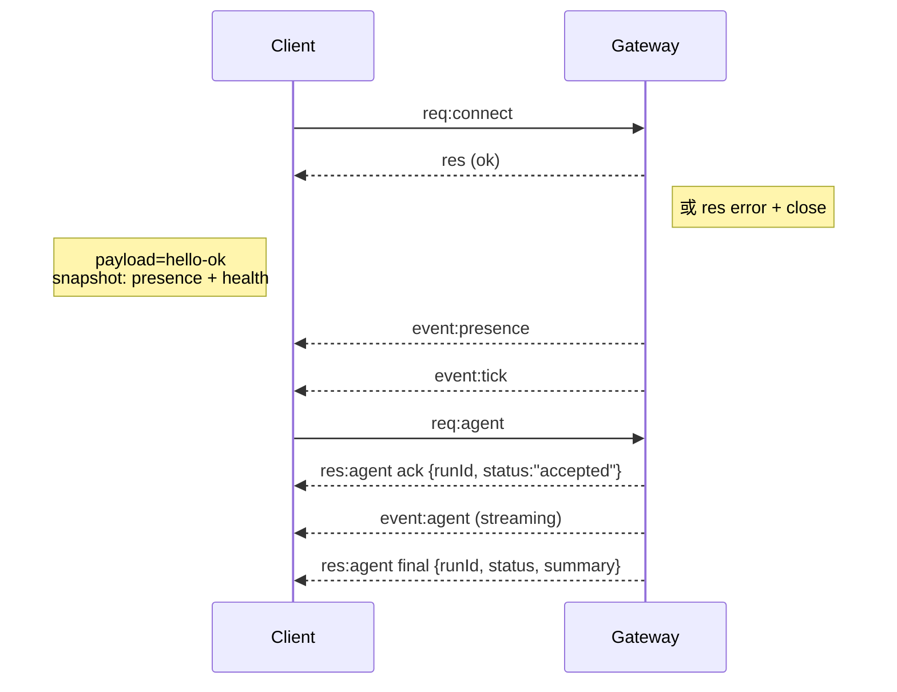

# 实验 1 补课：WS 握手与会话文件逐行详解

> 本文回答实验 1 的两个自查点，全部材料来自 **2026-10-27 我们自己实操留下的日志和文件**，
> 每一步都能在代码里找到出处。读完你应该能独立回答：
>
> 1. TUI 连 Gateway 时那不到一秒里发生了什么？为什么我们会踩 `pairing required` 的坑？
> 2. `sessions/*.jsonl` 里每一行是什么？为什么说它是"链"而不是"列表"？

---

## 第一部分：TUI 与 Gateway 的 WS 握手

### 1.1 先建立直觉：这不是 HTTP

普通 HTTP 是"一问一答就断线"。而 TUI 和 Gateway 之间是 **WebSocket（WS）**：
连接建立后**一直保持**，双方随时互发消息（流式回复、事件广播都靠它）。

正因为连接是长久的、能执行操作的，Gateway 必须在**一开始**就搞清楚三件事：

| 问题                     | 用什么回答                                     |
| ------------------------ | ---------------------------------------------- |
| 你是谁？（进程级）       | **token 认证**（`gateway.auth.token`） |
| 你是哪台设备？（设备级） | **设备身份**（密钥对 + 签名）            |
| 你被允许做什么？         | **配对记录 + scope 权限**                |

打个比方：进公司大楼。

- token = 工卡（证明你是员工）
- 设备身份 = 人脸（证明"你"就是你，卡不能借给别人）
- pairing = 访客审批（新设备第一次来要登记，前台放行）
- scope = 门禁等级（`operator.read` 只能进大厅，`operator.admin` 能进机房）

### 1.2 官方时序图（docs/concepts/architecture.md）



协议规矩（`docs/concepts/architecture.md` 的 Wire protocol 一节）：

- 传输：WebSocket，**文本帧 + JSON**
- **第一帧必须是 `connect`** —— 不握手就发别的请求会被拒
- 握手后：请求 `{type:"req", id, method, params}` → 响应 `{type:"res", id, ok, payload|error}`；
  事件由服务端主动推 `{type:"event", event, payload, seq}`

但这个图太简了，`req:connect` 内部其实分了 **7 步**。下面展开。

### 1.3 完整握手 7 步（含代码出处）

```
TUI                                Gateway
 │                                    │
 │ ① WS TCP 连接（ws://127.0.0.1:19001）
 │ ────────────────────────────────► │
 │                                    │
 │           event: connect.challenge │ ② 服务端立刻发一个随机数(nonce)
 │ ◄──────────────────────────────── │    "考题"，防重放攻击
 │                                    │
 │ ③ 客户端组装 connect 请求：          │
 │    - auth.token（工卡）             │
 │    - device 身份：deviceId/公钥/    │
 │      签名(对 nonce+platform+…签名)  │
 │      ← 用私钥答"考题"，证明持钥      │
 │    - 请求的 role + scopes           │
 │ ────────────────────────────────► │
 │                                    │ ④ 验 token（不匹配 → 1008 断开）
 │                                    │ ⑤ 验设备身份：
 │                                    │    - deviceId 必须=公钥推导值
 │                                    │    - 签名时间戳未过期
 │                                    │    - nonce 与 ② 发的一致
 │                                    │    - 签名验证通过
 │                                    │ ⑥ 查配对表 + scope 判定：
 │                                    │    未配对/权限不足 → 发起 repair
 │                                    │    请求挂起等审批 → 拒绝 1008
 │                                    │ ⑦ 全过 → 发设备 token + hello-ok
 │ ◄──────────────────────────────── │
 │                                    │
 │ ⑧ 之后就是正常 req/res + event 流    │
 └────────────────────────────────────┘
```

**每一步的代码入口**（想深入时按图索骥）：

| 步骤               | 代码位置                                                                                                                                   |
| ------------------ | ------------------------------------------------------------------------------------------------------------------------------------------ |
| ② 发 challenge    | `src/gateway/server/ws-connection.ts:205`（`randomUUID()` 当 nonce）                                                                   |
| ③ 客户端签名应答  | `src/gateway/client.ts:401` `sendConnect()`（`buildDeviceAuthPayloadV3` + `signDevicePayload`）                                    |
| ④ token 校验      | `src/gateway/server/ws-connection/message-handler.ts:695` `resolveConnectAuthDecision`                                                 |
| ⑤ 设备身份校验    | `src/gateway/server/ws-connection/message-handler.ts:640-694`（deviceId 推导比对、签名时效、nonce 比对、验签）                           |
| ⑥ 配对/scope 判定 | `src/gateway/server/ws-connection/message-handler.ts:940-1030`（四种升级：not-paired / role-upgrade / scope-upgrade / metadata-upgrade） |
| ⑦ hello-ok        | `src/gateway/server/ws-connection/message-handler.ts:1105`（含设备 token、服务器版本、可用 methods/events、presence 快照）               |

### 1.4 用我们的真实日志对照这 7 步

以下全部摘自 `/tmp/xiaoaiclaw/xiaoaiclaw-2026-10-27-11.log`（IDE 里打开的那个文件）。

**第一幕（11:46:04）：CLI 首次连接，静默自动配对**

```
11:46:04 [gateway] device pairing auto-approved device=4f79f878…2797 role=operator
```

对应第 ⑥ 步：CLI 是**本地回环**连接，命中"local 连接静默自动配对"策略
（`docs/concepts/architecture.md`: "Local connects (loopback…) can be auto-approved"）。
但注意 —— 自动配对只批了当时的请求 scope：`operator.read`。

**第二幕（11:46:51 起）：TUI 连接，请求 `operator.admin`，被拒**

```
11:46:51 [gateway] security audit: device access upgrade requested reason=scope-upgrade
           device=4f79f878…2797 auth=token
           roleFrom=operator roleTo=operator
           scopesFrom=operator.read scopesTo=operator.admin,operator.write,…
11:46:52 gateway connect failed: GatewayClientRequestError: pairing required
11:46:52 [gateway/ws] closed before connect … code=1008 reason=connect failed
```

读这段日志的关键在 `scopesFrom=operator.read scopesTo=operator.admin,…`：

- 同一台设备（deviceId 相同），token 也对，签名也对
- 但它**这次要的权限**（scopesTo）超出了**上次配对时批的权限**（scopesFrom）
- 代码路径：message-handler.ts:997 `roleScopesAllow(...)` 返回 false →
  `requirePairing("scope-upgrade", paired)` → 生成一条 repair 请求（`silent: false`，
  即必须人工批）→ 广播 `device.pair.requested` 事件 → 回 `pairing required` 并 close(1008)

**为什么 TUI 会踩坑而 CLI 不会？**
CLI 第一次连只申请了 `operator.read`（够 status 查询用），自动配对成功。
TUI 一上来就要全套 `operator.admin`（聊天需要），超出已批范围 → 触发 scope-upgrade 审批。
这就是"配对审批是**按设备+按权限等级**记忆的"——不是批一次终身全通。

**第三幕（11:48:52）：我们批准，之后 TUI 连上**

```
11:48:52 Approved 4f79f878…2797 (fda89ac9-c524-4ed1-b4ce-cb64cc6f1f5d)
11:49:12 [gateway/ws] ⇄ res ✓ chat.history 2741ms conn=d93f8df8…2d38
11:49:18 client disconnected client=xiaoaiclaw-tui role=operator … durationMs=8674
```

`devices approve --latest` 把 repair 请求批掉后，配对表里这台设备的
`approvedScopes` 更新为全套 operator 权限（可在
`~/.xiaoaiclaw-dev/devices/paired.json` 里看到）。TUI 重连 → 这次第 ⑥ 步判定
`roleScopesAllow = true` → 第 ⑦ 步 hello-ok → 立刻调 `chat.history` 拉历史（2741ms，
首次加载要读盘）。

### 1.5 三个设计问题（理解了才算真懂）

**Q1：为什么要 nonce（考题）？**
没有 nonce，抓包的人可以把一段合法签名原样重放（replay）。nonce 是服务端**每次连接**
新生成的随机数，客户端签名必须包含它 → 旧签名对新连接无效。
签名还绑定了 `signedAt` 时间戳（超时拒绝）和 platform/deviceFamily
（换平台冒充要重新配对）。

**Q2：token 和设备签名为什么不重复？**
token 是**静态共享秘密**——谁拿到谁能用（可能泄露）。签名是**非对称证明**——
私钥不出设备，公钥可公开验证。两者结合：token 管"你是我们的人"，签名管
"你确实是那台机器"。所以 metadata 改变（metadata-upgrade）也要重新配对。

**Q3：为什么 scope 不足不静默放行本地连接？**
`shouldAllowSilentLocalPairing` 的白名单里，`scope-upgrade` 是被排除的
（message-handler.ts:786 附近可读出该逻辑：只有 not-paired 等场景可静默）。
设计意图：**权限升格永远要人审**——本地自动放行只用于"第一次见面"，
不用于"以后每次加码"。

### 1.6 自查：你能复述吗？

- 第一帧必须是什么？（connect）
- ②③④⑤⑥⑦ 分别验什么？（nonce 防重放 / 签名证身 / token 工卡 / 配对+scope 门禁 / 发 token+hello-ok）
- `pairing required` 什么时候出现？（未配对、role/scope/metadata 四种升级且不可静默时）
- 配对记录存在哪？（`~/.xiaoaiclaw-dev/devices/paired.json`，pending 在 `pending.json`）

---

## 第二部分：会话文件（transcript）逐行详解

### 2.1 先说"懒创建"

实验时我们翻 `~/.xiaoaiclaw-dev/agents/dev/sessions/` 是**空的**——TUI 连上、
status 都跑通了，还是没有文件。直到第一条消息成功处理完才出现：

```
~/.xiaoaiclaw-dev/agents/dev/sessions/
├── 23dfc0d9b60368d18fb934b897aea596.jsonl   ← 会话文件（名字 = sessionId）
└── sessions.json                             ← 元数据索引（sessionKey → sessionId 映射）
```

为什么这么设计？session 代表"一段对话上下文"，**连接不等于对话**——
你打开 TUI 可能只是看看状态。只有真的产生消息，才值得在磁盘上开文件。
这就是"懒创建"（lazy creation）。

`sessions.json` 里能看到路由关系：

```json
"agent:dev:main" → { "sessionId": "23dfc0d9b60368d18fb934b897aea596", … }
```

正好呼应实验 2 的 sessionKey 知识：路由键（sessionKey）定位到具体会话（sessionId）。

### 2.2 JSONL 是什么

JSON Lines：**一行一个独立 JSON 对象**，追加写（append-only）。

```
{"type":"session", …}          ← 第 1 行
{"type":"session", …}          ← 第 2 行（旧格式的兼容头）
{"type":"model_change", …}     ← 第 3 行
…共 45 行
```

为什么不用一个大 JSON 数组？追加写只需 `fs.appendFile`，不用读出-改-写回整个文件；
进程崩了也最多丢最后一行。数据库圈管这叫 write-ahead log 思路。

### 2.3 逐行类型解读（来自我们的真实文件）

我们这个会话共 45 行，类型统计：`session×2, model_change×1, thinking_level_change×1, custom×4, message×37`。

**① `session` 头 —— 会话的"出生证明"（只有第一行有意义）**

```json
{
  "type": "session",
  "version": 3,
  "id": "23dfc0d9b60368d18fb934b897aea596",
  "timestamp": "2026-10-27T03:55:52.858Z",
  "cwd": "/home/zzy/.xiaoaiclaw/workspace-dev"
}
```

`id` 就是 sessionId（也是文件名）；`cwd` 记录了这个 agent 的工作目录
（还记得实验 6 文档里"跨用户 cwd 错位"的 bug 吗？错的就是这个字段）。

**② `model_change` / `thinking_level_change` —— 环境变更记号**

```json
{"type":"model_change", "provider":"anthropic", "modelId":"claude-opus-4-6", …}
{"type":"thinking_level_change", "thinkingLevel":"medium", …}
```

中途换模型/换思考档位都会插一条，保证回放时能还原"当时用什么模型"。

**③ `custom` —— 扩展记号（如 model-snapshot）**

```json
{"type":"custom", "customType":"model-snapshot",
 "data":{"provider":"anthropic","modelApi":"anthropic-messages","modelId":"…"}, …}
```

**④ `message` —— 主体，占 37 行**

用户消息长这样：

```json
{
  "type": "message",
  "id": "f577803f",
  "parentId": "7c832112",
  "message": {
    "role": "user",
    "content": [
      { "type": "text", "text": "[周二 2026-10-27 12:17 GMT+8] 执行这个命令并告诉我当前时间: date" }
    ]
  }
}
```

assistant 消息（发起工具调用那次）长这样——重点看 content 里 `toolCall` 与 `text` 混排：

```json
{
  "type": "message",
  "id": "26a1a4d2",
  "parentId": "225d08b0",
  "message": {
    "role": "assistant",
    "content": [
      {
        "type": "toolCall",
        "id": "call_8a2218713de14dba9eef3512",
        "name": "exec",
        "arguments": { "command": "mkdir -p … && echo … && cat …" }
      }
    ],
    "provider": "anthropic",
    "model": "claude-opus-4-6",
    "usage": {
      "input": 81, "output": 138,
      "cacheRead": 27712, "cacheWrite": 0,
      "cost": { "total": 0.0177 }
    },
    "stopReason": "toolUse"
  }
}
```

三个值得盯的字段：

- `content` 是**数组**，一段回复可以同时含 text 和多个 toolCall（思考文字+动手）
- `stopReason: "toolUse"` —— 模型这次停下来是因为要调工具，不是说完话（`end_turn`）
- `usage` 精确到 token 与费用 —— 实验 5 的归因分析数据就是从这里来的

工具的**结果**由下一条 user 侧消息回填（pi 的约定：toolResult 挂在 user role 里，
`toolCallId` 与上面 `toolCall.id` 配对），这样一轮"调用→结果"在 transcript 里是两条相邻记录。

### 2.4 `parentId`：这不是列表，是一条链（DAG）

每条记录都带 `id` + `parentId`。连续几行看：

```
id=17af8265  parent=d5a5ca9e   (custom)
id=26e23ee1  parent=17af8265   (message)
id=6f82bb5d  parent=26e23ee1   (message)
id=12ee1ec3  parent=6f82bb5d   (message)
id=a0db8f7b  parent=12ee1ec3   (message)
```

除了 session 头（`parentId: null`），每条都指向前一条 → 整个文件是**链表/树**。

为什么要链而不是"自然顺序就是顺序"？

- **分支**：`/new` 或 fork 会话时，从某个节点岔出新链，旧链保留
- **压缩（compaction）**：长对话摘要后，摘要节点成为新链头，旧消息链整体作废但可追溯
- **一致性**：写入乱序/中断时，靠 parentId 仍能还原真实顺序

**工程红线**（`src/gateway/server-methods/CLAUDE.md` 原话）：Pi transcript 是
parentId 链/DAG；**绝不许绕过 `SessionManager.appendMessage(...)` 裸写 JSONL 行** ——
缺 parentId 会切断 leaf 路径，直接破坏 compaction 和历史回放。二开里所有写
transcript 的代码都必须走 SessionManager（实验 6 文档里的 redis 双写修复，
修的就是"怎么在写 Redis 的同时不破坏这条链"）。

### 2.5 把两部分连起来：一条消息的完整一生

```
TUI 发消息
  → WS 握手（第一部分，早已完成，连接复用）
  → req:agent 进 Gateway → 路由到 sessionKey agent:dev:main
  → runReplyAgent → 模型流式回复（可能夹 toolCall）
  → 每一步都 appendMessage 到 <sessionId>.jsonl（含 usage）
  → res:agent final 回 TUI
```

所以：**会话文件是链路全程的"黑匣子"**——实验 2 的链路追踪、实验 5 的耗时归因，
数据源头都在这里。

### 2.6 自查：你能回答吗？

- 为什么连接成功后 sessions/ 还是空的？（懒创建，第一条消息才建）
- 一行 JSON 里 `parentId` 缺失会怎样？（切断链，破坏 compaction——所以必须走 appendMessage）
- `stopReason: "toolUse"` 和 `end_turn` 区别？（前者停在路上等工具结果，后者说完话）
- toolCall 和 toolResult 怎么配对？（toolCall.id ↔ toolResult.toolCallId，后者挂 user 侧）
- `sessions.json` 和 `.jsonl` 分工？（前者是路由索引 sessionKey→sessionId，后者是流水）

---

## 附：动手验证清单（10 分钟）

```bash
# 1. 看配对表：找到你 TUI 那台设备的 approvedScopes
cat ~/.xiaoaiclaw-dev/devices/paired.json | python3 -m json.tool

# 2. 看路由索引：sessionKey 怎么映射到 sessionId
cat ~/.xiaoaiclaw-dev/agents/dev/sessions/sessions.json | python3 -m json.tool

# 3. 挑一条 assistant 记录，找到它的 usage 和 stopReason
head -30 ~/.xiaoaiclaw-dev/agents/dev/sessions/*.jsonl | grep toolCall | head -3

# 4. 验证 parentId 链：连续几行的 id/parent 是否首尾相接
python3 -c "
import json,sys,glob
f=glob.glob('/home/zzy/.xiaoaiclaw-dev/agents/dev/sessions/*.jsonl')[0]
es=[json.loads(l) for l in open(f)]
for e in es[2:8]: print(e.get('id'), '←', e.get('parentId'), e['type'])
"

# 5. 故意断开重连 TUI，观察日志里 connect.challenge → connect → hello-ok 的节奏
tail -f /tmp/xiaoaiclaw/xiaoaiclaw-2026-10-27-*.log | grep -E "connect|hello"
```

## 相关阅读

- 官方时序图与协议规则：`docs/concepts/architecture.md`（"Connection lifecycle" 与 "Wire protocol" 两节）
- 握手判定核心代码：`src/gateway/server/ws-connection/message-handler.ts:600-1230`
- 客户端签名逻辑：`src/gateway/client.ts:401`（sendConnect）
- 实验 2 链路追踪笔记：[2026-10-27-hands-on-lab.md](2026-10-27-hands-on-lab.md)
