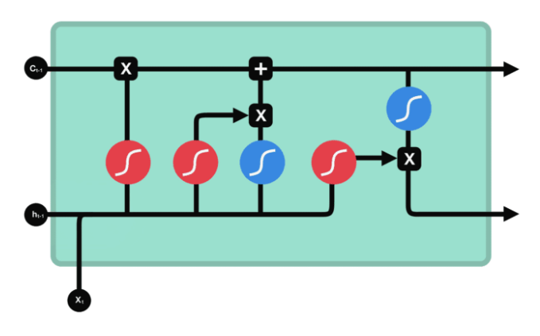

# PPT 制作目录

## 第 页，总结

1. 最开始要解决问题是猜词问题，判断一个句子后面下一个词跟什么。对于后文提到的模型，默认都是由梯度传播更新好的模型。
2. 最开始是N-gram，如果两个词多次重复出现，则说明两个词关系更加紧密。问题在于：不能覆盖所有的词，次数组合太多。
3. 然后提出词向量word vector，将词嵌入到向量空间，相似的词在向量空间中距离更近。
4. 然后提出了前馈神经网络FNN，用来捕捉词与词之间的关系。问题在于：窗口固定，句子过长超出窗口的部分模型看不到。
5. 然后提出了循环神经网络RNN，理论可以输入无限长的句子。一个词进入之后，计算隐藏层参数，然后接入下一个词，然后再计算隐藏层参数。问题在于：顺序计算，很难大规模并行计算。
6. 然后提出长短时间序列，lstm，增加细胞状态cell state和门控机制，使用输入门控制哪些信息要被着重记住，使用遗忘门控制哪些信息不重要要被忘掉，使用输出门控制读取哪些信息。模型可有选择的保存删除和读取记忆。问题在于：对于一个长句子，token之间的信息量也会因为距离被洗漱。
7. 然后提出[transformer](./Transformer_script.md)，引入注意力机制，让token之间可以相互看到。

## 第 页，参考材料

[从词向量到Transformer，AI大模型背后的原理](https://www.bilibili.com/video/BV1nogs6qEZn?spm_id_from=333.788.videopod.sections&vd_source=f520474b32080bfed1b47d9eea6866c7)
[LSTM从入门到精通](https://blog.csdn.net/mary19831/article/details/129570030)