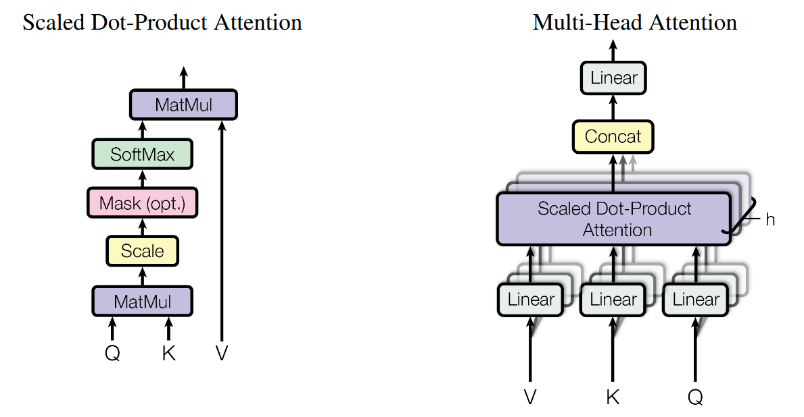
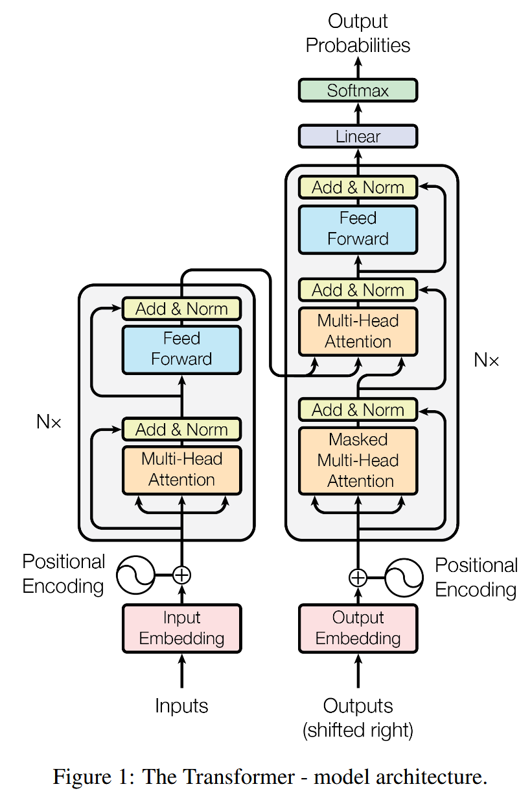

# ppt 目录

## 第 页，弄明白的问题

1. 注意力机制
2. 多头注意力机制
3. 位置编码
4. 前馈神经网络
5. 残差连接
6. 编码器与解码器

## 第 页，注意力计算的示意图

## 第 页，transformer的完整架构。

## 第 页，总结

1. 对于已有的lstm存在的问题：按顺序逐个token计算，算力消耗大，token之间存在很大的间隔。
2. 提出attention 机制：让每个token都能直接查看其他token，通过token 向量之间相互相乘，得到注意力矩阵。从向量相似度角度来解释，两个向量相似度比较高，那么点积的数值比较大。
3. 原始的token vector进来之后，会被3个线性变换变换为Q，K，V。
4. Q 表示查询向量，用来表示该token发起的查询信息。
5. K 表示key向量，表示该token的所呈现的检索信息，用来匹配查询。
6. V 表示value向量，用来表示该token所呈现的语义信息，用来真正传递信息。
7. 实际句子里面可能存在多种关系，单个注意力矩阵承载不了，需要使用多个注意力矩阵。
8. 引申：一个注意力矩阵所能关注的信息有限，通过将q和k的dim维度切分，然后再相乘可以得到多个注意力矩阵，可以从多个维度去汇总token的不同信息。
9. 使用Q和K点积，得到注意力矩阵attention matrix。
10. 需要额外计算$softmax(\frac{Q  K^T}{ \sqrt{d_k}} )$，这里除以一个$\sqrt{d_k}$ 是为了避免$QK^T$的数值相差太大，导致取$softmax$的方差太大。
11. 对于生成token而言，看不到未来的token，所以对于注意力矩阵而言，提出掩码注意力矩阵，将上三角mask掉，使得当前token只能看到前面的token，看不到后面的token。
12. 使用注意力矩阵来乘value，用来加权出其他token与自己相关的信息的。
13. attention只负责找信息，然后再通过一个FNN，将这些信息学习起来。
14. 一个注意力模块，加一个FNN模块，构成一个transformer模块。分别构成encoder模块和decoder模块。
15. 多个transformer模块越堆越深后原始信息容易丢，训练变困难，模块之间使用残差连接，缓解梯度消失的问题。
16. 对于翻译场景，对于decoder模块，让decoder模块的q去匹配encoder的k和v，于是叫做交叉注意力机制。
17. 原来的计算方式缺少了位置信息，引入位置编码融入词向量。

## 第 页，参考文献

1. [Attention Is All You Need](http://arxiv.org/abs/1706.03762)
2. [Transformer到底是个啥？一个动画彻底搞懂](https://www.bilibili.com/video/BV1Pyta66EDh?spm_id_from=333.788.videopod.sections&vd_source=f520474b32080bfed1b47d9eea6866c7)