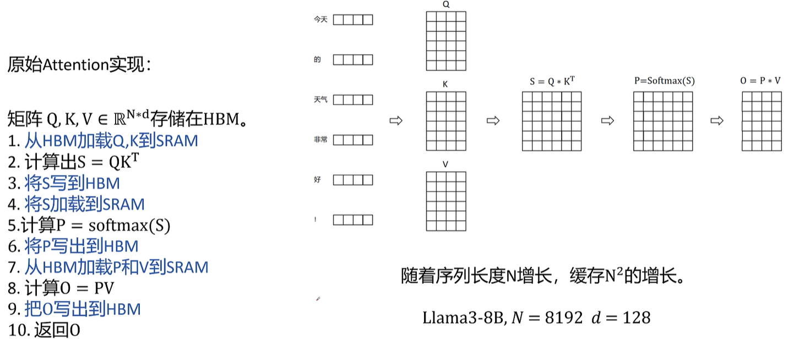
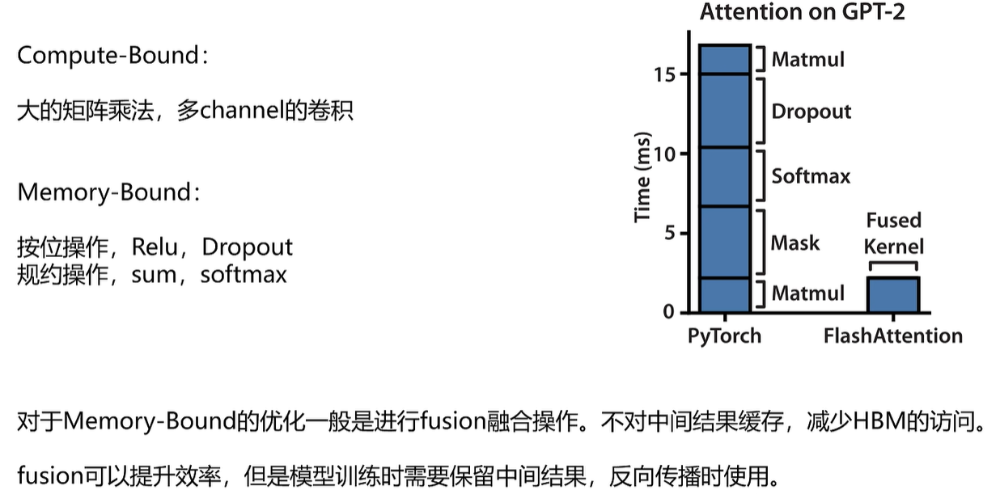
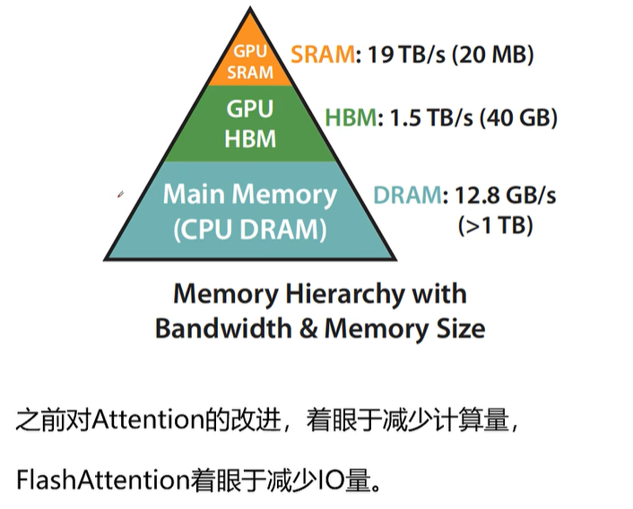
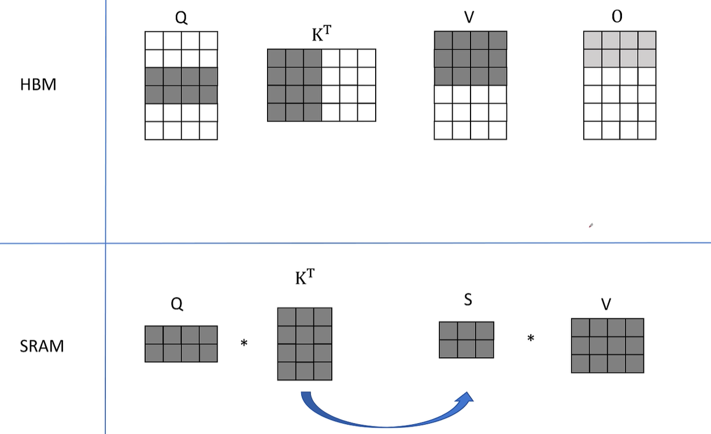

标准attention计算

计算瓶颈，显存瓶颈

GPU里面的存储关系：SRAM，HBM，DRAM

flash attention 优化的具体原理：通过将计算矩阵分块，以此减少IO。矩阵分块之后可以直接在SRAM里面完成完整的注意力计算，通过一定的数学关系，可以等效变换回最开始直接计算的值。

# 一、flash_attn 是什么
FlashAttention（`flash_attn`）**不是新的注意力数学公式，是一套高度优化的CUDA算子**，用来替换Transformer原生的Self-Attention；**数学结果完全等价、无近似**，但显存占用大幅下降、训练速度显著提升，VERL、HF Transformers、vLLM都大量使用它。

> 朴素标准Attention痛点：
> Q@Kᵀ 会生成一个 `[seq_len, seq_len]` 的**N×N注意力分数矩阵**。序列越长，这个矩阵显存占用平方暴涨（seq翻倍，显存×4），这就是长上下文训练OOM元凶之一。

# 二、核心原理（两个核心：Tiling分块 + 在线Softmax + 反向重算）
1. **Tiling 分块（切片计算）**
GPU有两级存储：大容量但慢的HBM（显存），很小但带宽极高的片上SRAM（寄存器/共享缓存）。FlashAttention把Q、K、V切成小块（tile），**分批把小块加载进SRAM计算，算完直接丢弃中间结果，全程不把完整的N×N注意力矩阵写入HBM**。
> 朴素实现：一次性算出完整N×N矩阵，存到显存（巨大中间激活，就是你前面问的中间激活）。
> Flash：小块就地算，**完整N×N矩阵永远不会出现在显存**。

2. **在线Softmax（Online Softmax，rescale修正）**
Softmax需要每行最大值做数值稳定；Flash边遍历K/V边维护每行的最大值、归一化分母，动态缩放输出，保证分块计算softmax数学正确。

3. **反向传播：只保存少量归一化系数，重算中间值**
前向只存每行logsumexp（线性O(N)，非常小），不存巨大注意力矩阵；反向时**重跑一遍分块前向**来求梯度，属于计算换显存，和`gradient_checkpointing`思想很像，但它是专门针对Attention内核层面的优化，效率远高于通用梯度检查点。

一句话总结原理：**减少GPU显存(HBM)读写搬运，分块在高速片上缓存计算，避免生成巨大N×N中间注意力矩阵，用少量额外计算换取巨大显存节省**。

# 三、模块意义（对你VERL训练场景非常关键）
1. **大幅降低Attention层中间激活显存开销**，显存复杂度从 $O(N^2) → O(N)$，更长序列（4k/8k/16k）训练不再轻易OOM；
2. **加速训练**：减少HBM读写（GPU训练瓶颈大多不是计算，是显存带宽），一般2~4倍提速；
3. **数学无损**：输出和原生Attention一模一样，不会像稀疏注意力那样损失模型效果；
4. 和你前面的技术栈联动：搭配动态batch、梯度检查点一起使用，可以进一步放大长序列训练的显存上限，VERL训练时在model配置开启`use_flash_attn: true`即可启用。

> 注意限制：FlashAttention原生只支持NVIDIA显卡（Ampere及以后，A100/A10/H100/RTX30/40/50系）；老卡、AMD GPU不支持。

